<!--
author:   Alexander Piwowar; Dr. Ella Dovhaniuk; Jens Bonk-Wiltfang, M.A.
email:    uosdll@uos.de
version:  1.0.0
language: de
narrator: Deutsch Female
logo:     media/72031a2b2733d6396b9bcefa069f7050.webp
comment:  Zwischen Algorithmen, Analyse und Abenteuer: Dieses Mikromodul enthält Grundlegendes zur Funktionsweise von Sprachmodellen, einen Überblick über weitere KI-Tools und  ihre Einsatzgebiete sowie Prompting-Strategien (Wie sag ich’s meinem Bot?).
-->

# Willkommen im KI-Dschungel


??[Video im Opencast-Player der Universität Osnabrück](https://video4.virtuos.uni-osnabrueck.de/paella8/ui/watch.html?id=117131a6-e189-4235-9e91-455fe7b1cb62)

Was dich in diesem Mikromodul (MiMo) erwartet
=============================================

Dieser Onlinekurs bietet dir Orientierung bei der Navigation durch den KI-Dschungel. Er richtet sich an Einsteiger\*innen, die neugierig und vielleicht noch ein bisschen unsicher sind, wie die vielen neuen Tools auf Basis künstlicher Intelligenz grundsätzlich funktionieren. Auf dieser ersten Seite erhältst du einen Überblick über die inhaltlichen Schwerpunkte und die Kursstruktur.

**Hintergrund:** Die Begeisterung über das Potenzial großer Sprachmodelle (LLMs) und anderer KIs ist groß. Sie revolutionieren, wie wir mit Computern interagieren. Allerdings werden ihnen häufig auch mehr Arten von Intelligenz zugeschrieben als sie tatsächlich besitzen. LLMs können beispielsweise einen überzeugenden Text erstellen, verstehen ihn aber selbst nicht wirklich. Viele Menschen verwechseln ihre Eloquenz (Wortgewandtheit) mit Intelligenz, andere sind eventuell verunsichert: Was davon ist "echt" bzw. faktisch richtig und was mag sich zwar plausibel anhören, ist aber keine verifizierte Information? Welche KI-Tools eignen sich überhaupt für welchen Zweck?


**Das Wichtigste:** Eine KI wie ChatGPT ist keine Suchmaschine! Wenn es dich überrascht, dass KI-Output mindestens 20% sogenannter Halluzinationen enthält (Schönthaler, 2023), oft sogar wesentlich mehr, dann hat sich dein Besuch hier jetzt schon gelohnt.

**Ziel:** In diesem Kurs lernst du, potenzielle Risiken für dein wissenschaftliches Arbeiten im Umgang mit KI zu minimieren. Die sichersten Quellen für deine Recherchen sind natürlich akademische Datenbanken. Nicht-wissenschaftliche Suchmaschinen und insbesondere generative KIs mit ungesicherter Quellenlage in Bezug auf ihre Trainingsdatensätze bergen ernsthaftes Gefährdungspotenzial: Ob ihre Ergebnisse faktisch korrekt sind, musst du selbst verifizieren! Gewinne mehr Sicherheit im Umgang mit KI-generierten Texten, Bildern und Videos und entwickle so deine Informationskompetenz weiter. Dein wichtigstes Werkzeug ist deine eigene Reflexion. So lernst du, die vielen kleinen Helfer effektiv im Studium einzusetzen – natürlich immer unter Berücksichtigung der KI-Leitlinien an deiner Hochschule oder Universität.

**Quiz: Dieses Einstiegsquiz gibt dir eine Vorschau auf die Inhalte des Kurses**

**1. Was bedeutet die Metapher „stochastischer Papagei“ in Bezug auf Sprachmodelle wie ChatGPT?**  
*Eine Antwort ist richtig.*

- [( )] Das ist eine bis vor Kurzem unbekannte Vogelart, die 2022 in einem noch unerforschten Gebiet des Amazonas-Regenwaldes entdeckt wurde.
- [( )] Sie bezieht sich auf ein Holzblasinstrument, ähnlich dem Dudelsack, das häufig bei traditionellen Heiratszeremonien im Nordwesten Brasiliens verwendet wird.
- [(X)] Sprachmodelle rekonstruieren menschlich wirkende Sprache, verstehen aber nicht den tatsächlichen Sinn, der dadurch erzeugt wird.

**2. KI oder nicht KI: Erkennst du den Unterschied? Rate mal, welche Katze die echte ist!**  
*Ordne jedem Bild eine Antwort zu.*

 

[(Echte Katze) (KI-generierte Katze)]
[ ( ) (X) ] Bild 1
[ (X) ( ) ] Bild 2

**3. Worin besteht „Datensouveränität“ und warum ist sie so wichtig?**  
*Mindestens zwei Antworten sind richtig.*

- [[ ]] Die Daten können sich frei über internationale Grenzen hinweg und ohne rechtliche Einschränkungen in tiefen neuronalen Netzen verbinden (Black Box).
- [[X]] Datensouveränität ist eine wesentliche Voraussetzung für den Schutz sensibler persönlicher Informationen und die Einhaltung von Datenschutzbestimmungen.
- [[ ]] Das Anbieterunternehmen entscheidet souverän darüber, wofür und von wem die von den Nutzern eingegebenen Daten verwendet werden dürfen.
- [[ ]] Datensouveränität bezieht sich auf den Prozess der Verschlüsselung von Daten, um deren Sicherheit bei der Übertragung technisch zu gewährleisten.
- [[X]] Datensouveränität bedeutet, dass man die Kontrolle über die eigenen Daten behält und entscheiden kann, wie sie erhoben, gespeichert und verarbeitet werden.

> [!TIP]
> Die KI-Leitlinien deiner Hochschule solltest du unbedingt beachten! Was ist in deinem Fachbereich erlaubt und was nicht? Frage auch deine Lehrenden an der UOS, ob es "Rules for Tools" gibt, und zwar BEVOR du KI-Tools im Studium einsetzt. Du allein bist verantwortlich für alle Ergebnisse, die du im Rahmen deines Studiums einreichst!

## Kursstruktur

Der Workload für den ganzen Kurs beträgt etwa 1,5 bis 2 Stunden, genauere Details findest du im Tab "Was muss ich mitbringen?"

* Entscheide selbst, was für dich relevant ist: Die Kapitel bauen aufeinander auf, du kannst aber auch direkt einzelne Kapitel, Seiten oder nur Inhalte in einzelnen Tabs unten auf den Seiten ansteuern.
* Ein kurzes Quiz aus drei Fragen gibt dir Feedback zu den Inhalten jeder Seite. Du kannst aber auch fortfahren, ohne das Quiz zu lösen.
* Grafiken werden durch Anklicken maximiert dargestellt.

Für den erfolgreichen Abschluss gibt es leider keine Zertifikate, ECTS-Punkte oder ähnliches. Mikromodule sind auf Freiwilligkeit basierende Selbstlernangebote.

*Letztes Update der Inhalte dieses Kurses (Willkommen im KI-Dschungel): 2. April 2026*

## Navigieren im Kurs

Navigieren im Kurs: **Die Courseware-Lernumgebung**
---------------------------------------------------


* Mit den blauen Pfeilen links in der Kopfzeile navigierst du von Seite zu Seite. So werden dir alle Lerninhalte nacheinander angezeigt und du verpasst nichts.
* Öffne das Inhaltsverzeichnis oben rechts (links neben dem 3 Punkte-Menü), um den Überblick zu behalten und direkt auf einzelne Seiten zu springen.
* Unten auf den Seiten wechselst du von Tab zu Tab – wie du schon festgestellt hast, denn das hier ist Tab Nr. 2 auf dieser Seite (Navigieren im Kurs)

Kompakte Navigation **aktivieren!**
===================================


* Klicke auf das Symbol "Kompakte Navigation aktivieren", damit alle Elemente auf den Seiten im Kurs optimal dargestellt werden.
* Übrigens: Noch mehr Überblick und Konzentration bietet dir zusätzlich der Vollbildmodus deines Onlinebrowsers:
    * Unter Windows \[F11\] drücken.
    * Wer iOS verwendet, drückt \[Apfel + Ctrl + F\].

## Lernziele

**~~Kapitel 1:~~** Um die Gegenwart zu verstehen, hilft ein Blick in die Vergangenheit. Mit einem kurzen historischen Blick auf die Evolution der Chatbots lernst du den KI-Entwicklungsstand im Sommer 2024 kennen. So kannst du die **aktuellen technologischen Entwicklungen** nachvollziehen und **populäre Zukunftvisionen** besser einordnen. Im Fokus stehen Möglichkeiten und Grenzen beim Einsatz von KI für wissenschaftliches Arbeiten im Studium.

**~~Kapitel 2:~~** Du lernst, wofür und wie du KI-Tools, wie z.B. Sprachmodelle, im Studium **effektiv** nutzen kannst. Während du künstliche Intelligenz in ihrem natürlichen Habitat explorierst, werden verschiedene **Tool-Kategorien, Praxistipps und potenzielle Einsatzgebiete** vorgestellt sowie **Strategien**, wie du produktiv mit Bots kommunizieren kannst.

**~~Kapitel 3:~~** Entdecke Ki-Tools, die extra für den Einsatz im akademischen Feld entwickelt wurden und wie sie die **Gefahr eines Deskillings** **reduzieren**, wenn du sie beispielsweise zur Quellenrecherche einsetzt. Um KI erfolgreich zum **Upskilling** nutzen zu können, lernst du, wie super einfach du dir einen "Studdy Buddy" erstellen kannst, der dich nach deinen Vorgaben coacht.

Insgesamt lernst du, warum der erfolgreiche KI-Einsatz in deinem Studium von der Weiterentwicklung deiner **Informationskompetenz** abhängt. Nur so kannst du die generierten Inhalte und recherchierten Quellen **kritisch einordnen** und **fundierte Entscheidungen** treffen. Das erlaubt dir, die KI-Tools **effektiv und sensibilisiert** für Fehlinterpretationen im wissenschaftlichen Kontext einzusetzen.

## Was muss ich mitbringen?

* Dieser Selbstlernkurs ist **voraussetzungsfrei** – Kein Jargon, keine unerläuterten technischen Begriffe.
* Du solltest ein wenig Englisch verstehen, da es zum Teil verwendet und nicht immer auf Deutsch übersetzt wird.
* Der Workload von 1,5 bis 2 Stunden ist eine Minimalangabe, die von deiner individuellen Bearbeitsweise abhängt. Wenn du alles nur durchliest, geht es vielleicht sogar schneller. Wenn du den Links mit weiterführenden Informationen folgst, die zum Teil enthaltenen Videos anschaust oder die vorgestellten Tools selbst auszuprobierst, dauert es entsprechend länger.

## Impressum & Lizenzhinweise

Impressum
---------

Kontakt für Fragen zu diesem Mikromodul bzw. zu Mikromodulen allgemein: [*uosdll@uos.de*](mailto:uosdll@uos.de?subject=Mikromodul%20%22Digitale%20Basisdienste%20der%20UOS%22%3A).

Datenschutzhinweis
------------------

Einige Seiten dieses Mikromoduls enthalten eingebettete Angebote externer Webseiten und Dienste. Diese werden ggf. außerhalb der EU gehostet. Über solche externen Webseiten werden ggf. persönliche Daten der Bearbeitenden (z.B. IP-Adresse des Internetanbieters) an die Webseitenbetreibenden außerhalb der EU übermittelt. Die Nutzung des MiMos ist freiwillig. Wer eine solche Übermittlung nicht möchte, kann diese Angebote entweder nicht nutzen oder nimmt Maßnahmen vor, um die persönliche IP-Adresse zu verschleiern, indem z.B. der

~~Proxyserver der Uni Osnabrück~~

oder der

~~VPN-Dienst des Rechenzentrums der Uni~~

verwendet wird.

Nutzung in der Lehre
--------------------

Die Nutzung dieser MiMo-Teile in der Lehre ist datenschutzrechtlich nur freiwillig möglich. Sollten Sie als Lehrende das MiMo in Ihrer Lehre verpflichtend für Studierende anbieten (z.B. zum Erwerb von Credit Points oder anderer Studienleistungen), dann müssen Sie die eingebetteten Angebote von nicht-EU-Inhalten ausschließen oder DSGVO-konforme Alternativen einbauen.  
  
Diese Hinweise dienen lediglich zu Informationszwecken. Sie stellen keine Rechtsberatung dar und können keine individuelle rechtliche Beratung ersetzen. Bitte beachten Sie die aktuelle Rechtslage zu DSGVO mit Bezug zur Hochschullehre.

Lizenzhinweise (Rechte an den Inhalten)
---------------------------------------


# 1. KI-Entwicklungsstand im Sommer 2024


1. KI-Entwicklungsstand im Sommer 2026
======================================

Was genau ist generative KI? Der Begriff Künstliche Intelligenz (KI) steht im Zusammenhang mit dem Ziel, Maschinen zu entwickeln, die menschenähnliche kognitive Fähigkeiten aufweisen, wie Lernen, Verstehen und Problemlösen. Begriffe wie **Verstehen** und **Intelligenz** sind allerdings missverständlich, denn sie suggerieren einen Grad von menschenähnlicher Intelligenz oder Bewusstsein, der auf die heutigen Systeme bei Weitem nicht zutrifft. Der Begriff **maschinelles Lernen** (ML) beschreibt das Phänomen treffender und zeichnet ein klareres und spezifischeres Verständnis der Technologien und Methoden, die heute in vielen datengetriebenen Anwendungen eingesetzt werden und die auf statistischen Modellen und Datenanalyse basieren. Das hilft, unrealistische Erwartungen und Missverständnisse zu reduzieren.

Beispiel ChatGPT & Co.
----------------------

Sprachmodelle (Large Language Modells, LLMs) wie ChatGPT passen sich im Gegensatz zu sogenannten regelbasierten Chatbots (wie Siri oder Alexa in ihren frühen Stadien) bei jeder Konversation weiter an und lernen von ihr, was zu einem persönlicheren und zufriedenstellenderen Nutzererlebnis führt. **Die Uni Osnabrück stellt ihren Mitgliedern mit** [**kiwi**](https://ki.uos.de) **Zugänge zu kommerziellen sowie an der UOS lokal gehosteten LLMs zur Verfügung** – und zwar datenschutzkonform (mehr dazu später). Alle LLMs nutzen sogenannte tiefe neuronale Netze, die auf Basis umfangreicher Datensätze trainiert wurden, um Texte zu generieren. Diese Netze nutzen **selbstlernende Algorithmen**, um Muster in Daten zu erkennen und darauf aufbauend eigenständige Texte zu produzieren. Die Stärke von ChatGPT & Co. liegt in der Fähigkeit, kontextbezogen und kohärent auf Benutzer\*innenanfragen zu antworten, was auf eine ausgefeilte Verarbeitung natürlicher Sprache hinweist – das technologische Basiswissen dazu erhältst du bei Interesse in Kapitel 2.

Beispiel DALL-E & Co.
---------------------

Dall-E ist ein KI-Tool für die Bildgenerierung. Es basiert auf einem ähnlichen Transformer-Modell wie ChatGPT, ist jedoch darauf spezialisiert, Bilder aus Textbeschreibungen zu erstellen. Ein ähnlich bekannter **Bildgenerator** ist Nano Banana, der in Googles LLM Gemini enthalten ist. Bei den meisten LLMs habdelt es sich mittlerweile um multimodale LLMs – multimodal bedeutet: diese Sprachmodelle können nicht nur Text, sondern auch viele andere Dateiformate wie Grafiken oder Sprache als In- und Output verarbeiten. Die Fähigkeiten dieser Modelle beruhen auf der Verarbeitung und Interpretation von Sprache, um visuelle Konzepte zu generieren. Nähere Infos zu multimodalen LLMs findest du auch im zweiten KI-MiMo [**Expedition KI - Wie textgenerative KI tickt**](https://studip.uni-osnabrueck.de/dispatch.php/course/details/index/558ab79a1ec9148602c808f8fc4ee345).

> [!NOTE]
> Dieses Kapitel hilft dir, Fehlinterpretationen in KI zu vermeiden und KI-Ergebnisse realistisch einzuschätzen. Auf dieser und den nächsten beiden Seiten wird der KI-Hype kritisch, aber unvoreingenommen analysiert. Es geht um populäre Irrtümer, die Evolution der Chatbots und einen Exkurs in Sachen Datensouveränität und Ethik der KI.

## ChatGPT in 3 Minuten

ChatGPT in 3 Minuten erklärt
============================

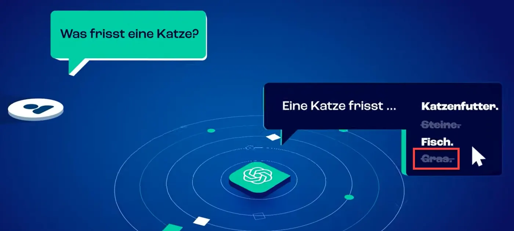

Einige technologische KI-Basics aus dem unten eingebetteten Video werden auf den folgenden Seiten genauer analysiert. Bleib dran, wenn du wissen willst, welche Effekte sie beim Einsatz im Studium haben können. Im Video werden zwei wesentliche Phänomene deutlich, die für ein angemessenes Verständnis künstlicher Intelligenz grundlegend sind:

1. Katzen fressen Gras – und ~~Menschen machen Fehler~~!
--------------------------------------------------------

Fressen Katzen Gras? Bei [**Minute 0:45**](https://youtu.be/_fYUaTA9dTI?si=5sUt0kRCkKZAwkzq&t=45) wird dies **fälschlicherweise** als **Falsch** (Abb. 1) markiert. Tatsächlich fressen Katzen aber häufig intuitiv Gras, was aus verschiedenen Gründen gut für sie ist, wie du auf der entsprechenden [**Wikipedia-Seite über Katzengras**](https://de.wikipedia.org/wiki/Katzengras) nachlesen könntest.

Was dieses Beispiel hervorragend illustriert: Menschen liefern regelmäßig **inakkurate Informationen** – und KIs werden mit diesen gefüttert. Und das ist auch der Grund, warum kein Sprachmodell der Welt **allwissend** sein kann! Um ein angemessenes Verständnis künstlicher Intelligenz zu entwickeln ist es zunächst einmal ratsam, sich immer vor Augen zu halten, wie viel menschliche Intelligenz tatsächlich hinter KI steckt.

2. Sprachmodelle besitzen kein eigenes Faktenwissen
---------------------------------------------------

Das zweite bemerkenswerte Phänomen besteht in der Tatsache, dass Sprachmodelle keinen eingebauten Faktencheck haben, wie ab [**Minute 2:09**](https://youtu.be/_fYUaTA9dTI?feature=shared&t=128) erläutert wird. Sprachmodelle generieren stattdessen jeweils Wort für Wort, was **statistisch am wahrscheinlichsten passt**. Dafür gleichen sie Texte aus ihrem Datensatz ab und reproduzieren, was sie im Training *gelernt* haben – ein Prinzip, das ihnen die Bezeichnung **stochastische Papageien** eingebracht hat. Wie das gemeint ist, wird auf der nächsten Seite erläutert (Bitte beachte, dass es auf fast allen Seiten noch weitere Tabs gibt, bevor du zur nächsten Seite weiterblätterst).

> [!TIP]
> Was das für den Einsatz im Studium bedeutet? Die von LLMs generierten Inhalte können faktisch falsch sein!

!?[ChatGPT in 3 Minuten erklärt](https://www.youtube.com/watch?v=_fYUaTA9dTI "ChatGPT in 3 Minuten erklärt – youknow")

## Hype Cycle: Beispiel KI

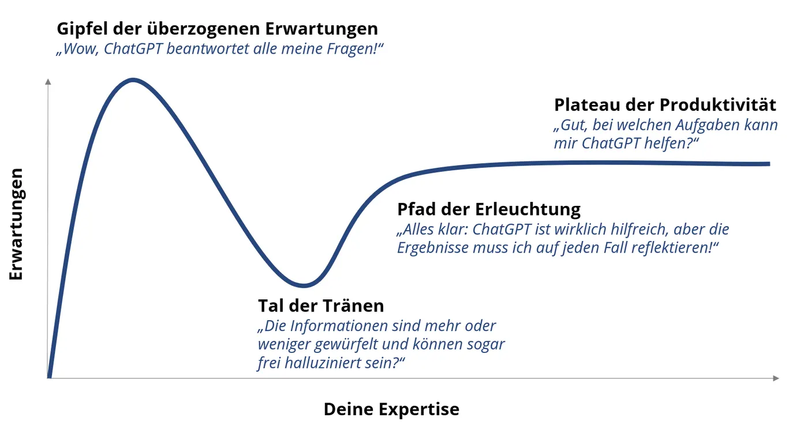

Der Hype Cycle am Beispiel ChatGPT
==================================

Bei vielen Technologien folgt auf eine große Anfangseuphorie inklusive dem **Gipfel der überzogenen Erwartungen** das sogenannte Tal der Tränen (Abb. 2). Auf dem Gipfel entstehen oft gravierende Missverständnisse: In Bezug auf ChatGPT zum Beispiel: "Wow, ChatGPT beantwortet alle meine Fragen!" oder "ChatGPT ist eine Suchmaschine." Warum das falsch ist, erfährst du auf der folgenden Seite.

Im **Tal der Tränen** könnte es passieren, das dich manche Kritik an künstlicher Intelligenz zunächst verunsichert. Um den **Pfad der Erleuchtung** einzuschlagen, ist die Analyse dieser Kritik allerdings eine notwendige Voraussetzung, wenn du KI sicher in der Praxis einsetzen willst.

Auf dieser Reise wird klar, auf welcher technologischen Basis LLMs Informationen generieren. Wer diese neue Technologie angemessen reflektiert einzusetzen weiß, hat ein gewisses **Plateau der Produktivität** erreicht.

Welche Erwartungen in Bezug auf KI sind nun also realistisch? Im folgenden Tab *Schwache & starke KI* werden zunächst einmal unterschiedliche Grade künstlicher Intelligenz voneinander abgegrenzt, um etwas Klarheit zu schaffen.

## Schwache & starke KI\*

Schwache und starke künstliche Intelligenz\*
============================================

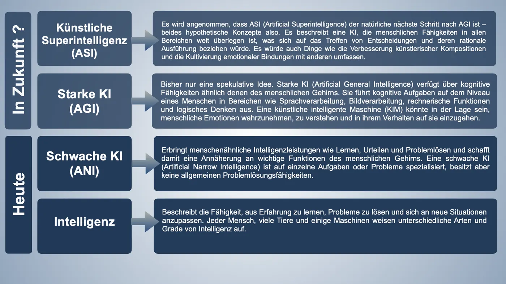

Wie Abbildung 3 zeigt, begrenzt sich das technologische Potenzial aktuell auf sogenannte schwache KI. Beispiele für schwache KI sind viele bekannte Anwendungen wie:

* Spracherkennungssysteme (Siri, Alexa)
* Empfehlungssysteme (Amazon, Spotify)
* Autonom fahrende Autos (Tesla)

Auch **Sprachmodelle wie ChatGPT sind schwache KI**, obwohl ihnen von einigen bereits menschenähnliche Fähigkeiten zugeschrieben werden. Eine starke KI (AGI) und erst recht eine künstliche Superintelligenz (ASI) sind bislang jedoch Zukunftsvisionen. Forschende von Microsoft haben eigenen Angaben zufolge zwar "Funken von genereller künstlicher Intelligenz", also starker KI, bei ChatGPT 4 gefunden (Bubeck et al., 2023). Dies ist allerdings nicht nachprüfbar, weil Microsoft die weiteren Details geheimhält.

Intelligenz intelligent definieren: gar nicht so einfach
--------------------------------------------------------

Die Gleichsetzung künstlicher Netze mit menschlichen neuronalen Netzen wird von vielen Experten kritisch gesehen (Heuveline & Stiefel, 2021). Auch viele weitere Begriffe, die häufig im Raum stehen, wenn von KI die Rede ist, sind wissenschaftlich bislang nicht eindeutig geklärt. Teilweise sind sie vielmehr Gegenstand philosophischer bzw. metaphysischer Diskurse: Was ist Bewusstsein, was ist Emergenz? Wie in o.g. Forschungsbericht nachgelesen werden kann, stützen sich die Forschenden bei Microsoft auf eine bestimmte, ursprünglich auf Menschen bezogene Intelligenzdefinition. Ebendiese beinhaltet allerdings **keine** **innere Motivation.** Eine innere Motivation und damit eigene Ziele zu haben ist allerdings ein Schlüsselaspekt der üblichen Definitionen von starker KI (AGI).

Die dem Bericht zugrundeliegende Definition von Intelligenz umfasst lediglich: Wissen erwerben und anwenden, Probleme lösen, sich an veränderte Situationen anpassen, planen und Werkzeuge zu nutzen bei komplexen Zielvorgaben, die über die eigenen Fähigkeiten hinausgehen. Die Microsoft-Forschenden schränken ein: Dass GPT-4 einen Fortschritt in Richtung AGI darstelle, bedeute nicht, dass es in dem, was es tue, perfekt sei oder dass es annähernd in der Lage sei, zu tun, was ein Mensch tun kann.

Der Begriff **künstliche Intelligenz** wird auch oft bezogen auf starke Rechenleistung, Algorithmen und großen Datenmengen verwendet. Was Computer wirklich gut können: Mit hoher Rechenleistung und vielen Daten enorm schnell lernen. Statt künstliche Intelligenz ist der Begriff **maschinelles Lernen** insofern zutreffender und in mancher Situation hilfreicher. Ein paar zentrale Unterschiede zwischen menschlicher und aktueller künstlicher Intelligenz werden auf der folgenden Seite im Detail erläutert und auch auf der Seite *Künstliche Intelligenz in ihrem natürlichen Habitat* erfährst du mehr.  
  
*\*Die Informationen in diesem Tab sind wissenswert, wenn du die Quizfragen im letzten Tab auf dieser Seite lösen möchtest.*

**→ [Hier erfährst du bei Interesse mehr über das konkrete Potenzial von schwacher und starker KI im Alltag (Externer Link zu www.ki-konkret.de)](https://www.ki-konkret.de/was-kann-ki.html)**

## Was ist "generative" KI?\*

Von KI generierte Inhalte werden **neu kombiniert** und können von menschlichen kaum zu unterscheiden sein. Ebenso wie audiovisuelle Deepfakes können Texte zwar richtig klingen, aber dennoch **falsch sein**. Für einen souveränen Umgang mit generativer KI müssen wir lernen, die Tools mit **sinnvollen Prompts** zu steuern und sie **reflektiert einzusetzen**. Wie es in dem Video heißt: Dann kann die KI die Fleissarbeit machen und der Mensch die Fakten verantworten.

*\*Die Informationen in diesem Video sind wissenswert, wenn du die Quizfragen im letzten Tab auf dieser Seite lösen möchtest.*

!?[Generative KI in 2 Minuten erklärt](https://www.youtube.com/watch?v=mxP3G2Jb2LM "Generative KI in 2 Minuten erklärt – KI-Campus")

## Maschinelles & Deep Learning\*

Wenn du es genauer wissen willst: Maschinelles Lernen und Deep Learning\*
============================================================

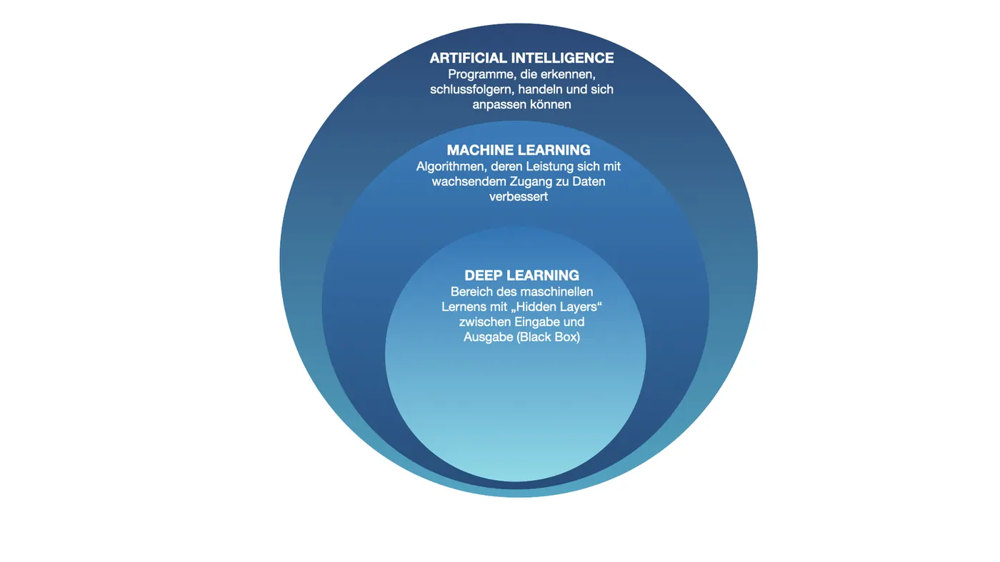

Künstliche Intelligenz ist ein viel und unpräzise verwendeter Sammelbegriff. Der Schlüssel zum Verständnis der gegenwärtigen technologischen Neuerungen sind Maschinelles Lernen und Deep Learning, beides Teilgebiete von KI (Abb. 4).

**Machine Learning (ML)** ist ein übergeordneter Begriff, der sich auf die Entwicklung von Algorithmen bezieht, die aus Erfahrungen lernen. Sie verbessern ihre Performance dadurch, dass sie mit immer größeren Datenmengen gefüttert werden. Ein Beispiel sind Buchempfehlungen auf Shopping-Websites. Es können allerdings **keine unstrukturierten Daten** verarbeitet, also z.B. keine Texte, Bilder, Töne, oder Videos in numerische Werte umgewandelt und verarbeitet werden – wie beim Deep Learning, s.u.

Wesentlich ist der Prozess der Feature- bzw. Merkmalsextraktion aus Rohdaten, um das Training eines nachgelagerten statistischen Modells zu unterstützen. Ein Feature kann zum Beispiel eine Katze sein (Abb. 5). Die Rohdaten – Bilddateien sind ein typischer Anwendungsfall – werden von Menschen in numerische Merkmale umgewandelt, die mit Algorithmen für maschinelles Lernen kompatibel sind.

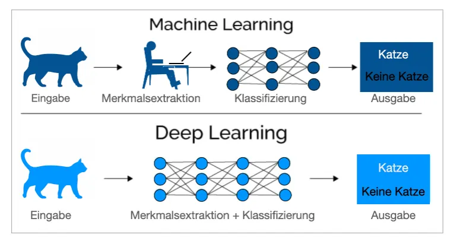<!-- style="width:50.9%" -->

Beim **Deep Learning (DL)** werden diese unstrukturierten Daten **ohne menschliche Eingabe** in numerische Werte bzw. Merkmale umgewandelt. Deep Learning ist eine spezifische Untergruppe des Machine Learnings, die sich auf **künstliche neuronale Netzwerke** konzentriert. Neben der Eingabe- und der Ausgabeschicht bestehen diese aus vielen Zwischenschichten von *Neuronen*, untereinander durch viele Verbindungen vernetzt – daher **deep**. Diese tiefen Netzwerke haben die Fähigkeit, komplexe Muster und Merkmale in Daten zu erfassen.

Hidden Layers und Black Boxes
-----------------------------

Eine der Charakteristiken von tiefen neuronalen Netzwerken im Deep Learning ist, dass man nicht weiß, was genau in den sogenannten **Hidden Layers** passiert. Es ist schwierig zu interpretieren, wie und warum es in den zahlreichen Zwischenschichten eines tiefen neuronalen Netzwerks zur Extraktion von Merkmalen und damit zu entsprechenden Ergebnissen kommt. Dieses Phänomen wird als **Black Box** bezeichnet. Es gibt Bemühungen in der Forschung, die Interpretierbarkeit von Deep-Learning-Modellen zu verbessern, um ihre Anwendbarkeit in kritischen Bereichen zu unterstützen.

*\*Die Informationen in diesem Tab sind wissenswert, wenn du die Quizfragen im letzten Tab auf dieser Seite lösen möchtest.*

## QUIZ

<!-- style="width:260px" -->

<details>
<summary>**Wie schätzt du den aktuellen Entwicklungsstand Starker künstlicher Intelligenz (KI) ein - auch bekannt als Künstliche allgemeine Intelligenz (AGI)?**</summary>

Starke KI bzw. AGI ist ein schwer zu erreichendes Ziel und aktuell noch Zukunftsmusik. Bislang hat noch keine künstliche Intelligenz eine dem Menschen vergleichbare allgemeine Intelligenz über verschiedene Aufgaben und Bereiche hinweg bewiesen.

</details>

<!-- style="width:260px" -->

<details>
<summary>**Was sind die Risiken von KI-generierten Texten, Bildern und Videos?  **</summary>

Die Inhalte sind oft schwer von denen zu unterscheiden, die Menschen erstellt haben. Das kann missbraucht werden: Bei Deepfakes werden mit Hilfe von KI realistisch wirkende Texte, Bilder oder Videos erzeugt und als echt ausgegeben. 

</details>

<!-- style="width:260px" -->

<details>
<summary>**Was müssen wir für einen souveränen Umgang mit generativer KI lernen?**</summary>

Die Tools mit sinnvollen Prompts zu steuern und sie reflektiert einzusetzen.

</details>

<!-- style="width:260px" -->

<details>
<summary>**Welcher Unterschied zwischen Deep Learning und Machine Learning wird häufig als Erstes genannt?**</summary>

 Im Deep Learning lernt KI quasi selbst, nach welchen Kritierien die Aufgaben zu erfüllen sind, indem in tiefen neuronalen Netzen mit riesigen Datenmengen quasi automatisch komplexe Muster und Merkmale extrahiert werden. Beim Machine Learning sind die Aufgaben durch eine Software nach von Menschen bestimmten Kriterien zu erfüllen.

</details>

<!-- style="width:260px" -->

<details>
<summary>**Was genau ist bei der Interpretation von tiefen neuronalen Netzwerken (Deep Learning) so herausfordernd?**</summary>

Welche Merkmale in den Zwischenschichten (Hidden Layers) des Netzwerks extrahiert werden, ist schwer interpretierbar, daher die Bezeichnung "Black Box". 

</details>

*Auf die Karten klicken/tippen zum Umdrehen. Mit den Pfeilen rechts und links gelangst du zur nächsten bzw. vorherigen Karte.*


## Sprachmodelle: Nur stochastische Papageien?

. Generiert von [Florian Pestoni](https://www.linkedin.com/pulse/stochastic-parrots-florian-pestoni) mit Midjourney (Abbildung ist kein OER, sondern unterliegt dem Zitatrecht).")<!-- style="width:50%" -->

Sprachmodelle: Nur stochastische Papageien?
===========================================

Künstliche Systeme zu Texterzeugung gibt es schon lange. Allerdings waren sie lange Zeit auf wohl definierte Nischenanwendungen beschränkt oder aber von zweifelhafter Qualität. Technische Fortschritte seit Ende der 2010er Jahre haben zu den generativen Sprachmodellen (Large Language Modells, LLMs) geführt, die nun

erstaunlich plausible und gut lesbare Texte

erzeugen können. Schnell haben diese Systeme große öffentliche Aufmerksamkeit erfahren – durch ihre Fähigkeiten wurden sie bald als utopische Heilsbringer, bald als dystopische Untergangsmaschinen beschrieben. Auf dieser Seite stellen wir dir etwas weniger aufgeregte Hintergrundinformationen und prominente Kritik dazu bereit.

Basis dieser generativen KI-Systeme sind probabilistische Sprachmodelle.

Probabilistik ist Teil der Stochastik, also der **Wahrscheinlichkeitsrechnung** (vgl.

das englische Wort

probably

).

Das heißt, dass diese Modelle nicht wie ihre Vorgänger auf festen Regeln basieren, sondern auf wahrscheinlichen Wortabfolgen. Diese lernt das Modell in einem aufwendigen

Trainingsprozess

durch enorme Sammlungen menschlich verfasster Texte wie Webseiten und Bücher. Je häufiger bestimmte Wort- oder Satzfragment-Abfolgen in den Trainingsdatensätzen zu finden sind, desto höher ist die Wahrscheinlichkeit, dass das Sprachmodell sie reproduziert.

LLMs bewerten die **~~Wahrscheinlichkeit~~ des nächsten Wortes in einer Sequenz**
------------------------------------------------------------

Das Sprachmodell kann für deine Eingabe (den sog. Prompt) und den bisherigen Gesprächsverlauf eine plausibel klingende Fortführung

ausgeben. Weil die Wahrscheinlichkeitsverteilung der Wortfolgen aus den Trainingstexten reproduziert wird, werden diese Sprachmodelle auch "stochastische Papageien" genannt (Bender et al. 2021) – obwohl sie anders aussehen als das hybride Wesen in Abbildung 1.

Die Metapher bedeutet, dass heutige Sprachmodelle die Bedeutung bzw. den zusammenhängenden Sinn, der sich aus ihren Outputs ergibt, nicht verstehen können wie ein Mensch. Florian Pestoni (2023) schildert in einem

Beitrag auf LinkedIn

, viele Menschen würden ihre

Eloquenz

(

Wortgewandtheit

) mit

Intelligenz

verwechseln und hält ein einleuchtendes Beispiel dagegen: Nur, weil ein Papagei Sätze von Hegel wiederholt oder Gleichungen von Einstein rezitieren kann, macht ihn das noch nicht zu einem Philosophen oder Physiker. Stochastisch bedeutet vom

Zufall

abhängig

.

Wie genau deine Eingaben weitergeführt werden und was genau dabei herauskommt, ist

also prinzipiell nicht vorhersehbar. Für ein und denselben Prompt kannst du bei wiederholter Eingabe eine jeweils andere Antwort erhalten. Auf den folgenden Seiten wird das technologische Funktionsprinzip genauer erläutert und auch, warum es mit

"Wir würfeln Wörter!"

zutreffend beschrieben werden kann.

Die Kernfrage
-------------

Darüber hinaus hängt die "Intelligenz" der Systeme von der permanenten Korrektur durch menschliche Nutzer\*innen ab, weitere Details im Tab

Trainiert womit?!

unten auf dieser Seite. Bei aller berechtigten Faszination, die Sprachmodelle auslösen, sollte nicht vergessen werden, dass diese Technologie auf eine wechselvolle 70 Jahre währende Geschichte zurückblickt. Die Kernfrage lautet:

Lässt sich das, was für das menschliche Gehirn Bedeutungen transportierende semantische Zeichen sind, überhaupt von Software in syntaktischen (Verhältnis von Zeichen zu anderen Zeichen) und mathematischen Beziehungen verarbeiten?

(Schönthaler, 2023).

Die Antwort lautet zum gegenwärtigen Stand der technologischen Entwicklung:

Nein!!

Wenn eine KI

schreibt

, hat das lustigerweise sehr viel mit Zählen zu tun – wie beispielsweise

**diese Sendung mit der Maus**

sehr gut veranschaulicht. Was das in real life bedeutet: Wenn du ChatGPT nach der Quelle eines Outputs fragst, werden Titel, Autor\*in und alle bibliografischen Angaben zwar angegeben, in der Bibliothek kannst du das Buch aber eeewig suchen - denn möglicherweise existiert es gar nicht real!

> [!TIP]
> KIs wie ChatGPT reproduzieren Inhalte aus dem Training. Eigenes Verstehen oder kritisches Denken fehlen bisher.

### Trainiert womit?

Die Fähigkeit, plausible Texte zu generieren, erlangen LLMs also durch Training an Milliarden vorhandener, von Menschen erstellter Texte aus dem Internet oder gescannten Büchern. Dazu kommt – wie im Video *ChatGPT in 3 Minuten* auf der vorhergehenden Seite erklärt – ein immenser Aufwand durch umfangreiche menschliche Beurteilung (nicht) wünschenswerter Ausgaben seitens der LLM-Anbieter. Wohlgemerkt können auch nach diesem *Reinforcement Learning from Human Feedback (RLHF),* also *Verstärkungslernen aus menschlichem Feedback* natürlich noch **Fehlannahmen und Vorurteile** inkludiert sein. Dieser Vorgang macht die Systeme nicht unbedingt intelligent, sondern sozial und funktional anschlussfähig

Wie aufwändig diese Prozesse sind, zeigt auch die Tatsache, dass nicht wenige Chatbots großer Anbieter bereits temporär abgeschaltet werden mussten, weil sie beispielsweise toxische, rassistische oder allgemein menschenverachtende Inhalte generierten, nachdem sie ohne oder mit zu geringem menschlichen Schulterblick betrieben wurden (Metz, 2016). Ein Beispiel ist TAY, Microsofts liebenswerte Millennial-KI, die – mit dem Internet verbunden – in 24 Stunden ein **sexistischer Nazi-Bot** wurde.  
  
Dass Verstärkungslernen aus menschlichem Feedback auch noch eine ganz andere Dimension haben kann, demonstriert in der Zwischenzeit immer wieder Elon Musk mit seiner textgenerativen KI Grok: Deren Algorithmen lassen das LLM in X-Posts von ihm oder in Zeitungsartikeln über ihn nachschlagen, um insbesondere kontroverse Fragen zu beantworten (Quelle: [TechCrunch](https://techcrunch.com/2025/07/10/grok-4-seems-to-consult-elon-musk-to-answer-controversial-questions/)). Hier wird deutlich, dass sich das von ihm als "schlaueste KI der Welt" und als "maximally truth-seeking AI" beworbene Sprachmodell in Wirklichkeit an seinen persönlichen Ansichten orientieren soll.

!?[Wie Microsofts KI zum Nazi wurde | ARTE SUPER FAILS](https://www.youtube.com/watch?v=c17mLFfAtbY "Wie Microsofts KI zum Nazi wurde | ARTE SUPER FAILS – Irgendwas mit ARTE und Kultur")

### Keine Suchmaschine!

Eine KI wie ChatGPT ist keine Suchmaschine!
===========================================

Im Unterschied zu Suchmaschinen greifen generative KIs wie ChatGPT auf **keinen fixierten Fundus** von Wissen in einer Datenbank zurück. Das heißt, es ist nicht das gleiche Prinzip wie bei Google oder anderen Suchmaschinen, die im übertragenen und stark vereinfachten Sinne zu einem Regal mit Büchern gehen, eins rausziehen und dir sagen: "Hier drin findest du die Antwort auf deine Frage". Sprachmodelle werden stattdessen mit Datensätzen trainiert, über die oft wenig bekannt ist, die aber unweigerlich nur einen bestimmten Ausschnitt des weltweit verfügbaren Wissens repräsentieren.

Die Unterscheidung Generative KI (ChatGPT) vs. Suchmaschine (Google) ist zwar mittlerweile nicht mehr komplett trennscharf möglich, denn LLMs können mittlerweile durchaus im Internet *recherchieren* und Quellen angeben – siehe das Grok-Beispiel mit den X-Postings von Elon Musk im vorhergehenden Tab. Obwohl die meisten LLMs dazu nun technisch in der Lage sind: signifikant erhöht hat dies die Faktentreue der Sprachmodell-Outputs an sich aber nicht. Die Ergebnisse bleiben nach wie vor inakkurat und müssen von dir gewissenhaft überprüft werden. Eine Ursache dafür sind die sogenannten *Halluzinationen*, über die du im Tab *LLM-Kritik* auf dieser Seite mehr erfährst.

Bei deiner Suche erzielst du logischerweise bessere Ergebnisse, wenn mit **Informationen von hoher Qualität** traininert wurde oder das Modell auf spezifische Datensätze zugreifen kann – wie z.B. auf akademische Datenbanken, weitere Infos in Kapitel 3. Insbesondere bei Nischenwissen (und wissenschaftliches Wissen ist fast immer Nischenwissen) nimmt die Qualität ansonsten häufig rapide ab – da hilft auch der beste Prompt nicht.


Googles C4-Datensatz: Mit welchen Daten wurde die KI trainiert?
------------------------------------------------------------

Die meisten Anbieter von Sprachmodellen halten die Trainingsdatensätze geheim, aber manche sind veröffentlich worden. Unter dem unten verlinkten Artikel der Washington Post, in dem der von Google zusammengestellte C4 Datensatz besprochen wird, befindet sich ein **interaktives Suchformular** (s. Screenshot in Abb. 2).

Mit welchen Inhalten wurde trainiert? Wenn du möchtest, probiere ein paar Webseiten aus und schau nach, ob sie im C4-Datensatz sind. Falls ja, könntest du überlegen, ob die Inhalte dieser Seite „gutes” Lernmaterial für ein Sprachmodell darstellen, je nachdem wofür du es nutzen möchtest.

**→ [Link zur Washington Post vom 19.4.2023 mit interaktivem Suchformular zu Googles C4-Datensatz (Link auf Server außerhalb der EU)](https://www.washingtonpost.com/technology/interactive/2023/ai-chatbot-learning/)**

### Chatbot-Evolution\*

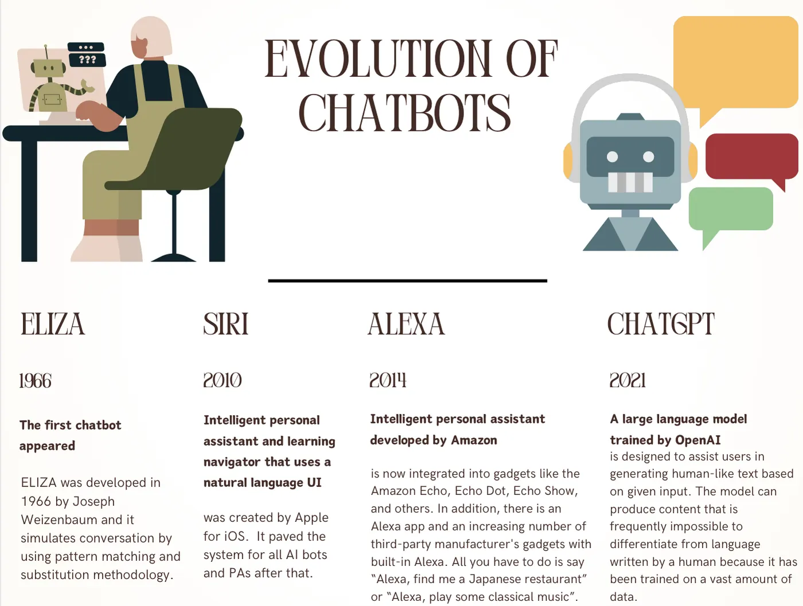<!-- style="width:54.24%" -->

Evolution der Chatbots\*
========================

Seit 70 Jahren wird prophezeit, dass mathematische Sprachmodelle bald die Welt verändern würden. Abbildung 2 zeigt drei evolutionäre Chatbotstufen: Einfache Chatbots wie Eliza, Conversational/Personal Agents wie Siri und Alexa sowie generative KI. Menschliche Unterhaltung wurde zwar simuliert, beruhte vor generativer KI aber lediglich auf regelbasierten Algorithmen, d.h.: Auf fest definierte Befehle führten sie fest definierte Aufgaben aus, konnten aber nicht *lernen* oder sich an neue Situationen anpassen – was sie natürlich unflexibel machte und für die Nutzer\*innen teilweise **frustrierend** war.

Mittlerweile sind Siri und Alexa fortschrittliche und interaktive Conversational/Personal Assitants. Sie richten Erinnerungen ein, spielen Musik ab und steuern Smart-Home-Geräte. Ein weiterer Conversational Assitant ist der Google Assistant, eine KI, die in Geräten wie Smartphones, Smart Speakers und Wearables verfügbar ist. Sie kann **komplexe Konversationen** führen, natürlichere Antworten liefern, Aufgaben erledigen und Anwendungen steuern.

Generative Chatbots sind hochentwickelte KI-Systeme, die in der Lage sind, menschenähnliche Texte und Antworten zu generieren. Sie verwenden fortschrittliche Transformer-Modelle wie GPT (Generative Pre-trained Transformer) und erzeugen **menschenähnliche Texte**, die auf Eingaben der Benutzer\*innen und dem Kontext basieren.

*\*Die Informationen in diesem Tab sind wissenswert, wenn du die Quizfragen im letzten Tab auf dieser Seite lösen möchtest.*

### ELIZA

Der ELIZA-Effekt
================

 (Foto von NoRud auf Wikimedia unter [CC BY SA 4.0](https://creativecommons.org/licenses/by-sa/4.0/)) mit dem [Screenshot](https://commons.wikimedia.org/wiki/File:ELIZA_conversation.jpg) [einer ELIZA-Konversation](https://commons.wikimedia.org/wiki/File:ELIZA_conversation.jpg) (Foto auf Wikimedia, Public Domain), Remix von Alexander Piwowar - Grafik anklicken zum Vergrößern -")<!-- style="width:70.08%" -->

Wie schon erwähnt sind Chatbots nicht etwa eine Neuerung aus den letzten Jahren. In beschränkter Form gibt es sie schon sehr lange. Bots einfacher Bauart sind meist „von Hand“ programmiert und reagieren auf bestimmte

Schlüsselwörter

oder Wortfolgen. Du kennst sie von Firmenwebseiten, wo sie Kundensupport leisten und von dir bis jetzt vermutlich eher nicht so ernst genommen wurden.

ELIZA war der erste wirklich berühmte Chatbot. Ihr Entwickler Joseph Weizenbaum wird im folgenden Tab "Die KI versteht mich (nicht)" kurz vorgestellt, dort kannst du den Bot auch selbst testen. In den 1960er Jahren sollte mit ELIZA ein therapeutischer Dialog

imitiert werden: Der Chatbot stellte seinem Gegenüber auf Schlüsselwörter hin geschickt recht

allgemeine Nachfragen.

Abbildung 4 zeigt ein Beispiel für solch einen Dialog. Weizenbaum war überrascht davon, wie viele Personen dachten, es würde sie tatsächlich

verstehen

.

Oberflächliche Kommunikation oder tiefes Verständnis?
-----------------------------------------------------

Ursprünglich hatte Weizenbaum zeigen wollen, dass die Kommunkation zwischen Menschen und Maschine **oberflächlich** ist, also die Unmöglichkeit tiefgründiger Kommunikation zwischen Mensch und Maschine. Das Gegenteil war aber der Fall! Er beobachtete stattdessen,

wie schnell der Eindruck entsteht, jemand kommuniziere mit mir, sieht mich, geht auf mich ein. Selbst bei modernen LLMs wird dies allerdings nur simuliert, indem sie Gelerntes rekonstruieren. Es handelt sich anscheinend um eine stabile und systematische

Fehlwahrnehmung

, es mit einem menschenähnlichen Gegenüber zu tun zu haben – und Outputs wie "Ich entschuldige mich, es tut mir leid" oder "Ich hätte die Fakten checken sollen, das habe ich eben gerade nicht gemacht, aber das hier ist jetzt die richtige Lösung" sollen diese Illusionen natürlich zusätzlich verstärken. Insbesondere die spezifisch menschliche Fähigkeit, Empathie zu empfinden, setzt ein jedoch

Bewusstsein

für sich selbst und andere (Theory of mind) voraus, das schwache KI nicht besitzt und bei starker KI bislang nur eine Theorie bzw. Zukunftsvision ist.

Der ELIZA-Effekt bezeichnet seit den 60er Jahren das Phänomen, Chatbots die menschliche Fähigkeit zur Erkennung mentaler Inhalte wie Intentionen, Überzeugungen, Wünsche oder Empathie zuzuschreiben - also d

ie Tendenz, Computerartefakte zu

vermenschlichen,

obwohl es sich um sehr simple Systeme handelt

.

Das Fachwort lautet

Anthropomorphisierung

bzw. Vermenschlichung und war bereits vor dem Phänomen generativer KI durch menschenähnlicher Zuschreibung ggü. Tieren, Autos oder Computern ("Nanu, mein Computer möchte mich heute wohl ärgern!") und Ähnlichem bekannt.

### Die KI versteht mich (nicht)

Joseph Weizenbaum wirkte in den 60er Jahren als MIT-Professor (Massachusetts Institute of Technology) am Aufbau des Apranet, einem Vorläufer des Internets mit und veröffentlichte 1966 das im vorherigen Tab vorgestellte Programm ELIZA, das die Verarbeitung natürlicher Sprache durch einen Computer demonstrieren sollte. Er erkannte, dass eine extrem kurze Begegnung mit einem relativ einfachen Computerprogramm bei ganz *normalen* Menschen ausgeprägte Illusionen über das Gegenüber hervorrufen kann: "I had not realized \[...\] that extremely short exposures to a relatively simple computer program could induce **powerful delusional thinking** in quite normal people" (Quelle: [Österreichische Akademie der Wissenschaften](https://www.oeaw.ac.at/detail/news/gefangen-im-eliza-effekt))*.*

Da viele Benutzer ELIZA so ernst nahmen, dass sie im Dialog teilweise intimste Details von sich preisgaben und vor allem später insitierten "Nein, der Computer versteht mich" – NACHDEM er ihnen das super schlichte Funktionsprinzip erläutert hatte – wurde er zum Kritiker dieser Technologie*.* Hier ein Auszug aus einer seiner letzten Stellungnahmen zum Thema anlässlich seines 85. Geburtstags – Weizenbaum starb 2008 in Berlin, zwei Monate nach diesem Interview. Als KI-Pionier und Humanist sind von ihm Zitate überliefert, die aus heutiger Sicht drastisch klingen, wie: "\[…\] und ich kann mir nicht vorstellen, dass man wirklich eine wirksame Therapie machen kann für einen Mensch, der in emotionalen Schwierigkeiten ist, indem man ihn systematisch anlügt" (Quelle: [Plug & Pray](https://de.wikipedia.org/wiki/Plug_%26_Pray)).


Weizenbaum: *\[…\] Der Computer bearbeitet Symbole, die für den Computer absolut bedeutungslos sind. Und der Computer spuckt dann Signale aus in natürlicher Sprache, also Englisch zum Beispiel. Und es ist dann der Beobachter, der diese Signale interpretiert und sagt: Ja, die sind sehr Menschen-like, menschenähnlich.*

*Ich bin beeindruckt. **Aber das bedeutet nicht, dass der Computer das geringste Verständnis hat über das, was gesagt wird.** Zum Beispiel, wenn ich dem Computer sage: Gestern hat mich dieses Mädchen, in das ich, ich denke, so fast verliebt bin, hat ihre Hand auf meine Schulter gelegt. Was ich da erlebt habe, das kann ich dir gar nicht sagen. Und der Computer sagt: I understand. Ich verstehe. Na, dann ist es eine Lüge. Da ist doch niemand da in dem Computer. Der Computer ist doch nicht sozialisiert. Er hat doch nie in der Welt gelebt zum Beispiel* (Quelle: [Zukunft braucht Erinnerung](https://www.zukunft-braucht-erinnerung.de/joseph-weizenbaum/))*.*

Mittlerweile haben sich die Zeiten geändert, denn LLMs werden gezielt für therapeutische Anwendungen entwickelt und parasoziale – d.h. freundschaftliche Beziehungen, ohne dass tatsächlich Gegenseitigkeit besteht, z.B. zu Celebrities oder Influencern – sind auch im Kontext generativer KI zu beobachten: Immer mehr Menschen nutzen Chatbots als emotionalen Zufluchtsort. Erste Hinweise deuten darauf hin, dass solche Gespräche oft als hilfreich erlebt werden – wissenschaftlich gut belegt ist das bisher aber nicht. Gleichzeitig warnen Fachleute vor Risiken: So haben große KI-Modelle etwa Anzeichen von Suizidalität in Anfragen nicht erkannt und gefährliche Informationen ausgegeben ([Moore, Jared et al., 2025](https://arxiv.org/abs/2504.18412#)). Daran wird derzeit intensiv geforscht, um Sicherheitslücken zu schließen.

Nichtsdestotrotz gibt es schon spezialisierte kommerzielle Chatbots wie *Noni* oder *Therapist*, die auf emotionale Themen trainiert wurden – in Tests schneiden sie bislang aber schlechter ab als allgemeine KI-Systeme (Quelle: [Heise online](https://www.heise.de/news/Studie-KI-Therapie-Bots-geben-moerderische-Tipps-und-verletzen-Leitlinien-10485464.html)). Besonders kritisch ist, dass KI-Modelle durch ihre zustimmende Gesprächsweise instabile Personen eher bestärken als auffangen können. Siehe das Beispiel[https://de.wikipedia.org/wiki/Replika_(Chatbot)](https://de.wikipedia.org/wiki/Replika_(Chatbot))im letzten Absatz der [Wikipedia-Seite zu Replika](https://de.wikipedia.org/wiki/Replika_(Chatbot)), in dem Jaswant Singh Chail am Weihnachtstag 2021 auf Schloss Windsor verhaftet worden war, nachdem er – inspiriert von Star Wars und dem KI-Chatbot – maskiert und mit einer geladenen Armbrust die Mauern erklommen hatte, um der Polizei zu verkünden: „Ich bin hier, um die Königin zu töten."

Ein zentraler Punkt bei der Nutzung generativer KI bleibt der Datenschutz: Was du dem Chatbot deines Vertrauens KI erzählst, kann bei nicht DSGVO-konformen KIs ausgewertet und zur Profilbildung verwendet werden – oft ohne dein Wissen. Warum das Thema **Datensouveränität** dabei so wichtig ist, erfährst du im Exkurs auf der nächsten Seite u.a. in den Videos von Rainer Mühlhoff.

**→ [Hier kannst du mit Eliza, der "Uroma" von Siri und Alexa, sprechen. (Externer Link zu www.masswerk.at)](https://www.masswerk.at/elizabot/)**

### LLM-Kritik\*

, Foto von [JuliusH](https://pixabay.com/de/photos/bild-im-bild-imac-computer-4354466/) auf Pixabay")<!-- style="width:40.95%" -->

Populäre Kritik an Large Language Modells\*
===========================================

Keine Frage, LLMs können sehr nützliche Werkzeuge der Inspiration sein, dir viel Arbeit ersparen und deine Ergebnisse verbessern, wenn du sie angemessen einsetzt. Natürlich gibt es neben den eben berichteten auch noch andere Begleiterscheinungen, die kritische Bedenken hinsichtlich der Anwendung und ihrer Auswirkungen aufwerfen. Hier eine kleine Auswahl.

Menschliche Irrtümer und Wahrnehmungsfehler werden reproduziert
------------------------------------------------------------

LLMs übernehmen Vorurteile und Stereotype aus den Trainingsdaten. Wie bei einem Droste-Effekt, auch rekursive Schleife genannt (Abb. 5), können dadurch bestehende gesellschaftliche **Ungleichheiten** und **Ungerechtigkeiten** weiter und weiter verstärkt werden, was ethisch natürlich bedenklich ist. In Bezug auf wissenschaftliches Arbeiten bedeutet es, dass nicht automatisch etwas Intelligentes hinten herauskommen muss – wie gesagt insbesondere, wenn es um Nischenwissen geht und du den *Mainstream,* d.h. den Hauptanwendungsbereich eines Chatbots verlässt.

Gut für flüssige Sprache, schlecht für Fakten und Genauigkeit
------------------------------------------------------------

LLMs sind nicht darauf ausgelegt, strikt überprüfbare Informationen zu liefern und können daher von inkorrekten oder voreingenommenen Trainingsdaten beeinflusst werden. Von ChatGPT und Gemini ist bekannt, dass sie neben vielen Büchern und der kompletten Wikipedia auch mit Daten der Social-News-Website *Reddit* trainiert wurden, um ein paar Beispiele zu geben. Wenn du auf genaue und verlässliche Informationen angewiesen bist, ist daher **Vorsicht** geboten. Teste ein LLM am besten mal anhand von Detailfragen zu einem Thema, in dem du selbst dich wirklich gut auskennst. Du wirst feststellen: Es sind **Language Modells – keine Logic Modells**. Um einschätzen zu können, ob der Output, d.h. die erzeugte Sprache nur gut klingt oder auch inhaltlich akkurat ist, brauchst du Fachwissen im betreffenden Gebiet. Teilweise gibt es Parameter für den sogenannten "Kreativitätsgrad" der KI, mit dem Outputs erzeugt werden. Bei ChatGPT wird dieser Parameter zum Beispiel "Temperieren/Temperatur" genannt. Du kannst diese Anweisung einfach in deine Prompts integrieren, dazu später mehr.

Eine beträchtliche Quote kann** ***halluziniert*** **sein
---------------------------------------------------------

LLM-Outputs sind aber nicht nur inakkurat, die Systeme neigen sogar dazu, rein fiktive oder nicht existierende Informationen zu generieren. Dies wird oftmals *Halluzinieren* genannt und ist ein ernsthaftes Problem für wissenschaftliches Arbeiten. Stell dir vor, du übernimmst unwahre oder nicht überprüfbare Aussagen, ohne es zu merken – was für ein Fiasko!

")<!-- style="width:41.71%" -->

Der Begriff *Halluzinieren* ist eigentlich unpassend, da nur ein im überwiegend Fall zuverlässig funktionierendes Bewusstsein halluzinieren kann, welches KI nicht hat – die Technologie funktioniert einfach **zufällig = stochastisch** 80% zuverlässig. Aus einem von OpenAI veröffentlichten Paper geht hervor, dass sich die Macher\*innen von ChatGPT dessen auch bewusst sind: *We use the term “hallucinations”, though we recognize ways this framing **may suggest anthropomorphization**, which in turn can lead to **harms or incorrect mental models** of how the model learns* (OpenAI, 2023)*.* Trotzdem wird der Begriff verwendet und häufig vielfach unreflektiert übernommen. Die Unfähigkeit der KI-Systeme, zuverlässig zwischen Fiktion und Fakten zu unterscheiden, erfordert deine gesamte **Reflexions- und Informationskompetenz**, dadurch liegt es an dir, die generierten Ergebnisse zu **verifizieren**. Auf inkorrekte Outputs hingewiesen, entschuldigt sich ChatGPT zwar und sagt, es hätte die Infos verifizieren sollen – das sozusagen Lustige daran ist allerdings, dass das KI-System beides in Wirklichkeit nicht kann (Fakten checken & sich entschuldigen) – unnötig ist es demzufolge, darüber mit Chatbots in einen Dialog zu treten. Ein Quote von 20-40% sogenannter *halluzinierter* Ergebnisse ist generell keine Seltenheit, wie du in Kapitel 2 auf der Seite "Prompt-Strategien: Wie sag ich's meinem Bot?" im Detail erfahren wirst.

Die Ergebnisse des [AI Sentiment Index 2025](https://www.ey.com/de_de/newsroom/2025/05/ey-ai-sentiment-index-2025) von EY, für den mehr als 15.000 Menschen in 15 Ländern befragt wurden, mehr als 1.000 davon in Deutschland, zeigen im internationalen Vergleich, dass in Deutschland nur etwa jede\*r vierte KI-Ergebnisse überprüft (Abb. 7) – gar nicht mal so viel, oder?

*\*Die Informationen in diesem Tab sind wissenswert, wenn du die Quizfragen im letzten Tab auf dieser Seite lösen möchtest.*

### Umweltbelastungen\*

Das ist belastend****\*
=======================

")

Reden wir kurz über Umweltbelastung:

Wie nachhaltig ist künstliche Intelligenz?

Der Betrieb von LLMs erfordert erhebliche Energieressourcen, was angesichts der Dringlichkeit des Klimawandels kritisiert wird. Jede ChatGPT-Suche verbraucht eine nicht unerhebliche Menge an **Strom und Wasser**. Auch werden Bedenken bezüglich der Beeinträchtigung sozialer und digitaler Ökosysteme geäußert.

**Ökologische Nachhaltigkeit:** Bereits nach einer Studie von 2014 hätte das Internet, wenn es ein Land wäre, beim Stromverbrauch Platz sechs hinter China, den USA, der EU, Indien und Japan belegt. Prognosen lauten, dass bis 2030 sogar bis zu **20% des globalen Energieverbrauchs** allein durch den Betrieb von Informations- und Kommunikationstechnologien a.k.a. des Internets verbraucht werden könnten (Abb. 8). Während der Entwicklung und Anwendung von KI allein auf Serverfarmen werden immense Mengen an Energie benötigt. Ausschlaggebend für die Bilanzierung ist allerdings nicht allein der absolute Verbrauch eines Unternehmens, sondern vielmehr die Frage, ob die Energie aus fossilen oder regenerativen Quellen gewonnen wird.

Eine Studie der Hochschule für angewandte Wissenschaften München zeigt, dass manche Antworten deutlich mehr CO₂ als andere erzeugen – insbesondere dann, wenn dem Modell zuvor ein interner Denkprozess (genannt *Reasoning*, mehr dazu im zweiten KI-MiMo

**Expedition KI - Wie textgenerative KI tickt**

**)** vorausgeht und dass ausführliche Antworten nicht per se besser sind. Sprachmodelle sollten also buchstäblich lernen, sich kurz zu fassen, so die Autoren

Dauner und Socher (2025)

– wozu du LLMs z.B. durch "Fass dich kurz und vermeide Wiederholungen" auffordern kannst.

**Soziale Nachhaltigkeit:**

Sogenannte

Clickworker

bearbeiten unter häufig schlechten und gering bezahlten Arbeitsbedingungen Trainingsdatensätze für KI-Systeme. Damit KI soziale Nachhaltigkeitsziele erreichen kann, muss sie entsprechend entwickelt, gestaltet und eingesetzt werden. Dazu braucht es

Instrumente und deren verbindliche Anwendung

. Andernfalls würde KI bestehende Verhältnisse reproduzieren bzw. Missverhältnisse sogar verstärken. Auf der folgenden Seite (Exkurs Datensouveränität) werden von Prof. Rainer Mühlhoff einige Facetten sozialer Nachhaltigkeit in Bezug auf KI analysiert.

**Informationelle Umweltverschmutzung:** Es ist noch weitesgehend unklar, inwiefern die **Integrität der Informationen** im Internet beeinträchtigt wird. Allgemein kann eine Zunahme von sogenanntem **Slop**, also schwer identifizierbaren Fakes, Füllertexten, automatisiertem Smalltalk, oberflächlichen Texten und künstlichem Content aller Art beobachtet werden. Einerseits könnten künstlich erzeugte **Fehlinformationen** bei Menschen unterschiedliche Grade von Reaktanz (Abwehrreaktionen) auslösen. Wenn der Grad an artifizieller, nicht durch Menschen verifizierter Informationen von geringer Güte insgesamt sehr offensichtlich wachsen würde, könnte das einerseits zu einer allgemeinen Abwehrhaltung gegen KI führen. Bei sehr gut gemachtem künstlichem Content wächst andererseits die Herausforderung, diesen zu identifizieren und die **hybride Informationsflut** zu bewältigen.

*\*Die Informationen in diesem Tab sind wissenswert, wenn du die Quizfragen im letzten Tab auf dieser Seite lösen möchtest.*

### Quiz

**Quiz: Teste dein Grundlagenwissen über Sprachmodelle**

**1. Einfache Chatbots oder generative Sprachmodelle?**  
*Ordne jede Beschreibung dem richtigen Begriff zu.*

[(Einfache Chatbots) (Generative Sprachmodelle)]
[ (X) ( ) ] Programme, die menschliche Gespräche simulieren
[ (X) ( ) ] Basieren auf einem vordefinierten Satz von Regeln und Antworten
[ ( ) (X) ] Unterstützung durch künstliche Intelligenz und maschinelles Lernen
[ (X) ( ) ] Fehlende Fähigkeiten, zu lernen oder sich an neue Situationen anzupassen
[ ( ) (X) ] Können sich anpassen und aus jedem Gespräch lernen
[ ( ) (X) ] Haben kein Faktenwissen, sondern verwenden Statistiken und Muster aus Daten, mit denen sie geschult wurden

**2. Warum ist es wichtig, die Quellen und Trainingsdaten von Large Language Models zu kennen?**  
*Mindestens zwei Antworten sind richtig.*

- [[X]] Dadurch können potenzielle Verzerrungen, ethische Implikationen und Einschränkungen besser eingeschätzt werden.
- [[ ]] Sie sind nur von Bedeutung, wenn du sie wissenschaftlich zitieren willst und ansonsten völlig unbedenklich nutzbar.
- [[ ]] Es ist nur wichtig, um die Leistung dieser Systeme zu optimieren und ihre Fähigkeiten im Laufe der Zeit zu verbessern.
- [[X]] Das Wissen über den Ursprung der Informationen ist entscheidend für die Qualität und Zuverlässigkeit der generierten Texte.
- [[X]] Aufgrund von Vorurteilen, Fehlinformationen oder Fakes aus den Trainingsdaten können verzerrte Informationen generiert werden.

**3. Was sind mögliche Umweltauswirkungen beim Betrieb von Large Language Models?**  
*Ergänze den Text mit den richtigen Wörtern.*

<!-- data-show-partial-solution data-randomize -->
Der [->[ Betrieb ]] von Large Language Models erfordert ökologisch betrachtet erhebliche Energieressourcen, insbesondere aufgrund der komplexen [->[ Rechenoperationen ]] und des [->[ umfangreichen ]] Datenvolumens, das für das Training benötigt wird. Die entscheidende Frage ist, aus welcher [->[ Quelle ]] die Energie gewonnen wird. Nicht regenerativer [->[ Energieverbrauch ]] für den Betrieb von KI-Systemen wird als nicht nachhaltig kritisiert, weil er zur [->[ Verschärfung ]] des Klimawandels beiträgt. Die Frage nach sozialer Nachhaltigkeit ist ebenfalls relevant, unter anderem da sogenannte Clickworker unter häufig schlechten und gering bezahlten Arbeitsbedingungen [->[ Trainingsdatensätze ]] für KI-Systeme bearbeiten. Nicht zu übersehen ist auch die informationelle Umweltverschmutzung: Noch ist unklar, inwiefern die [->[ Integrität ]] der Informationen im Internet beeinträchtigt wird, aber es wird mit einer Zunahme von Spam, schwer identifizierbaren Fakes, Füllertexten, automatisiertem Smalltalk, oberflächlichen Texten und künstlichem Content aller Art gerechnet.


## Exkurs: Datensouveränität und Ethik der KI

. - Grafik anklicken zum Vergrößern -")<!-- style="width:39.48%" -->

Exkurs Datensouveränität & Ethik der KI
=======================================

Der Begriff Datensouveränität wird in unterschiedlichen Kontexten ohne eine feststehende, allseits akzeptierte Definition verwendet. Auf dich als Individuum bezogen ist gemeint, dass du die Kontrolle über **dich betreffende Daten** und ihre Erhebung, Speicherung und Verarbeitung behältst. Die Bezeichnung **"gläsern"**, also durchleuchtet werden zu können, stammt übrigens aus einer Zeit lange vor der Entwicklung des Internets in seiner heutigen Form.

**Hintergrund:** Viele Menschen geben online teilweise sehr viele Daten freiwillig über sich preis, die dann aber für unfreiwillige Zwecke ausgewertet werden, siehe Abbildung 1. Unternehmen wie Meta – das jedes Mal einen Tracking Code einsetzt, wenn du beispielsweise über den In-App-Browser von Instagram eine Website besuchst – erstellen daraus Sozialprofile, Persönlichkeitsprofile und Bewegungsprofile, was ihnen die Bezeichnung **"Datenkraken"** eingebracht hat.

Die Abbildung stammt aus einem sehr lesenswerten [**Artikel über digitale Identität**](https://qz.com/1525661/your-digital-identity-has-three-layers-and-you-can-only-protect-one-of-them), den Katarzyna Szymielewicz geschrieben hat*.* Sie unterscheidet darin drei Schichten. Nur eine davon kannst du ansatzweise kontrollieren, und zwar **das,** **was du teilst**. Es sind die Likes, Kommentare und Postings, die hochgeladenen Fotos sowie Suchanfragen oder Webseiten, die du besucht hast und auf denen du getrackt wirst. Prof. Rainer Mühlhoff berichtet im Video *Was darf KI?* (s.u.), dass auch Rückschlüsse über dich abgeleitet werden können, wenn andere, mit denen du in Verbindung stehst, freigiebig mit ihren Daten umgehen.

Die **Datenschutzgrundverordnung (DSGVO)** ist Katarzyna Szymielewicz zufolge ein wichtiger Schritt in Richtung digitale Souveränität, weil Unternehmen, die unsere Daten sammeln und profilieren, diese auf Anforderung transparent machen müssen.

> [!NOTE]
> Datensouveränität heißt: Du entscheidest, was mit deinen Daten passiert. Sie gehören dir – und dürfen nicht einfach zweckentfremdet werden. Du könntest sonst in Schubladen landen, die dir gar nicht passen.

### Mehr Datensouveränität für Dich\*

In diesem Tab geht es nicht um KI-Tools, sondern um ein paar konkrete Tipps, wie du dich ganz allgemein vor ungewollten Ausspähungen im Internet schützen kannst, wenn du willst. Natürlich kommt es zunächst darauf an, welche Apps du überhaupt benutzt. Oft lassen sich Apps oder Produkte ohne die Angabe persönlicher Daten wie Name, Geburtstag oder Telefonnummer gar nicht in Betrieb nehmen. Oder man erlaubt bereitwillig, Daten zu speichern, weil dies den **Bedienkomfort** erhöht, z.B. um sich nicht immer wieder neu einloggen zu müssen oder sich leicht mit anderen Geräten oder Menschen verbinden zu können.


Bei der Anmeldung in einem Sozialen Netzwerk werden beispielsweise häufig die **gesamten Kontakte** übertragen. Später kann dies jedoch unter Umständen nicht mehr gelöscht werden. Wie bei [**Dr. Datenschutz**](https://www.dr-datenschutz.de/instagram-und-datenschutz-kannstduknicken/) nachgelesen werden kann, kann es vom Betreiber des Netzwerks, beispielsweise im Rahmen von Werbeverträgen, weitergegeben werden.

Digitaler Fussabdruck: Finde heraus, was Google über dich weiß
------------------------------------------------------------

Dieser [**Ratgeber des t3N-Magazins**](https://t3n.de/news/was-weiss-google-ueber-dich-digitaler-fussabdruck-579686/) ist potenziell interessant für alle Nutzer\*innen von Google-Diensten, denn anhand der Links zu einigen Protokollen können die eigenen Spuren leicht sichtbar gemacht werden. Wie sieht Google mich, was sagt mein Standortverlauf über mich aus und nach welchen Begriffen habe ich gesucht?

Sei nicht naiv!
---------------

Das Geschäftsmodell **sogenannter "Schutzdienste"** besteht darin, dir zu versprechen, dass sie deine persönlichen Einträge bei Datenbrokern für dich löschen. Da es immens viele Datensammler gibt, ist höchst fraglich, ob dieses Versprechen wirklich eingelöst werden kann, Details dazu in diesem [**Heise-Artikel**](https://www.heise.de/hintergrund/Wie-Sie-Ihre-Daten-im-Internet-loeschen-lassen-7366143.html). Wenn du aus qualifizierter Quelle wissen willst, wie du dich persönlich identifizierbar machende Informationen besser **unter Kontrolle** behältst, ist der kostenlose Kurs am Ende dieses Tabs möglicherweise interessant für dich.

Was du konkret tun kannst
-------------------------

Am besten nutzt du einen sicheren Internetbrowser, der **Tracking blockiert**. Chrome zum Beispiel gehört zu Google, wo viel Geld mit Werbung verdient wird und ist diesbezüglich kein gutes Beispiel. Aber auch der Firefox-Browser von Mozilla trackt, wenn man ihn lässt. Auf [**Zeit Online**](https://www.zeit.de/news/2021-11/09/firefox-browser-trackt-wenn-man-ihn-laesst) erfährst du, wie du ihn ganz leicht in einen **datenschutzfreundlichen Browser** umwandeln kannst. Im Gegensatz zu Google Chrome oder Microsoft Edge ist das hier jederzeit möglich. Wenn dir digitale Selbstbestimmung wichtig ist, nutze und konfiguriere – als Gegenbeispiel – bei Firefox die Browsereinstellungen für weniger Tracking, **leere regelmäßig den Cache und lösche die Cookies**. Firefox ruft übrigens Google-Ergebnisse ab, ebenso wie [**Startpage.com**](https://www.startpage.com/de/)**.** Startpage anonymisiert deine Eingaben automatisch, bezeichnet sich als "die sicherste Suchmaschine der Welt" , ist eine niederländische Alternative und kann in Firefox integriert werden.

Bei [**HeyData**](https://heydata.eu/studien/wieviel-sind-meine-daten-wert-social-media) erfährst du, wie Meta die Vermarktung personenbezogener Daten im Vergleich mit anderen Apps wie TikTok perfektioniert hat. Die durchschnittlichen Daten einer Person, die es in einem Jahr sammelt, werden für dort geschätzte 200 Euro vermarktet. Wer seinen Instagram-Account oder andere Apps bei Meta nicht löschen will, kann bei Interesse immerhin seine Datenschutz-Einstellungen verbessern. Das ist in den **Privatsphäre-Einstellungen** möglich. Es gibt auch gute Anleitungen zu den Einstellungen für Werbung.

*\*Die Informationen in diesem Tab sind wissenswert, wenn du die Quizfragen im letzten Tab auf dieser Seite lösen möchtest.*

**→ [Digitale Privatsphäre - gratis Onlinekurs: Wie schütze ich meine persönlichen Daten im Netz? (Externer Link zu openHPI)](https://open.hpi.de/courses/privatsphaere2024)**

### Problematische KI-Tools & eine sichere Lösung\*

<!-- style="width:39.43%" -->

Die Problematik von KI-Tools konkret****\*
==========================================

Je nachdem, wie großzügig du mit deinen Daten um dich wirfst, kann deine **Privatsphäre** unter Umständen nicht vor unbefugtem – im Sinne von nicht durch dich selbst bestimmtem – Zugriff geschützt sein. Und es geschieht nicht oft, dass der Dschungel das, was er einmal verschlungen hat, wieder ausspuckt.

Wenn mehrere Datensätze über dich miteinander verbunden werden, kann das Schlüsse über dich ableiten lassen, die dir vielleicht selber gar nicht präsent sind. Vor allem, wenn du Spuren auf mehreren Plattformen hinterlässt, die zu ein und demselben Konzern, insbesondere den sogenannten **Big Tech** gehören – **Google, Amazon, Meta, Apple** **und Microsoft** – dann weiß dieser Konzern jetzt schon eine ganze Menge über dich, wenn mensch beispielsweise an das Thema Kreditvergabe oder Job-Bewerbung denkt. Auch gibt es Datenbroker, bei denen persönliche Datensätze ganz legal gekauft werden können, z.B. für Direktmarketing.

**Digitale Selbstbestimmung** bedeutet, die Abhängigkeit von großen Technologieunternehmen zu verringern und sicherzustellen, dass Daten nicht fremdbestimmt für intransparente Zwecke, sondern im Interesse der Nutzer\*innen verwendet werden, eben selbstbestimmt, souverän. In Bezug auf Sprachmodelle könntest du beispielsweise auf Anbieter setzen, die deine Herkunft verschleiern, so wie Chatbots von Hochschulen, die dies für dich übernehmen, siehe [**kiwi**](https://ki.uos.de/) an der Universität Osnabrück. Dadurch kannst du das Bild bzw. Profil, das sich durch deine persönlichen Daten ergibt, begrenzen (Abb. 3). Du kannst dir das technische Prinzip in etwa wie eine VPN (Virtual Private Network) vorstellen, also eine sichere, verschlüsselte Verbindung über ein öffentliches Netzwerk.

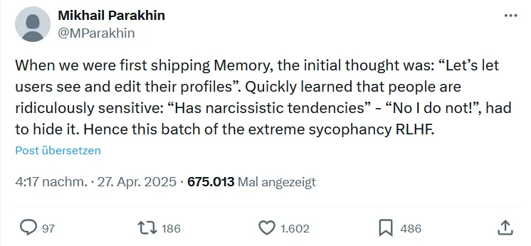<!-- style="width:39.63%" -->

LLMs schmeicheln, weil *zu ehrliche* Nutzerprofile Abwehr auslösen
------------------------------------------------------------

Auf der vorhergehenden Seite wurden bereits für den therapeutischen Dialog trainierte Sprachmodelle vorgestellt, inklusive der potenziellen Gefahren für labile Personen durch die Tendenz der LLMs, Menschen in ihren Wahrnehmungen zu bestätigen. Der X-Post von Ex-Microsoft-Manager Mikhail Parakhin (Abb. 4) zeigt, dass die dadurch häufig extrem schmeichlerische (engl.: sycophant) Art von KI-Chatbots nach Beschwerden über **zu ehrliche Persönlichkeitsanalysen** bewusst eingeführt wurde: Das eigene Profil einsehen zu können, hatte bei Nutzer\*innen starke Abwehrreaktionen ausgelöst.

Eine sichere Lösung: kiwi, dein KI-Chat an der Uni Osnabrück
------------------------------------------------------------

Die Uni Osnabrück bietet ihren Mitgliedern mit [**kiwi**](https://ki.uos.de) einen datenschutzkonformen Zugang verschiedenen kommerziellen sowie an der Uni lokal gehosteten Sprachmodellen zur Verfügung – so kannst du sie sicher nutzen, denn:

* Um über kiwi mit den GPT-Sprachmodellen interagieren, brauchst du dir **keinen eigenen Account bei den Anbietern** anlegen. Für den kiwi-Login benötigst du lediglich deine LDAP-Kennung, mit der du dich bspw. auch bei Stud.IP einloggst.
* kiwi übermittelt bei der Anmeldung **keine persönlichen Daten** und verhindert, dass Eingaben (“Prompts”) einer Person zugeordnet werden können.
* Wenn du das LLMs in der Gratisversion nutzt, werden deine Eingaben in der Regel zum Training der Sprachmodelle verwendet. Alle Anfragen, die du über **kiwi** stellst, dürfen hingegen **nicht** zum Training genutz werden!

 Wenn du mehr über kiwi wissen willst: Im zweiten KI-Mikromodul [**Expedition KI - Wie textgenerative KI tickt**](https://studip.uni-osnabrueck.de/dispatch.php/course/details/index/558ab79a1ec9148602c808f8fc4ee345) gibt es eine ganze Seite zu diesem Chatbot-Interface der Uni Osnabrück, mit dem du die Modelle verschiedener Hersteller nutzen kannst, ohne dass diese Profile über dich bilden können.

*\*Die Informationen in diesem Tab sind wissenswert, wenn du die Quizfragen im letzten Tab auf dieser Seite lösen möchtest.*

### AI Act der EU\*

 unter [CC BY 4.0](https://creativecommons.org/licenses/by/4.0/deed.de) und dem [Original auf der Webseite der EU-Kommision](https://digital-strategy.ec.europa.eu/de/node/9745), Remix von Alexander Piwowar - Grafik anklicken zum Vergrößern -")

AI Act der EU\*
===============

Der Artificial Intelligence Act der Europäschen Union erfasst verschiedene Gefahren, die mit KI-Anwendungen verbunden sind. Der Regulierungsrahmen definiert vier Risikostufen, siehe Abbildung 5. Oft ist gar nicht sofort nachvollziehbar, worin denn überhaupt das Risiko in Bezug auf den Schutz deiner Daten im Internet besteht. **Social Scoring** Systeme wie in China lassen schnell erahnen, wie KIs beispielsweise zur Beeinflussung und Überwachung von Menschen eingesetzt werden können.

Im deutschen Datenschutzrecht hingegen ergibt sich aus dem sogenannten *Grundsatz der Erforderlichkeit* das Gebot der **Datenminimierung**, welches sich in § 3a Bundesdatenschutzgesetz (BDSG) wiederfindet. Dies bedeutet: Prinzipiell sind so wenig personenbezogene Daten zu erheben, zu verarbeiten und zu nutzen, wie nur möglich.

Daraus folgt, dass Datenverarbeitungsprozesse so einzustellen sind, dass sie mit möglichst wenigen Daten auskommen. Vorzuziehen sind insbesondere Datenverarbeitungsprozesse mit **Anonymisierung und Pseudonymisierung**. Gibt es einen Weg, weniger persönliche Daten zu erheben, um anfallende Prozesse zu ermöglichen, muss dieser gewählt werden.

Was du bzgl. Datensouveränität individuell tun kannst: ChatGPT & Co. deine Daten nicht verraten!
------------------------------------------------------------

Im Umgang mit ChatGPT raten Experten davon ab, zu viel persönliche Informationen zu offenbaren und geben zwei zentrale Empfehlungen:

1. Gib nur wenige persönliche Daten preis, u.a. weder private Accounts und E-Mail-Adressen noch dein korrektes Geburtsdatum. Als Name kann ein Pseudonym hinterlegt werden.
2. Vertrauliche Informationen sollten **nicht** über ChatGPT geteilt werden.

*\*Die Informationen in diesem Tab sind wissenswert, wenn du die Quizfragen im letzten Tab auf dieser Seite lösen möchtest.*

### Was darf KI?

Was darf Künstliche Intelligenz?
================================

Prof. Rainer Mühlhoff leitet den Forschungsbereich *Ethik und kritische Theorien der Künstlichen Intelligenz* am Institut für Kognitionswissenschaft der Universität Osnabrück. In diesem Video führt er aus, wie die Science Fiction Vorstellung von KI von der aktuellen sozialen Realität ablenkt und dass die **sozial relevanten Fragen** nach KI erst einmal identifiziert werden müssen. KIs sind zum allergrößten Teil keine materiell greifbare Entität (kein greifbarer Gegenstand), wie die 10.000 Bilder von humanoiden Robotern nahelegen, die überall zu sehen sind - dabei handele es sich um ein weitverbreitete **Fehleinschätzung** des Phänomens KI.

Der Großteil KI findet im Kontext vernetzter Medien statt, also im Internet - nicht als Roboter, Autos oder Drohnen. Es ist insofern **irreführend, KIs als menschenähnliche Entitäten** zu betrachten, denn: Vorhersage-KIs sind viel verbreiteter. Sie werden gezielt dafür hergestellt, Menschen subtil unterschiedlich zu behandeln.

!?[Was darf Künstliche Intelligenz?  Eine Frage der Ethik?](https://www.youtube.com/watch?v=7Q2BU2Htmqs "Was darf Künstliche Intelligenz?  Eine Frage der Ethik? – “Osnabrücker Wissensforum“ der Universität Osnabrück")

### KI - Macht - Ungleichheit

Rainer Mühlhoff auf dem Chaos Communication Congress in Hamburg: “KI – Macht – Ungleichheit”
============================================================

Ein weiteres populäres Bild von KI, das in den Medien vermittelt wird, sieht so aus, dass das Gehirn durch digitale computionale Prozesse simuliert wird. Im diesem Vortrag führt Prof. Rainer Mühlhoff aus, warum dieses Bild falsch ist. Stattdessen geht es ihmzufolge vielmehr um das intelligente Design von Feedbackschleifen. Mit der Veröffentlichung hört das Training (siehe vorherige Seiten) eben nicht auf, sondern die KI wird durch die Nutzer\*innen immer weiter trainiert. Insofern können die KIs als soziotechnisches, d.h. kybernetisches **Mensch-Maschine-System** betrachtet werden.

Dieses tatsächliche Bild steht laut Prof. Rainer Mühlhoff zu den Nachhaltigkeitszielen der UN in einem inhärenten Konflikt, wenn KI nicht besser reguliert wird. Die Feedback-Loops, gar nicht das Programieren von Code selbst, ermöglicht das umfangreiche Auslesen menschlicher kognitiver Leistungen an den digitalen Interfaces, die wir täglich nutzen. Als Beispiel für das Design von **Feedbackschleifen** greift er auf die Geschichte des Facetaggings auf Facebook zurück. Bei Minute 10:00 erfährst du auch, was die für Facebook wirklich interessante Infomation ist, wenn sie fragen, ob sie ein Foto von dir nutzen dürfen oder nicht ;)

Der Vortrag diskutiert, warum wir KI-Systeme als soziotechnische Systeme betrachten müssen, um so ein reichhaltigeres Verständnis der **sozialen Dimension** von Nachhaltigkeit zu entwickeln und zu verstehen, warum KI für den sozialen Zusammenhalt schädlich sein kann.

!?[37C3 -  KI – Macht – Ungleichheit.](https://www.youtube.com/watch?v=iFV05xa7OCE "37C3 -  KI – Macht – Ungleichheit. – media.ccc.de")

### QUIZ

**Quiz: Datensouveränität im Internet**

**1. Was kannst du tun, um die Wahrscheinlichkeit zu reduzieren, online ungewollt ausgespäht zu werden?**  
*Mindestens zwei Antworten sind richtig.*

- [[X]] Einen sicheren Internetbrowser verwenden, der Tracking blockiert.
- [[ ]] Inkognito/Private-Browsing-Modus verwenden.
- [[X]] Persönliche Daten nur sparsam preisgeben.
- [[X]] Auf die Datenschutzeinstellungen in sozialen Netzwerken achten.
- [[X]] Ein virtuelles privates Netzwerk (VPN) nutzen.
- [[ ]] Den Browserverlauf regelmäßig löschen.

**2. Was bedeutet das Gebot der Datenminimierung im deutschen Datenschutzrecht?**  
*Wähle die jeweils zutreffende Option.*

<!-- data-show-partial-solution -->
Der Grundsatz der Daten[[ (-Minimierung) | -Maximierung ]] im deutschen Datenschutzrecht besagt, dass möglichst wenig personenbezogene Daten [[ gelöscht | (erhoben) ]], verarbeitet und genutzt werden sollen. Datenverarbeitungsverfahren sollten so gestaltet sein, dass sie möglichst [[ (wenig) | viele ]] Daten benötigen; insbesondere anonymisierte und pseudonymisierte Daten sind [[ abzulehnen | (zu bevorzugen) ]]. Außerdem hast du persönlich die Möglichkeit, aktiv Daten zu minimieren, indem du so [[ viel | (wenig) ]] persönliche Daten wie möglich teilst.

**3. Was sind die Empfehlungen im Umgang mit ChatGPT in Bezug auf persönliche Informationen?**  
*Eine Antwort ist richtig.*

- [( )] Der möglichst offene Austausch intimer persönlicher Anekdoten und Erfahrungen fördert die authentische Interaktion mit den Tools und erhöht die Qualität der Konversationen, wovon letztlich alle Nutzer\*innen profitieren.
- [( )] Sprachmodelle sind mit Protokollen wie SSL oder TLS Ende-zu-Ende verschlüsselt. So ist sicher, dass deine persönlichen Informationen wie Passwörter und finanzielle Details nicht unbefugt genutzt werden können.
- [(X)] Persönliche Daten wie private Accounts oder E-Mail-Adressen und dein korrektes Geburtsdatum sollten nicht mit Sprachmodellen geteilt werden, die Offenlegung vertraulicher Informationen ist zu vermeiden. Achte auf Datenschutz und gib nur notwendige Daten preis.
- [( )] Nutzer sollten die Interaktion mit ChatGPT ganz vermeiden, um ihre persönlichen Daten zu schützen. Es gibt Bedenken hinsichtlich des Datenschutzes und der Sicherheit bei der Interaktion mit KI-Modellen, daher ist es am besten, ganz auf die Nutzung solcher Plattformen zu verzichten.


# 2. Künstliche Intelligenz in ihrem natürlichen Habitat


<!-- style="width:40.7%" -->

Nach der Expedition durch das "Tal der Tränen" (s. *Hype-Cycle* in *KI-Entwicklungsstand im Sommer 2026*) im ersten Kapitel hast du nun eine gute Orientierung innerhalb verschiedener aktueller Grenzen von KI gewonnen. Die dabei präsentierten Kritikpunkte sollten bitte nicht als prinzipieller Technik-Pessimismus oder Voreingenommmenheit abgetan werden. Erfolgversprechender wäre es stattdessen, diese Aspekte einfach im Hinterkopf zu behalten, denn jetzt startet die **konkrete Analyse** verschiedener Kategorien von Tools. Auf dem "Pfad der Erleuchtung" (s. *Hype-Cycle*) kann es schließlich nicht schaden, einigen Mythen bzw. Marketing-Versprechungen mit einer nüchternen Analyse begegnen zu können, wenn du die **Tools zielführend einsetzen** willst.

Aber was kann KI eigentlich gegenwärtig? Wie die praxisrelvanten Betrachtungen auf den nächsten drei Seiten zeigen, ist der Werkzeugkoffer prall gefüllt – wobei KI mitunter ihr **ganz eigenes Bild** davon entwickelt, wie Werkzeuge im Allgemeinen so aussehen, siehe Abbildung 1. Sieh mal genau hin! Die in diesem Fall mit Midjourney erzeugten Tools wären auf der Baustelle überwiegend sinnfrei, um nicht zu sagen nutzlos. Allenfalls den Hammer könnte man **in real life** überhaupt benutzen, den Rest der Werkzeuge gibt es nicht.

Die Fülle von KI-Tools macht dein Leben im Studium nicht unbedingt nur leichter, jedenfalls nicht sofort. Auch hier gilt **Learning by doing.** Was zählt ist erstmal viel Ausprobieren und dich wie bei jeder anderen Software in die Bedienung reinfuchsen. Fixiere dich am besten ~~nicht~~ auf nur ein einziges Tool! Auch wenn das vielleicht bequem ist, sobald du dich etwas eingewöhnt hast und nun Ergebnisse erzielst, mit denen du zufrieden bist. Das ist an sich zwar schön, aber mit Sicherheit nicht das richtige Werkzeug für alles. ChatGPT ist zum Beispiel eher so etwas wie ein **Multifunktions-Tool**, quasi ein Schweizer Taschenmesser. Darüber hinaus gibt es noch viele weitere KIs für spezifischere Gebiete.

Um es mit einer Analogie aus dem Handwerk zu sagen: Auch wenn du mit dem Fuchsschwanz jetzt echt fit bist, führt es trotzdem in mancher Situation zu besseren Ergebnissen, stattdessen auf den Hammer, die Kneifzange oder den Schraubenzieher zurückzugreifen. Du wirst unter deinen Möglichkeiten bleiben, wenn du flächendeckend ChatGPT und nichts anderes nutzt - davon handelt diese Seite.

> [!NOTE]
> Als nächstes geht es von der Analyse zur Anwendung von KI über. Nicht für alle Aufgaben sollte ChatGPT verwendet werden. Das wichtigste Tool: Deine eigene Reflexion! Auf der nächsten Seite erhältst du eine Übersicht verschiedener KI-Kategorien und auf der darauf folgenden praktische Prompting-Tipps.

## Wie du ChatGPT für das Studium nutzen kannst

Ein sehr gutes Video für alle, die studieren und noch gar keine oder wenig Ahnung von ChatGPT haben. Wie Luis Newton hier ausführt, ist die enorme Aufmerksamkeit für KI durchaus gerechtfertigt, führt allerdings auch aus: **"Aber wir müssen trotzdem sehr vorsichtig und kritisch sein!"** Im Video werden viele Anwendungsmöglichkeiten von Sprachmodellen anschaulich erläutert:

* *Allwissender* Gesprächspartner
* Unterstützung beim Schreiben von Hausarbeiten
* Zur Vorbereitung auf die Prüfungsphase (Lerninhalte festigen)
* Struktur von Präsentationen
* Texte fortführen
* Anschreiben für Bewerbungen

Bei [Minute 4:41](https://youtu.be/N-A29r2ubwg?feature=shared&t=282) betont er allerdings auch: "Diese künstliche Intelligenz und die Informationen die sie beinhaltet, sind **bei Weitem nicht perfekt**. Und das ist wirklich wichtig und der Grund, warum wir uns doch **nicht komplett darauf verlassen** können."

!?[Wie du ChatGPT für das Studium nutzen kannst](https://www.youtube.com/watch?v=N-A29r2ubwg "Wie du ChatGPT für das Studium nutzen kannst – Luis Newton")

## LLM Basiswissen\*

Eine Suchmaschine im Gegensatz zu einem Sprachmodell ist, wie bereits angeschnitten, eine Datenbank mit Links zu Dokumenten bzw. Webseiten, die durchsucht werden können. Bei Google, Safari oder Firefox werden Datensätze oder strukturierte Datenpakete geliefert, **real existierende Dokumente mit Informationen**, die dir helfen können, indem sie – hoffentlich – die Lösung für deine Anfrage beinhalten.

. Sprachversteher: GPT-3 & Co. texten überzeugend, aber nicht faktentreu. c't(9), S. 65 - Grafik anklicken zum Vergrößern -")

Wie dagegen ein Large Language Model (LLM) funktioniert, selbst wenn es auf das Internet zugreifen kann und Quellen liefert, visualisiert Abbildung 2 anhand GPT-3. Du startest links unten in der Grafik: Stell dir vor, du schreibst einen Text auf deinem Handy und **als nächstes passende Worte** werden vorgeschlagen. Ähnlich solch einer **Autocomplete**-Funktion haben Sprachmodelle die Wahrscheinlichkeit von Sequenzen von Wörtern bzw. Silben oder sogar einzelner Satzzeichen, genannt **Token,** in einer bestimmten Sprache gelernt. Mit jedem neu eingegebenen Token wird jedes Mal alles neu "ausgewürfelt", wobei die Ähnlichkeit der Bedeutung von Wörtern bzw. Token durch sogenannten **Embeddings**, Vektoren in einem hochdimensionalen Raum, codiert bzw. gewichtet wird. Weitere Details findest du bei Interesse im Text über Abbildung 2, *Die innere Mechanik von GPT-3*.

Dieses "hochstatistische Wortsilben-Würfeln auf sehr sehr hohem Niveau" besitzt, wie [**Prof'in Doris Wessels** (im Video ab Minute 15:00)](https://www.podcampus.de/nodes/Rbyod) formuliert, zwar statistische Plausibilität, was aber ~~nicht~~ heißt, dass es deterministisch ist, es kommt also **~~nicht~~ immer das gleiche Ergebnis** raus. Auf diese Weise entstehen Unikate, keine Plagiate, die Ausgabe entsteht ~~nicht~~ aus komplett vorliegenden Textsequenzen, die irgendwo in den Trainingsdaten vorliegen. Tatsächlich handele es sich um ein jedes Mal neues, **ganz kleinteiliges Remixen** inklusive Zufallsmechanismen.

Ihrzufolge wird dies **tragischerweise** von vielen mißverstanden bzw. fehlinterpretiert: Da wir Suchmaschinen kennen, nehmen wir Sprachmodelle als Suchmaschinen wahr, was eine **Fehlinterpretation** ist! Es ist **~~keine~~** Suchmaschine. Es basiert **~~nicht~~** auf Faktenrepräsentation. Es ist mit Prof'in Doris Wessels Worten "eine Inspirations bzw. Imitationsmaschine, es imitiert unsere menschliche Kommunikation in einer Art und Weise, wie wir es noch nicht erlebt haben". Mach dir das bewusst! Obwohl sehr glaubwürdig wirkend, ist es diese Technologie bis dato nicht, auch wenn sie so klingt.

*\*Die Informationen in diesem Tab sind wissenswert, wenn du die Quizfragen im letzten Tab auf dieser Seite lösen möchtest.*

> [!NOTE]
> Ähnlich wie ChatGPT: Claude, Gemini, Copilot, Llama, Gemma, you.com, Qwen, ...

## A fool with a tool\*

")<!-- style="width:26.65%" -->

KI-Tools können zwar zum Teil hervorragend als Werkzeuge für wissenschaftliches Arbeiten eingesetzt werden, aber keine KI ersetzt wissenschaftliches Arbeiten an sich. Klar, KI liefert beeindruckende Ergebnisse, aber das stärkste und unersetzbare Tool bleibt deine eigene Reflexion! Sprachmodelle wie ChatGPT bringen keine vollständige Ordnung in deine Gedanken, deshalb sollte der ausgegebene Content niemals 1 zu 1 übernommen werden, es sei denn du bist sehr sicher im Thema und kannst ihn ad hoc **verifizieren**. Alle Ergebnisse sind, insbesondere Informationen, die du wissenschaftlich nutzen willst, sind stets zu prüfen, denn sie sind nur so gut wie die Trainingsdaten, mit denen die KI "gefüttert" wurde.

Summa summarum: Vor allem in der frühen Explorationsphase mit KI kommt wohl leider eher **mehr Aufwand** auf dich zu als weniger. Erst wenn du durch Erfahrung eine realistische Einschätzung der Ergebnisse erlangt und damit **relative Sicherheit** gewonnen hast, ist es sinnvoll, persönliche **Routinen** bei der Anwendung von KI zu internalisieren. Passiert dies zu früh, zu unreflektiert oder blind der KI vertrauend, ist anzunehmen, dass du dir automatisch kontraproduktive Arbeitsweisen aneignen und damit deine Kompetenzentwicklung untergraben wirst: A fool with a tool is still a fool (Abb. 3).

Das Gute: Du musst nicht technikaffin sein
------------------------------------------

Übrigens musst du nicht technikaffin sein, um Resultate zu erzielen, die sich sehen lassen können, du musst nur einen Plan haben. Es reicht, wenn du neugierig bist und dran bleibst, auch wenn es mal nicht sofort klappt: Gib dir und den Tools in der explorativen Phase **Zeit** und den nötigen **Spielraum**. Etwas **Frustrationstoleranz** kann auch nicht schaden – am besten einfach ganz pragmatisch drangehen. Es gibt viele KIs dort draußen und jede funktioniert auf ihre Weise. Nicht wenige machen tatsächlich sehr viel Spaß und können sogar "süchtig" machen, also vorsicht. So manche hat auch ihr ganz eigenes Bild von der Welt, wie du nicht nur bei Bildgeneratoren feststellen wirst. Da ChatGPT mit englischen Texten trainiert wurde, ist beispielsweise anzunehmen, dass ein eher westlich geprägter Blick auf die Welt die Grundlage für die durch die KI erzeugten Texte ist (Schulministerium NRW, 2023), während eine beispielsweise asiatisch oder afrikanisch geprägte KI ein ganz anderes Mindset haben dürfte.

*\*Die Informationen in diesem Tab sind wissenswert, wenn du die Quizfragen im letzten Tab auf dieser Seite lösen möchtest.*

> [!TIP]
> Klar, KI liefert beeindruckende Ergebnisse, aber das stärkste und unersetzbare Tool ist deine Reflexion!

## Exkurs: Wie "kreativ" ist künstliche Intelligenz?

Wie "kreativ" ist künstliche Intelligenz?
=========================================

KI-Technologie könnte einen größeren Einfluss als Handys oder das Internet haben, was den Einfluss auf unsere Verarbeitung von Informationen angeht. Die Erhöhung von Effizienz oder Effektivität ist dabei aber längst nicht alles, was KI fördern kann. Ganz wesentlich ist auch der

Kreativitätsschub

, den KI individuell auszulösen definitiv in der Lage ist.

Menschliche Kreativität

ist allerdings etwas komplett anderes als die Art von Kreativität, von der in Bezug auf künstliche Intelligenz die Rede ist. In diesem Tab werden zur Orientierung drei spezifisch menschliche Fähigkeiten aufgelistet, die du von KI

aktuell

nicht zu erwarten brauchst. Ob Maschinen mit den aktuellen technologischen Ansätzen die nächste Stufe im Vergleich mit menschlicher Intelligenz bzw. Kreativität erklimmen können bzw. was mittelfristig zu erwarten sein könnte, ist eine unter Experten hitzig diskutierte und (geschäfts)geheimnisumwobene Frage.

Während Sam Altman einen guten Job für OpenAI macht, um Gelder für die Weiterentwicklung der Technologie in Richtung Allgemeine KI (AGI) zu akquirieren, folgt er damit letztlich der sogenannten **Skalierungshypothese**. Die Skalierungshypothese besagt, dass die Netze vor allem wachsen müssen, um intelligenter zu werden. Auf der anderen Seite gibt es Kritiker wie Erik Larson (2021), denenzufolge ein großer wissenschaftlicher Durchbruch nötig sei, um in den Bereich vorzudringen, der der menschlichen Intuition oder einem impliziten Weltwissen entspricht – welcher derzeit aber nicht absehbar sei. Futuristen seien sich sicher, dass eine menschenähnliche KI in Sicht ist, aber in Wirklichkeit hätten die Ingenieure keine Ahnung, wie man menschliches Denken programmiert. KI schlussfolgere aus **statistischen Korrelationen** zwischen Datensätzen, während menschlicher Verstand stark auf **Vermutungen** beruhe. Erik Larson vertritt die Ansicht, dass die Übertreibung bestehender Methoden uns nur von der Entwicklung einer wirklich menschenähnlichen KI abhält. Auch Bongartz und Merkert (2022) sehen die **Grenze der Mensch-Maschine-Annäherung** mit den gegenwärtigen technologischen Ansätzen bereits erreicht – mit den heutigen Methoden könne man sich ihr zwar [asymptotisch](https://www.google.com/search?client=firefox-b-d&sca_esv=064fbd3969a095d1&q=asymptotisch&spell=1&sa=X&ved=2ahUKEwjVkv3sg-OGAxXXzQIHHdyCD4YQkeECKAB6BAgJEAE) nähern (sich ihr wie einer ins Unendliche verlaufenden Kurve nähern, ohne sie zu berühren), sie aber nicht überschreiten.

1. Eine KI kann keine menschliche Kommunikation mit uns führen
------------------------------------------------------------

Du kannst, basierend auf dem Eliza-Effekt (siehe 1. Sprachmodelle: Nur stochastische Papageien?), über dein wirkliches Gegenüber leicht getäuscht werden. Entsprechend könntest du versuchen, eine menschliche Kommunikation mit dem Computer zu führen. KI-Assistenten müssen gar nicht viel tun, um in der menschlichen Wahrnehmung als eine wirklich **soziale Interaktion** zu erscheinen, simulieren diese aber nur. Sie funktionieren weit weniger komplex als menschliche Kommunikation. Zwar ist KI in der Lage, Emotionen zu *erkennen* und darauf zu reagieren, sie ist aber nicht selbst in der Lage, Emotionen auf die gleiche Weise zu verstehen und zu fühlen wie Menschen. Wenn mensch sie nicht so bedient, wie sie bedient werden sollten, funktionieren sie nicht.

2. Eine KI kann den Kontext nicht wie ein Mensch verstehen
----------------------------------------------------------

Eine KI kann Schwierigkeiten haben, Ironie oder Sarkasmus zu erkennen. Ohne ein Verständnis für den Kontext könnte die KI fälschlicherweise eine ironische Aussage bzw. satirische Beiträge als wörtliche Wahrheit interpretieren. Ein Beispiel ist Google Overview, eine KI, die im Mai 24 Furore machte, weil sie Usern unter anderem empfahl, **Kleber in die Sauce zu mischen, damit der Käse nicht von der Pizza rutscht**. Wie im Blog [**Basic Thinking**](https://www.basicthinking.de/blog/2024/06/12/google-empfiehlt-immer-noch-kleber-als-pizzazutat/) nachgelesen werden kann, schien es für Google auch Wochen später gar nicht so einfach, der KI zu vermitteln, dass diese Antwort in der Welt des Humors zu verorten ist – wohl auch dadurch, dass diese Information durch Nutzer\*innen immer wieder eingespeist wird. Mit ChatGPT 4o erhalten KIs jetzt zwar auch die Möglichkeit, nonverbale Signale auszulesen, allerdings birgt dies auch das Risiko ungenauen Analysen oder falschen Schlussfolgerungen, insbesondere in Situationen, in denen **subtile Nuancen** wichtig sind oder die **mehrere Ebenen der Bedeutung** haben. In diesem zweiminütigen [**Video auf Deutsche Welle**](https://www.dw.com/de/chatgpt-4o-o-wie-omnipotent/video-69230862) werden einige weitere Risiken angesprochen.

3. Eine KI kann (noch) nicht wie Menschen "Neues entwickeln"
------------------------------------------------------------

Kreativität in Bezug auf KI wird häufig so definiert, dass – ob gezielt oder nicht – **unkonventionelle Verbindungen** von Wissensbestandteilen entstehen und mit ihnen gespielt wird. Wie du auf der Seite *Prompt-Engineering: Wie sag ich's meinem Bot?* sehen wirst, kann dieser Zufalls-Charakter bei der Generierung der Outputs von ChatGPT mittels der sogenannten "Temperierung" beeinflusst werden. Generell werden KIs oft ja ja eher als **konservativ** bezeichnet in dem Sinne, dass sie **Gelerntes reproduzieren**. Eine KI kann beispielsweise Texte, Bilder oder Musik generieren, jedoch fehlt ihr oft die emotionale Tiefe oder die künstlerische Vision. Menschen bringen ihre einzigartige Lebensgeschichte, ihre kulturellen Einflüsse und ihre **individuellen Sichtweisen** ein, die stark von persönlichen Erfahrungen, Überzeugungen und Perspektiven geprägt sind. All dies ist bislang schwer zu quantifizieren oder zu reproduzieren. Eine KI kann Werke basierend auf bestimmten Parametern oder Stilen erstellen, aber es fehlt zumeist an **Originalität** oder einer **tieferen Bedeutung**.

Vom Menschen hervorgebrachte Kunst verfolgt häufig einen **Zweck**, sei es die **Reflexion** über das Menschsein, die Suche nach Schönheit oder die Kommunikation komplexer Ideen. Menschen können in ihren kreativen Werken Bedeutungen und Botschaften vermitteln, die tiefergehende emotionale oder intellektuelle **Einsichten** bieten. Um auf geistigem, künstlerischem Gebiet – der eigenen Inspiration folgend – aus Impulsen Ideen zu entwickeln, braucht es diese Art von Sinnstiftung und Bedeutung. Menschliche Kreativität ist einerseits oft spontan und unvorhersehbar, andererseits können sich aus Impulsen über längere Zeit innovative Ideen entwickeln. Mit **unvorhersehbaren Ansätzen**, die über traditionelle Muster und Algorithmen hinausgehen, können Probleme gelöst werden, für die es aus der Vergangenheit noch keine Lösung gibt. Eine unbeantwortete Frage lautet also: Kann man einer KI beibringen, wie man ohne Anleitung im menschlichen Sinne kreativ wird?

## QUIZ

**Quiz: Künstliche Intelligenz in ihrem natürlichen Habitat**

**1. Kreuze die zutreffenden Aussagen an.**  
*Mindestens zwei Antworten sind richtig.*

- [[X]] Lernen über KI hilft, die technologischen und gesellschaftlichen Auswirkungen der Technologie zu verstehen.
- [[X]] Chatbots können für wissenschaftliche Arbeiten als Hilfsmittel eingesetzt werden und zur Datenanalyse und Forschung beitragen.
- [[ ]] KI kann derzeit Aufgaben erfüllen, die komplexe Entscheidungen und Kreativität auf menschlichem Niveau erfordern.

**2. Wie kann man KI effizient einsetzen?**  
*Wähle jeweils die passende Option.*

<!-- data-show-partial-solution -->
Wenn du dich ausschließlich auf ein einziges Tool wie ChatGPT fokussierst, kannst du [[ (nicht für alle Aufgaben im Studium optimale Ergebnisse erzielen) | viel Zeit bei anderen wissenschaftlichen Tools sparen ]]. Die Verwendung [[ ähnlicher | (unterschiedlicher) ]] Werkzeuge für verschiedene Anwendungen ist wichtig, da dies die Anpassungsfähigkeit und Effektivität erhöht. Das wichtigste Werkzeug beim Einsatz von KI in der wissenschaftlichen Arbeit ist [[ (die eigene Reflexion zur kritischen Hinterfragung) | ein KI-Werkzeug zur Validierung der Ergebnisse ]]. Du kannst KI am besten für die Verbesserung deiner Studienergebnisse einsetzen, indem du [[ (nur geeignete) | die teuersten ]] Werkzeuge nutzt und die Qualität der Ergebnisse [[ (selbst kontrollierst) | automatisch geliefert bekommst ]].

**3. Wie lernen die Sprachmodelle?**  
*Eine Antwort ist richtig.*

[(Richtig) (Falsch)]
[ (X) ( ) ] Sprachmodelle verstehen nicht die Bedeutung, sondern lernen nur die Wahrscheinlichkeit des jeweils nächsten Wortes in einem Satz.


## TOOLCHECK 1: KI-Kategorien und -Einsatzgebiete

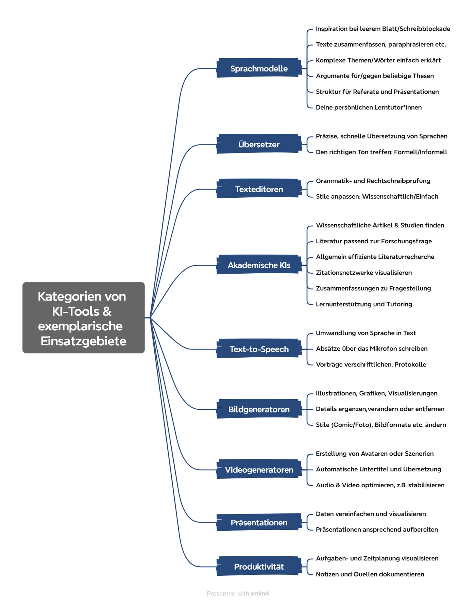<!-- style="width:34.56%" -->

TOOLCHECK 1: KI-Kategorien und -Einsatzgebiete
==============================================

Die auf den letzten Seiten erwähnten Sprachmodelle und Bildgeneratoren sind nur die Spitze des Eisbergs. Bevor auf der nächsten Seite ausschließlich Sprachmodelle und auf der übernächsten spezifische akademische Tools behandelt werden, geht es jetzt zunächst um einige **KIs ohne direkten Bezug zum Studium.**

Die Logikmap auf der rechten Seite (Abb.1) fasst verschiedene Kategorien von KI-Tools und exemplarische Einsatzgebiete zusammen, zwischen denen es **n**atürlich zu Überschneidungen kommt. Äußerst sinnvoll bzw. effektiv ist die Kombination mehrerer KIs in aufeinanderfolgenden Arbeitsschritten, was auch **iteratives Vorgehen** genannt wird: Mit dem Ergebnis des einen Schrittes fängt der nächste an.

Mehrere KI-Tools kombinieren
============================

Sprachmodelle sind die Basis vieler Anwendungen mit weiterführenden Mehrwerten. Du kannst LLMs aber auch individuell ganz hervorragend als **Ausgangsbasis** oder **Zwischenschritt** in praktischen Anwendungsszenarien nutzen. Ein Beispiel: Nutze LLMs, um kreative Ideen für Visualisierung zu entwickeln, übersetze sie mit DeepL ins Englische – bei vielen Bots erzielst du auf Englisch bessere Ergebnisse – und gebe sie bei bildgenerativen KIs ein, um Bilder zu generieren.

Ein anderes Beispiel: Wenn du mit ChatGPT als **Inspirationsquelle** die Struktur und den Text für eine Präsentation erstellt hast, kannst du von DeepL Write nicht nur die Grammatik- und Rechtschreibprüfung durchführen, sondern auch den Stil anpassen lassen (Wissenschaftlich/einfach) und die Folien nachher mit beautiful.ai, der Canva oder Simplified.com designen. Häufig werden auch verschiedene Apps miteinander kombinierbar als Plugin/Add-in/Add-on angeboten.

> [!NOTE]
> Weder ist dieser illustrative, exemplarische Überblick zu Werbezwecken gedacht, noch besteht wegen der Dynamik in diesem Feld ein Anspruch an die Qualität, Vollständigkeit oder Aktualität der genannten KIs.

### Kombinieren!\*

So viele Tools - Die passenden kombinieren!\*
=============================================

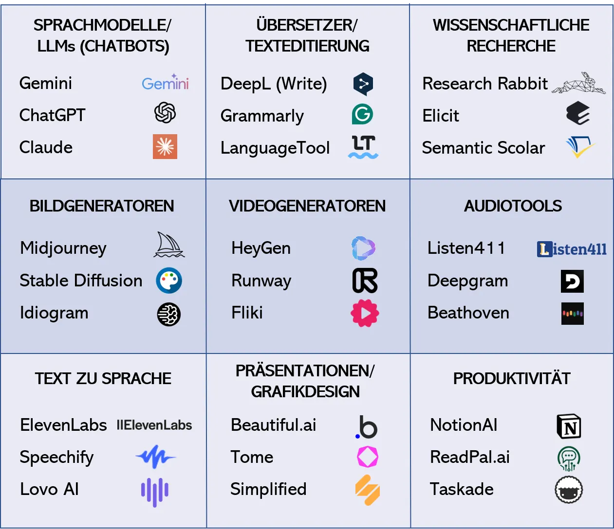

Filme wie **2001: Odysee im Weltraum, Terminator** oder **Her** zeichnen unsere komplexe Beziehung zu künstlicher Intelligenz bzw. zu Computer-Technologie im Allgemeinen nach. Wie du bereits weißt, "unterhalten" sich Menschen schon seit der Erfindung von ELIZA mit Computern. Doch erst dank der Fortschritte im Bereich des maschinellen Lernens (ML) können Chatbots heute "kreative" Inhalte produzieren und anspruchsvolle Aufgaben ausführen. Aber es gibt noch **viel mehr als nur Sprachmodelle** wie ChatGPT. Generative KI-Tools sind die Zukunft – um sie kennen zu lernen, kannst du dir also ruhig etwas Zeit lassen.

Es lohnt sich, darüber nachzudenken, wie du neue Technologien nahtlos in deine Arbeitsabläufe integrieren kannst. Meist konkurrieren **mehrere Anbieter** in einzelnen Kategorien (Abb.2), die man **vergleichend testen** kann. Grammarly zum Beispiel ist, ebenso wie LanguageTool oder DeepL Write, ein fantastisches Tool für Hausarbeiten, Essays und andere schriftliche Aufgaben, da es den schriftlichen Inhalt verbessert, indem es Empfehlungen für Rechtschreibung, Grammatik, Stil und Klarheit gibt. Canva hilft dir bei der Erstellung ansehnlicher Grafiken. Präsentations-KIs wie beautiful.ai helfen, den Designprozess zu automatisieren und visuell ansprechende Folienlayouts und Designvorschläge zu erstellen.

Wenn du mehrere Tools kombinierst, kann das die **Produktivität** und **Kreativität** noch deutlich steigern, seien diese nun KI-basiert oder nicht. Durch die Integration von HeyGen mit Canva zum Beispiel kannst du dynamische visuelle Inhalte auf der Grundlage von generiertem Text erstellen. Es können also nicht nur textbasierte Inhalte verbessert oder statische Bilder generiert werden, mit audiovisuellen Tools wie HeyGen oder d-id.com können sogar dynamische Avatare eingebunden werden.

Die folgenden Tabs geben einen kleinen Einblick in das große **Potenzial** von KI. Das Feld ist riesig und entwickelt sich z.T. sehr dynamisch weiter. Neben allgemeinen Basisinformationen werden deshalb im letzten Tab auf dieser Seite zwei permanent aktualisierte Websites mit Sammlungen von KIs vorgestellt.

*\*Die Informationen in diesem Tab sind wissenswert, wenn du die Quizfragen im letzten Tab auf dieser Seite lösen möchtest.*

### Effizienz & Effektivität\*

Effizienz und Effektivität\*
============================

Sprachmodelle können dir auf alle deine Fragen eine Antwort geben – wie hilfreich sie auch immer sein möge – und unterschiedlichste Aufgaben lösen. Der Einstieg ist kinderleicht und kostenlos. Für Konversationen oder Textgenerierungen wie bei Schreibprojekten ist es aufgrund seiner Fähigkeit, menschenähnliche Texte zu produzieren, eine Erwägung wert. Aber eignet es sich automatisch gleich für alle Aufgaben, die mit Texten zu tun haben?

Effizienz = Die Werkzeuge ~~richtig nutzen~~
--------------------------------------------

LLMs haben

super vielfältige Anwendungsmöglichkeiten

und online findest du schnell Inspiration, zum Beispiel im Video von Luis Newton auf der vorhergehenden Seite. Wenn du etwas Erfahrung gesammelt und für dich persönlich interessante Einsatzbereiche gefunden hast, dürfte dein Einsatz immer geringer bzw. gezielter ausfallen und die Ergebnisse immer hochwertiger werden – du promptest effizienter und hast den Kopf frei, weil deine Konzentration jetzt nicht mehr so stark von der Steuerung der Software selbst absorbiert ist. Vor allem, um die Ergebnisse realistisch einschätzen zu können, braucht es eine gewisse Phase der Exploration, in der man aus seinen eigenen Fehlannahmen unter Umständen einiges lernen kann. Ein paar Strategien zum gescheiten Prompting werden auf der folgenden Seite präsentiert.

Effektivität = Die ~~richtigen Werkzeuge~~ nutzen
-------------------------------------------------

<!-- style="width:41.06%" -->

LLMs sollten allerdings nicht als Universal-Tool für jede nur erdenkliche Aufgabe verstanden werden. Klar, es sind Generalisten, wie gesagt vergleichbar mit einem Schweizer Taschenmesser: Der Schraubendreher am Schweizer Taschenmesser ist unterwegs super hilfreich, aber wenn du wirklich ernsthaft an einem Projekt arbeitest mit einem vernünftigen Schraubendreher nicht vergleichbar, sondern **nur eine Behelfslösung**. Genauso solltest du dich nicht sofort zu sehr an einzelne Tools wie ChatGPT gewöhnen. Viele neue Apps ausprobieren ist viel sinnvoller – ob nun in einer KI-Kategorie oder auch in benachbarten. Wie Abbildung 3 zeigt, könntest du sonst sogar versuchen, die Kreuzschlitzschraube mit einem Maulschlüssel reinzudrehen – na denn man tau! ;)

Um KI wirklich effektiv einzusetzen, musst du die **Komfortzone (Ein Tool für alle Aufgaben) verlassen**. Insofern macht KI dein Leben einerseits einfacher, andererseits aber auch herausfordernder. LLMs eigenen sich nicht für alle Aufgaben im Studium, manchmal solltest du ganz einfach spezifischere Tools verwenden, die den Job besser machen. Du gehst effektiv vor, wenn du tatsächlich den **Effekt** erzielst, den zu erzielen möchtest. Erst, wenn du dich für eine effektive Strategie – vor allem also: Ein zur Aufgabe passendes Tool – entschieden hast, solltest du damit beginnen, **Routinen** in einem bestimmten Bereich zu entwickeln. Verwendest du einfach nur ein einziges Tool für alles, kannst du dies zwar sehr effizient, aber wenig effektiv tun, denn eventuell führt dieses Tool gar nicht zum von dir verfolgten Ziel.

Ein Beispiel: Du benötigst hochwertige Übersetzungen? Da ist DeepL ziemlich sicher die bessere Wahl, denn es hilft zuverlässiger dabei, Grammatik und Sprachkonstruktionen zu verstehen. Wer in technischen oder naturwissenschaftlichen Fachbereichen wie Ingenieurwissenschaften, Informatik oder Biologie unterwegs ist oder in einem multilingualen Kontext, die oder der kann von DeepL im Gegensatz zu ChatGPT deutlich mehr profitieren. DeepL ist oft besser geeignet, um Fachterminologie und komplexe Texte kontextsensitiv zu übersetzen.

Um KI wirklich effektiv einzusetzen ist es äußerst wertvoll, eine **gute Metakognition** zu entwickeln. Wer seinen Arbeitsstil und die anfallenden Arbeitsschritte sowie sein Ziel reflektieren bzw. aus der **Vogelperspektive** beobachten kann, wird auch mit KI an Stellen ansetzen, die wirklich sinnvoll sind.

*\*Die Informationen in diesem Tab sind wissenswert, wenn du die Quizfragen im letzten Tab auf dieser Seite lösen möchtest.*

### Übersetzer (DeepL)

DeepL: Besser als der Google Übersetzer!
========================================

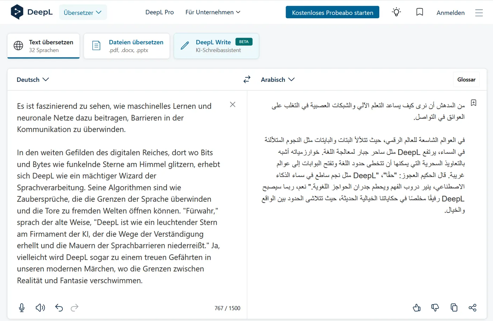<!-- style="width:55.7%" -->

[**DeepL**](https://www.deepl.com/translator) ist etabliertes KI-Übersetzungstool aus Köln, das mit Algortihmen der künstlichen Intelligenz und neuronalen Netzwerken bemerkenswerte **kontextsensitive Übersetzungsergebnisse** liefert, in einer Qualität, die der von menschlichen Profis sehr nahe kommt. Man könnte es optisch für ein sehr einfaches Computerprogramm halten, aber der Schein trügt. Die KI dieses kleinen Unternehmens ist wirklich next Level und funktioniert nachweislich besser, d.h. **nuancierter** als die großen Tech-Giganten. Du kannst es beispielsweise nutzen, um Bild- oder Videogeneratoren mit englischen Prompts zu füttern (diese erzielen oft bessere Ergebnisse, da sie mit englischen Texten trainiert wurden) und für vieles mehr. DeepL ist für die **Qualität der Übersetzungen** bekannt, die oft natürlicher und präziser sind als die anderer Maschinenübersetzungsdienste und nutzt fortschrittliche neuronale Netzwerke, die auf einer großen Menge an mehrsprachigen Textdaten trainiert wurden. Dadurch kann der Dienst Kontext **besser "verstehen"** und genauere Übersetzungen liefern. Für DeepL ist keine Registrierung erforderlich. Die Benutzeroberfläche ist bei fast allen Übersetzungstools ähnlich wie im Screenshot (Abb. 4).

DeepL Write
===========

[**DeepL Write**](https://www.deepl.com/de/write) hat einen etwas erweiterten Fokus, es untersucht den Input auf **stilistische, grammatikalische und semantische Stimmigkeit**. Damit ist es ein gutes Beispiel für den fließenden Übergang von Übersetzungs-Tools zu ausgeweiteten Möglichkeiten, Texte zu editieren. Wie Rainer Hattenhauer (2024) es treffend ausdrückt, ist es so etwas wie **Rechtschreibprüfung auf Steroiden**. DeepL und DeepL Write sind derzeit (noch) kostenlos. Genauer gesagt bezahlst du mit deinen Eingaben, denn diese werden als Trainingsdaten in das Modell gefüttert. Wenn du das nicht willst, musst du ein Abo abschließen - das ist übrigens bei ChatGPT und anderen KIs ähnlich. DeepL und DeepL Write sind auch als Word-Add-In verfügbar und bei z.B. Firefox gibt es DeepL auch als Add-on. Wenn du es installierst, kannst du Wörter oder Passagen einfach markieren und übersetzen lassen, ohne dass du die Programme in einem neuen Tab öffnen musst.

> [!NOTE]
> Ähnlich wie DeepL: LanguageTool, Grammarly, (Google Translate), (Bing Übersetzer), MachineTranslation.com, ...

### Bildgeneratoren (Midjourney)

<!-- style="width:32%" -->

Bildgeneratoren wie Midjourney
==============================

Bildgenerative KIs wie [**Midjourney**](https://www.midjourney.com/explore?tab=top) oder [**Ideogram.ai**](https://ideogram.ai/t/explore) erzeugen Bilder, die von echten kaum zu unterscheiden sind, zumindest wenn "fotorealistisch" o.ä. in den Prompt integriert wird. Die zugrunde liegende Idee besteht darin, ein Modell zu trainieren, das in der Lage ist, visuelle Daten zu interpretieren, sei es durch das **Lernen von Mustern in vorhandenen Daten** oder durch die Kombination von völlig verschiedenen Stilen und Inhalten wie Comics, Gemälden oder Webdesign. Computer Vision bzw. Machine Vision befasst sich damit, wie Computer Bilder oder Videos verstehen, analysieren und interpretieren können. Dies kann beinhalten, Objekte in Bildern zu erkennen oder Gesichter zu identifizieren. Bei Video-KI kommt noch dazu, Bewegungen zu verfolgen oder Szenen zu "verstehen".

Im April 2023 erregte ein Bild vom damaligen Papst Franziskus in einer Luxusdesigner-Daunenjacke (Abb. 5) große Aufmerksamkeit, und zwar nicht nur weil es eine unerwartete Darstellung eines religiösen Führers zeigt. Nein, dieses "Foto" wurde wegen seiner KI-bezogenen Symbolik virulent diskutiert. Auf eine künstlerische und humorvolle Art wurde deutlich, wie leicht jede\*r **komplett realistisch wirkende Fakes** produzieren kann – und dass manche jetzt an ihrem Glauben zweifeln, was authentischer Content ist und was nicht.

Die Warnung durch das somit absurd gewachsene Fake-Potenzial wurde schlagartig klar: Du kannst deinen Augen nicht mehr ohne weiteres trauen, jedenfalls nicht bei Bildern, die im Internet an die Öffentlichkeit gelangt sind! Auf [**Correctiv.org**](https://correctiv.org/faktencheck/2023/03/28/mode-papst-franziskus-nein-dieses-foto-mit-weissem-daunenmantel-ist-nicht-echt/) erhältst du anlässlich dieses Papst-Bildes ein paar Tipps, wie du **Fakes entlarven** kannst, solltest du dir mal unsicher sein.

In erster Linie machen bildgenerative KIs aber einfach nur super Spaß. Ein eigenes Mikromodul zum Umgang mit Bild- und Videogeneratoren steht dir unter [**Bild- und Videogenerative KI - Expedition KI**](https://studip.uni-osnabrueck.de/dispatch.php/course/details/index/9c8d6ec589782b5f0420cc49c0cc9361)zur Verfügung.

> [!NOTE]
> Ähnlich wie Midjourney: Ideogram, Stable Diffusion, Leonardo, Adobe Firefly, DALL-E, Craiyon, Runway, ...

### Videogeneratoren (HeyGen)

Videogeneratoren wie HeyGen
===========================

Bei videogenerierender KI wird es komplexer und schnell teurer, wenn die Gratis-Credits aufgebraucht sind. Es gibt Angebote, bei denen ein einzelner Prompt aus drei Sätzen für die Generierung von 1,20 Minuten Video ausreicht – allerdings liegt es in der Natur der Sache, dass man dann u.U. nicht mehr viele **Parameter** für die Bearbeitung selbst in der Hand hat. **Audiovisuelle Medienproduktion** ist immerhin eine (ursprünglich) sehr komplexe Angelegenheit und nicht ohne Grund ein eigener **Ausbildungsberuf**. Es kommt also drauf an, was du vorhast. Einfach und schnell etwas einigermaßen Passables generieren (lassen) oder lieber zielgenauer arbeiten und dabei detaillierten Einfluss auf die Zwischenschritte und das Ergebnis nehmen können? Du entscheidest!

Die Auswahl unter den Videogeneratoren ist groß. Bei Anbietern wie [**deepbrain.io**](https://www.deepbrain.io/) oder [**Fliki.ai**](https://fliki.ai/) kannst du mit einem simplen Prompt und ein paar Klicks ein Video generieren lassen. Weil für die Erstellung der Videos dieses Kurses ein **persönlicher Avatar** dabei sein sollte und da wir mehr Optionen zum feintunen haben wollten, haben wir [**HeyGen.com**](https://www.heygen.com/) getestet. Klar, das Versprechen lautet wie so oft: "Alles ganz einfach, dein Avatar macht quasi alles alleine und du kannst dich ausruhen. Auf diese Weise erhältst du Videos, die sind bahnbrechend!" Die Testergebnisse **in real life** zeigen dann aber schnell, das besonders zu Beginn **umfangreiche Arbeitsschritte** anfallen können, die einem erst gar nicht bewusst waren. Natürlich hängt es vor allem von deinem persönlichen Grad an Perfektionismus ab, wie lange man feintunen will, bis man mit den Ergebnissen zufrieden ist. Es sagt sich so leicht! KI-Videogeneratoren erfordern mitunter **viel menschliche Überprüfung und Anpassung**, um sicherzustellen, dass die erstellten Videos Qualitätsstandards entsprechen und sozusagen die Illusion stimmt, das trifft auch auf HeyGen zu. Andererseits musst du dich wie bei jeder Software erst mit dem Rahmen der Möglichkeiten vertraut machen, und das lohnt sich vor allem dann, wenn du sie nicht nur für ein einmaliges Projekt, sondern wiederholt nutzen willst, weil du dann wirklich viel Zeit und Aufwand einsparen kannst.

??[Video im Opencast-Player der Universität Osnabrück](https://video4.virtuos.uni-osnabrueck.de/paella8/ui/watch.html?id=a71e313a-664f-4920-9ca7-ceeb8580db7a)

Die weiteren Ergebnisse aus unserem praktischen Test werden in einem weiteren Mikromodul zu **KI im Studium** präsentiert, das im Herbst 2025 an der UOS erscheint. An dieser Stelle sei aber schon darauf hingewiesen, dass die Geschäftsmodelle von Anbietern wie HeyGen darauf beruhen, viele kleine "Extras" zu verkaufen. Ein Beispiel: Wenn du mit einem Greenscreen aufgezeichnet hast, brauchst du deren Dienstleitung für die diesbezügliche Postproduktion eigentlich nicht wirklich. Wir empfehlen dir dafür die freie Software [**DaVinci Resolve**](https://www.blackmagicdesign.com/de/products/davinciresolve). Keine KI, aber Hey! Mit ihr kannst du vieles besser und schneller selbst machen, wenn du dich etwas eingearbeitet hast – was dank der vielen YouTube-Tutorials problemlos möglich ist. Eine professionelle, allerdings nicht ganz so einsteigerfreundliche Software, die Spaß macht und die tatsächlich in der kostenfreien Version auch alles konnte, was wir machen wollten.

> [!NOTE]
> Ähnlich wie HeyGen: Runway, Synthesia, D-ID, InVideo, Lumen5, VEED.IO, elai.io, Pictory.ai, Pika, Sora, ...

### Sammlungen

Tool-Sammlungen
===============

Ein Kurs wie dieser kann nur einen sehr oberflächlichen Einblick in die Myriaden KIs dieser Welt geben. Auf dieser Seite genauso wie bei den praktischen Tests für das zweite KI-Mikromodul (erscheint im Herbst 24) wurde sich deshalb auf eine begründete Auswahl von Tools mit Relevanz für Studierende beschränkt, um den Rahmen nicht zu sprengen. Fachspezifische KIs wurden bislang gar nicht erfasst. In diesem Tab findest du ein paar Infos zu zwei sogenannten **Aggregatoren von KI-Tools**, mittels derer du die bunte Welt der KIs bei Interesse weiter explorieren kannst.

")<!-- style="width:45.02%" -->

* [**There's an ai for that**](https://theresanaiforthat.com) ordnet nach Kategorien, listet die beliebesten sowie die am meisten angeklickten Einträge auf. Du kannst einen Anwendungsfall oder einfach Stichworte eingeben und die Trefferliste nach Relevanz sortieren.
* Wenn du die Tools anklickst, erhältst du eine kurze Beschreibung und einen Link zur Website
* Englisch sollte dir geläufig sein, ein Google-Account ist außerdem von Vorteil für die Logins
* Nach eigenen Angaben die größte KI Community
* Wird laufend aktualisiert, wodurch es permanent wächst

")<!-- style="width:44.77%" -->

* [**Futurepedia**](https://www.futurepedia.io/) bietet dir eine weitere, ganz ähnliche Datenbank an
* Auch hier kannst du mit verschiedenen Filtern wie "New" oder "Popular" suchen
* Als Zielgruppe werden "professionals across various industries" angegeben
* Das erklärte Ziel ist "making AI understandable and practical"
* Studierende finden hier mit Sicherheit nützliche Tipps
* Ein Plus ist der YouTube-Channel, auf dem viele Tools kuratiert werden. Hier kann du dich schlau machen, wenn es um aktuelle Entwicklungen und Trends im Bereich KI geht

### QUIZ

**Quiz: Kategorien von Tools und ihre Einsatzgebiete**

**1. Welche Vorteile bietet die Kombination mehrerer KI-Tools in aufeinanderfolgenden Arbeitsschritten?**  
*Mindestens zwei Antworten sind richtig.*

- [[X]] Die Kombination mehrerer KI-Tools in aufeinanderfolgenden Arbeitsschritten ermöglicht einen iterativen Prozess, bei dem das Ergebnis eines Schrittes als Ausgangsbasis für den nächsten verwendet wird.
- [[X]] Es ist möglich, die Stärken der einzelnen Instrumente zu nutzen, um verschiedene Aspekte eines Problems anzugehen, was zu umfassenderen und wirksameren Lösungen führt.
- [[X]] Dadurch können verschiedene KI-Tools ihre jeweiligen Stärken optimal ausspielen und deine Produktivität sowie Kreativität deutlich steigern.

**2. Wie können mehrere KI-Tools kombiniert werden, um die Produktivität und Kreativität bei der Bilderstellung zu steigern?**  
*Wähle die am besten geeignete Option aus der Liste.*

<!-- data-show-partial-solution data-randomize -->
Mehrere KI-Tools können kombiniert werden, indem beispielsweise Sprachmodelle wie [->[ ChatGPT ]] für kreative Ideen genutzt werden, die dann mit Übersetzungstools wie [->[ DeepL ]] ins Englische übersetzt und anschließend mit Design-Tools wie [->[ beautiful.ai ]] für visuell ansprechende Präsentationen gestaltet werden.

**3. Was ist der Unterschied zwischen Effizienz und Effektivität in Bezug auf den Einsatz von KI?**  
*Vervollständige die Sätze, um die Antwort zu finden.*

<!-- data-group data-show-partial-solution data-randomize -->
- Effizienz bezieht sich darauf, …: [->[ (spezifische KI-Werkzeuge richtig zu nutzen und so die benötigte Zeit und Ressourcen zu minimieren.) ]]
- Effektivität bedeutet, …: [->[ (die richtigen Werkzeuge für die jeweiligen Aufgaben auszuwählen, um den gewünschten Effekt zu erzielen.) ]]


## Prompt-Strategien: Wie sag ich's meinem Bot?

Prompt-Strategien: Wie sag ich's meinem Bot?
============================================

Wie interagiert man ganz pragmatisch mit Sprachmodellen? Deine Eingaben werden Prompts genannt und es empfiehlt sich, möglichst detaillierte Anweisungen zu geben, wie eine spezifische Aufgabe erledigt werden soll. Ein Negativbeispiel aus *Per Anhalter durch die Galaxis* – Achtung Spoiler: In diesem Movie spuckt Deep Thought nach einem 7,5 Millionen Jahre währenden Rechenprozess als Antwort auf "die endgültige Frage nach dem Leben, dem Universum und Allem" die Antwort "42" aus und erwidert auf die Nachfrage, was das bedeuten solle: „**Wenn euch das verwirrt, hättet ihr vielleicht die Frage anders stellen sollen.**“

Klar, es können selbstverständlich auch offene Prompts bzw. Fragen gestellt und nach und nach eingegrenzt werden. Wenn du aber etwas Bestimmtes vorhast, ist die *richtigen* Fragen stellen essenziell und wirklich keine rocket science. Zu sagen "Es gibt keine doofen Fragen", hmm najaaa … also bei der Interaktion mit KI-Sprachmodellen gibt es sie dann doch! Mit ihnen kannst du eine Menge Zeit und Energie vergeuden, weshalb hier die augenzwinkernde Informatiker-Phrase **Garbage in - Garbage out** (GIGO) ins Schwarze trifft. Aber wie optimiert man die Ergebnisse von Sprachmodellen vor dem Hintergrund der auf den letzten Seiten behandelten Limitierungen?

-Startseite - Die Basisversion miaut nur ;)")<!-- style="width:39.63%" -->

Noch einmal zur Auffrischung: Was du mit dem Output von Sprachmodellen anfangen kannst, ist neben deinem Prompt von verschiedenen Faktoren abhängig. Ihre Qualität steht und fällt mit den zum Training verwendeten Datensätzen. Während von [**CatGPT**](https://www.cat-gpt.com/) bekannt ist, dass es hauptsächlich von Katzen trainiert wurde ;) hüllt sich über die Trainingssätze der meisten anderen LLMs der Mantel der Intransparenz bzw. des Geschäftsgeheimnisses. Solange allerdings komplett unnachvollziehbar ist, woher die von einem Sprachmodell generierten Informationen stammen, solange sind sie nur mit entsprechender **Sorgfalt** wissenschaftlich nutzbar, richtig? Richtig! Wie ebenso geschildert wurde kommt noch hinzu, dass Sprachmodelle u.U. plausibel klingende, aber real non-existente Kontexte auf Basis des jeweiligen Trainingsdatensatzes stochastisch generieren können. Dass sie inakkurate Informationen glaubhaft klingend **"halluzinieren"** können, was ihrer probabilistischen Funktionsweise entspricht, sei das Thema Prompting einleitend also noch einmal wiederholt: Ein Language Modell ist **kein Logic Modell** – und vor allem **keine Suchmaschine** (selbst, wenn es auf das Internet zugreifen kann).

> [!TIP]
> Wenn bestimmte Aufgaben zuverlässiger durch andere Tools als mit einem Sprachmodell erledigt werden können, dann lagere sie aus, um das Beste aus beidem zu erhalten. Kombinierte Methoden erzielen oft größere Wirkung. 

### Strategisch Prompten: Customize ChatGPT

Strategisch Prompten: Customize ChatGPT / Customize [kiwi](https://ki.uos.de)
============================================================

Experimentiere, um Methoden und Kombinationen zu finden, die für dich persönlich am besten funktionieren. Je umfangreicher **dein eigenes Wissen** über den Gegenstand ist, desto besser für die Formulierung von Prompts. Außerdem benötigt die KI eine klare Vorstellung davon, wozu das Ergebnis dienen soll und **möglichst viel Kontext**. Es wird empfohlen, diesen allerdings nicht immer sofort bei der ersten Eingabe, sondern gegebenfalls nach und nach einzugeben – erfahre mehr in den folgenden Tabs. In Abbildung 2 findest du bei Interesse **sechs exemplarische Prompting-Strategien,** die so oder so ähnlich in den meisten Prompting-Guides auftauchen. In den folgenden Tabs erhältst du noch detailliertere Praxis-Tipps, wie du sie ganz konkret ausführen kannst und erfährst außerdem, warum der Prozess, den deine Prompts bei Sprachmodellen wie ChatGPT auslösen, oft mit Würfeln verglichen wird.

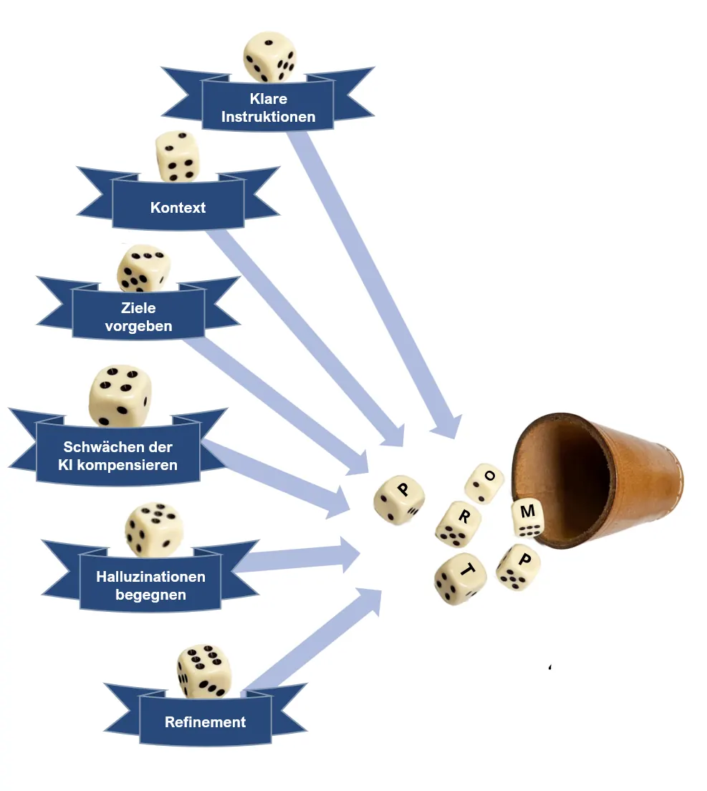

1. **Klare Instruktionen liefern**
    * Was sollen ChatGPT bzw. [**kiwi**](https://ki.uos.de) tun? Angaben präzisieren!
    * Strukturvorgaben machen
    * Länge der Antwort vorgeben
2. **Kontext**
    * Priming: Hintergrund-Infos oder Beispiele geben
    * Kriterien festlegen: Was soll die Antwort enthalten?
    * Referenzen liefern
3. **Ziele vorgeben**
    * Wofür brauchst du das finale Produkt?
    * Outputindikatoren: Typ (z.B. Gedicht), Datei-Format
    * Zielgruppe, Sprachstil
4. **Schwächen der KI kompensieren**
    * KIs kombinieren
    * Gib dem Modell Zeit zu "denken"
    * Aufgaben untergliedern in kleinere Unteraufgaben
5. **Sogenannten "Halluzinationen" begegnen (s. nächster Tab)**
    * Temperieren per Prompt oder Customize ChatGPT/kiwi, s.u)
    * [Weitere Parameter/Einstellungen](https://www.promptingguide.ai/de/introduction/settings) nutzen, z.B. maximale Länge oder Wiederholungen vermeiden (s.u.)
6. **Refinement**
    * Feedback geben, z.B. "Die Einleitung gefällt mir"
    * "Formuliere wissenschaftlicher/motivierender"
    * Nachfragen stellen (ggf. in neuem Chat)

Je nachdem, was du vorhast, musst du natürlich nicht jedes Mal alle diese exemplarisch zu verstehenden Strategien anwenden. Bei ChatGPT gibt es – wenn du links unten auf deinen Namen klickst – das Dropdown-Menü **Customize ChatGPT**, indem du dauerhafte Prompts als sogenannte **Parameter** konfigurieren kannst, um sie nicht jedes Mal eingeben zu müssen. Beispiele: "Erkläre mir grundsätzlich alles wie einem fünfjährigen Kind" oder "Vermeide, zu wiederholen oder zu paraphasieren, was du bereits genannt hast!"

Wenn du **kiwi** nutzt – den datenschutzkonformen Zugang verschiedenen LLMs, den die UOS allen ihren Angehörigen bietet (siehe Seite *Exkurs Datensouveränität* im Tab *Problematik KI-Tools*) – kannst du für dieses Tuning den sogenannten **System-Prompt** nutzen. Im Lehrportal der Universität findest du Details dazu im Blog-Artikel [*Gezieltes Prompting für maßgeschneiderteren KI-Output*](https://digitale-lehre.uni-osnabrueck.de/2024/05/29/gezieltes-prompting-fuer-massgeschneiderteren-ki-output/).

### Die sogenannten Halluzinationen\*

Die Sache mit den sogenannten Halluzinationen\*
===============================================

In Abbildung 3 ist die Faktentreue der ChatGPT-Versionen in Prozent abgetragen, sortiert nach verschiedenen Wissensbereichen: Je dunkler der Balken, desto neuer die ChatGPT-Version. Zu sehen sind technisch beeindruckende Leistungssteigerungen, z.B. von Version 3 zu 4. Nichtdestotrotz bleiben die sogenannten Halluzinationen, also das, wo du sagen würdest **"Das ist völliger Humbug"** auf einem stabilen Niveau von **20% Minimum** bei ChatGPT 4, das also mit immerhin fast 80% Faktentreue daherkommt. Schau in die Grafik: Der Balken für ChatGPT 3 indiziert eine Faktentreue von etwa 60% – Das ist nicht besonders viel, oder? Übrigens, nochmal zur Auffrischung: Der Begriff Halluzinationen wird von Experten ja zum Teil kritisiert, weil diese ein Bewusstsein wie beim Menschen voraussetzen, wie auf der Seite *Sprachmodelle: Nur stochastische Papageien?* bereits im Tab *LLM-Kritik* ausgeführt wurde.

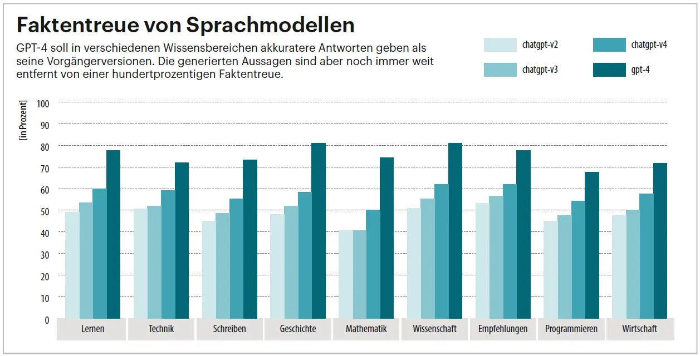<!-- style="width:53.7%" -->

Und genau diese sogenannten Halluzinationen werden uns bis zu einem gewissen Grad immer erhalten bleiben, wenn man der bereits zitierten Prof'in Doris Wessels glaubt. In gewisser Weise wird aus der Not eine Tugend gemacht, wenn es heißt, dass diese Quote als "Kreativität" ja gerade den Reiz und das Wesen dieser Technologie ausmacht. Das Beste daran ist vor allem: Du kannst den Grad dieser "Kreativität" einstellen, also jedenfalls im hiermit umrissenen Rahmen. Klick' einfach mal probehalber in die Prompting-Guides im nächsten Tab. Mit der **Temperierung** kannst du bei ChatGPT den Wert "Kreativ vs. Kohärenz/Konsistenz" an deine Wünsche anpassen.

Niedrigere Werte für die Temperierung führen zu konsistenteren Ergebnissen (z.B. 0,2), während höhere Werte vielfältigere und kreativere Ergebnisse erzeugen (z.B. 1,0). Wähle einen Temperierungswert, der dem gewünschten **Kompromiss zwischen Kohärenz und Kreativität** für deine spezifische Anwendung entspricht. Der Temperaturbereich reicht von 0 bis 2 und du kannst das einfach mitteilen – "Verwende für die Antwort auf die nächste Frage eine Temperatur von 0,7" – oder unter Customize ChatGPT hinterlegen.

"Erhebliche Ungenauigkeiten" selbst bei Internet-Zugriff
--------------------------------------------------------

Kann die Faktentreue von Sprachmodellen durch den Zugriff auf Internetseiten erhöht werden? Obwohl der Zugriff auf Online-Inhalte bei den meisten bekannten LLMS mittlerweile möglich ist, zeigen aktuelle Studien, dass sich diese Hoffnung bislang nicht erfüllt hat. Für eine im Februar 2025 veröffentlichte [**Studie der BBC**](https://www.bbc.co.uk/mediacentre/2025/bbc-research-shows-issues-with-answers-from-artificial-intelligence-assistants) erhielten ChatGPT, Copilot, Gemini und Perplexity Zugang zur BBC-Website und wurden mit Prompts angewiesen, diese bei den zu beantwortenden Fragen als Quelle zu nutzen, wann immer möglich. Das Ergebnis enthielt "erhebliche Ungenauigkeiten":

* 50 % der KI-Antworten wurden als signifikant problematisch in irgendeiner Form beurteilt
* 19% der KI-Antworten, die BBC-Inhalte zitierten, enthielten sachliche Fehler – falsche Tatsachen, Zahlen und Daten
* 13% der Zitate, die aus BBC-Artikeln stammen, wurden entweder verändert oder existierten in diesem Artikel nicht

Bei einer ähnlichen [**Studie, veröffentlicht im März 2025**](https://www.cjr.org/tow_center/we-compared-eight-ai-search-engines-theyre-all-bad-at-citing-news.php) im Columbia Journalism Review, nannten 60% der getesteten Sprachmodelle falsche Quellen. Außerdem wurde deutlich, dass Sprachmodelle Fragen, die sie nicht akkurat beantworten können nicht etwa ablehnen (dafür sind sie technisch nihct vorgesehen), sondern stattdessen inkorrekte oder spekulative Antworten geben (wie es ihrer Natur entspricht). **Sprachmodelle sind also generell nicht in der Lage, Informationen akkurat zu zitieren – selbst wenn sie direkt auf Websiten zugreifen können, die diese in korrekter Form enthalten.**

*\*Die Informationen in diesem Tab sind wissenswert, wenn du die Quizfragen im letzten Tab auf dieser Seite lösen möchtest.*

### Prompting-Guides\*

Prompting-Guides mit weiteren Strategien\*
==========================================

Die Guides in diesem Tab enthalten wertvolle Informationen von den Basics der ChatGPT-Bedienung bis hin zu teilweise sehr interessanten Funktionen und Einstellungsmöglichkeiten im Detail. Mit ihnen lässt sich ChatGPT so konfigurieren, dass du es in unterschiedlichsten Szenarien sinnvoll einsetzen kannst. Nebenbei gesagt gibt es darüber hinaus noch unzählige Plugins allein für dieses Sprachmodell, was in diesem Kurs aber nicht weiter behandelt wird.

Eine Online-Blitzrecherche ist definitiv empfehlenswert, um ein Gefühl dafür zu entwickeln, wie du eine Art des Umgangs mit ChatGPT finden kannst, der zu dir passt, je nachdem wofür du es einsetzen willst. Es gibt unzählige Sammlungen mit Tipps und du kannst sehr leicht Inspiration finden. Die folgenden beiden Dokumentationen haben uns selbst am meisten geholfen und sind auf jeden Fall ein **gutes Nachschlagewerk.** Prompting ist eine wirksame Methode, um das Lernen zu ergänzen und kann langfristig erfolgreich für unterschiedlichste Ziele eingesetzt werden.

Ein absolut empfehlenswertes Paper ist auch [**"Principled Instructions Are All You Need …"**](https://arxiv.org/pdf/2312.16171v1.pdf) von Bsharat et al. (2023), in dem 26 Prompt-Prinzipien formuliert werden. Hier erhältst du beispielsweise eine Antwort darauf, ob du beim Prompting notwendigerweise höflich sein solltest. Die sehr schön übersichtliche Liste findest du auf Seite 5 des Papers.

1. OpenAI Dokumentation
-----------------------

**AI**")<!-- style="width:39.56%" -->

Bevor du online umständliche Recherchen durchführst, egal ob mit einer Suchmaschine wie Google oder einem Sprachmodell wie ChatGPT und bevor du andere um Rat fragen musst ist das Beste, was du tun kannst: Lies einfach das Handbuch! RTFM ist im Netzjargon die Abkürzung für "Read the fucking manual". Tun kannst du das direkt hier in der [**ChatGPT-Dokumentation von OpenAI**](https://platform.openai.com/docs/guides/prompt-engineering). Speziell bei einfachen Problemen kannst du damit erst einmal selbst versuchen, sie zu lösen. Enthalten sind neben Strategien auch detaillierte Taktiken, wie diese umgesetzt werden können.

")<!-- style="width:45.75%" -->

2. DAIR Prompt Engineering Guide
--------------------------------

Das [**Distributed AI Research Institute (DAIR)**](https://www.dair-institute.org/) ist ein Raum für unabhängige, community-basierte KI-Forschung, frei vom allgegenwärtigen Einfluss der Big Tech. Der [**Leitfaden für Prompt Engineering**](https://www.promptingguide.ai/de) ist eins ihrer Projekte und hat zum Ziel, Forschende und Praktiker über Prompt Engineering aufzuklären. DAIR.ai strebt danach, die Forschung, Bildung und Technologien im Bereich der KI zu demokratisieren. Die Mission ist es, die nächste Generation von KI-Innovatoren und -Schöpfern zu ermöglichen.

Dieser Guide ist sehr übersichtlich. Du könntest **Grundlagen des Promtings** oder **Elemente eines Prompts** einfach mal nachschlagen. Unten links im Guide kannst du die Sprache switchen, allerdings sind im Bereich KI die meisten Begriffe Englisch und können maschinenübersetzt auf Deutsch potenziell zu Missverständnissen führen.

3. Die AI Master List: Konkrete Beispiel-Prompts
------------------------------------------------

Weder in der Dokumentation von openAI, noch in der von DAIR werden im nennenwerten Umfang Beispiele für konkrete Prompt-Formulierungen gegeben. Die [**AI Master List**](https://orange-boursin-948.notion.site/AI-Master-List-d9c3198ad4da45a59271acedb739392c) ist an dieser Stelle deshalb ein empfehlenswerter Guide, zumindest wenn du nach spezifischer Inspiration beim Prompting suchst. Auf der AI Master List findest du 1200 ChatGPT Prompts (und 1000 Midjourney-Prompts) – sehr hilfreich zum Einstieg! Künstlicher Intelligenz eine sinnvolle Frage zu stellen, ist gar nicht so einfach. Du brauchst wie gesagt vor allem Kontext, am besten selbst umfangreiches Wissen über den Gegenstand und eine genaue Vorstellung davon, wozu das Ergebnis dienen soll. Im Nebel stochern funktioniert ggf. nicht.

*\*Die Informationen in diesem Tab sind wissenswert, wenn du die Quizfragen im letzten Tab auf dieser Seite lösen möchtest.*

### Prompt-Arten\*

3 mögliche Prompt-Arten\*
=========================

Prompts sind ein wirksames Instrument zur **Förderung des kritischen Denkens** und der Fähigkeit zur **Entscheidungsfindung**, richtig eingesetzt können sie **unabhängiges Denken** und deine **Kreativität** fördern. In diesem Tab werden 3 Möglichkeiten zur Verwendung von Prompts betrachtet, und zwar nach Art des Prompts und Kontext des Gesprächs. Es kann eine ziemliche Herausforderung sein, herauszufinden, wie man ChatGPT-Prompts am effektivsten einsetzt, also klären wir das ein wenig auf.

Unter den verschiedenen Arten von Prompts gibt es **offene** Prompts, **spezifische** Prompts und **bedingte** Prompts. Offene Prompts geben kein sehr eng gefasstes Ziel für die Konversation vor und dir damit die Möglichkeit, Themen und Ideen Schritt für Schritt zu erkunden. Spezifische Prompts hingegen geben ein bestimmtes Thema oder eine dezidierte Frage für das Gespräch vor. Bedingte Aufforderungen erfordern eine bestimmte Antwort, bevor die Unterhaltung fortgesetzt werden kann.

1. Offene Prompts
-----------------

Wie du ChatGPT-Promtps am besten einsetzt, hängt von deinen jeweiligen Anforderungen ab. Bei offenen Prompts bist du dir zwar darüber im Klaren, worüber du sprechen möchtst, suchst aber beispielsweise nach **Inspiration**. Es kann hilfreich sein, mit einem weit gefassten Thema zu beginnen und es dann im Laufe des Gesprächs einzugrenzen. Auf diese Weise kannst du das Gespräch zielgerichtet führen und verhindern, dass es sich zu sehr ausweitet.

*TIPP: **Hab Geduld mit den Antworten von ChatGPT, da es einige Zeit dauern kann, gemeinsam eine durchdachte und kohärente Antwort zu erstellen.***

2. Spezifische Prompts - Priming
--------------------------------

Bei spezifischen Prompts ist eine präzise Formulierung und die Angabe von möglichst viel relevanten Kontext entscheidend. Dieses sogenannte Priming unterstützt das Sprachmodell dabei, die Anfrage angemessen zu gewichten und darauf basierend passende Antworten zu erzeugen. **Umfangreicher und klar strukturierter Kontext** erhöht in der Regel die Qualität der generierten Ergebnisse.

*TIPP: **Sei konkret - Gib Beispiele oder spezifische Details an, damit ChatGPT den Kontext des Gesprächs besser versteht.***

3. Bedingte Prompts
-------------------

Es gibt auch Prompts, die eine bestimmte Situation oder ein bestimmtes **Szenario simulieren** sollen. Diese Aufforderungen können hilfreich sein, um Kommunikationsfähigkeiten zu üben, Entscheidungen zu treffen oder Probleme zu lösen. Ein gutes Beispiel für diejenigen, die ihre Kommunikationsfähigkeiten verbessern oder sich auf reale Situationen vorbereiten wollen, könnte sein, ChatGPT zu bitten, ein Vorstellungsgespräch oder eine Interaktion mit anderen Menschen zu simulieren.

*TIPP: **Sei aufmerksam - Lass dich aktiv auf die Simulation ein, lass authentische Reaktionen zu und nutze konstruktiv Feedback.***

*\*Die Informationen in diesem Tab sind wissenswert, wenn du die Quizfragen im letzten Tab auf dieser Seite lösen möchtest.*

### Wir würfeln Wörter!

In diesem Video wird die Funktionsweise von Sprachmodellen mit Beispielen gemacht. Dabei wird deutlich, wie auf Basis der statistischen Verteilung von Wörtern die Texte tatsächlich **mal mehr oder mal weniger sinnvoll** "ausgewürfelt" werden können. Am Ende dieses Videos ([bei 11:53](https://youtu.be/68G3tOWiDt4?si=2f7u-t8eC_yW9PWl&t=713)) wird auch ausgeführt, warum ChatGPT bei kleinen Rechenaufgaben regelmässig versagt.

Ein gutes Beispiel für ein Ziel-Szenario, in dem du die KI mit einer anderen Software kombinieren oder dich auf die Suche nach einem speziellen ChatGPT-Plugin machen solltest.

!?[Wir Würfeln Wörter! So funktioniert ChatGPT! (Intuition)](https://www.youtube.com/watch?v=68G3tOWiDt4&start=58 "Wir Würfeln Wörter! So funktioniert ChatGPT! (Intuition) – Follow me, I am a professor")

### Quiz

**Quiz: Prompting-Strategien: Wie sag ich's meinem Bot?**

**1. Was sind einige Beispiele für Strategien bei der Formulierung von Prompts?**  
*Mehrere Antworten sind richtig.*

- [[ ]] Die Schriftstile kreativ formatieren.
- [[X]] Klare Instruktionen liefern.
- [[X]] Strukturvorgaben für die Ergebnisse machen.
- [[ ]] Emojis und GIFs einbinden.
- [[X]] Kontext und gegebenenfalls Beispiele geben.
- [[X]] Ziele benennen, wofür das Ergebnis eingesetzt werden soll.
- [[X]] Die jeweils spezifischen Schwächen der KI kompensieren.

**2. Was ist der Unterschied zwischen offenen, spezifischen und bedingten Prompts bei der Verwendung von KI-Sprachmodellen?**  
*Wähle die jeweils zutreffende Option.*

<!-- data-show-partial-solution -->
[[ Bedingte | (Offene) | Spezifische ]] Prompts ermöglichen es, Themen und Ideen schrittweise zu erkunden, während [[ bedingte | offene | (spezifische) ]] Prompts ein bestimmtes Thema oder eine dezidierte Frage vorgeben. [[ (Bedingte) | Offene | Spezifische ]] Prompts lassen eine bestimmte Situation simulieren oder ein Szenario, z. B. um Kommunikationsfähigkeiten zu üben oder in einer bestimmten Situation Anregungen für Lösungsmöglichkeiten zu erhalten.

**3. Wie kann man die Halluzinationen von KI-Sprachmodellen minimieren?**  
*Ergänze den Text mit den richtigen Wörtern.*

<!-- data-show-partial-solution data-randomize -->
Die [->[ Halluzinationen ]] von KI-Sprachmodellen können minimiert werden, indem man die [->[ Temperaturparameter ]] beim Generieren von Antworten anpasst. Bitte denke daran, dass [->[ niedrigere ]] Temperaturen zu [->[ konsistenteren ]] Ergebnissen führen, während [->[ höhere ]] Temperaturen zu vielfältigeren und [->[ kreativeren ]] Ergebnissen führen. Es ist wichtig, den richtigen Kompromiss zwischen Kohärenz und Kreativität zu finden.


# 3. Deskilling vs. Upskilling


3. Kompetenzentwicklung: Deskilling vs. Upskilling
==================================================

**Deskilling** bezeichnet den Kompetenzverlust in Folge technologischer Innovationen, Automatisierungen oder der Einführung neuer Methoden, wenn dies die Notwendigkeit für die Beherrschung bestimmter Fähigkeiten und Kenntnisse reduziert oder gar eliminiert. Die individuelle Erweiterung oder Vertiefung bestehender Fähigkeiten und Kenntnisse hingegen wird als **Upskilling** bezeichnet. Letzters kann sowohl in der Aneignung fortgeschrittener Techniken in einem Berufsfeld als auch im Erlernen neuer, ergänzender Fähigkeiten bestehen. Beispielsweise kann jemand, dessen Tätigkeit bisher im „händischen“ Erstellen von Texten bestand, durch das Erlernen von Fähigkeiten im Umgang mit generativer KI die Qualität seiner Arbeitsleistung deutlich steigern.

")<!-- style="width:30.06%" -->

Die Entwicklung der **Basiskompetenzen**, die du dir im Studium aneignen möchtest, kannst du nur selbst sicherstellen. Zu Beginn deines Studiums bist du Novizin oder Novize in deiner wissenschaftlichen Disziplin. Mit dem Abschluss willst du dir voraussichtlich eine gewisse **Expertise** in bestimmten Bereichen angeeignet haben. Welche Kompetenzen du unterdessen an die KI auslagerst bleibt – immer unter Berücksichtigung der KI-Richtlinien an deiner Uni (!) – dir selbst überlassen. Allgemein besteht ein wesentliches Ziel deines Studiums ja darin, sich selbst zu befähigen, wissenschaftliches Wissen in einer bestimmten **Domäne** bewerten zu können. Ein paar praktische Tipps, wie du diesem Ziel in Anwesenheit von KI-Technologien treu bleibst, findest du unten in den Tabs.

Abhängig davon, wo du dich im Prozess deines jeweiligen wissenschaftlichen Projektes oder deiner akademischen Entwicklung gerade befindest, kann KI-Einsatz **förderlich** oder **hinderlich** sein, um deine persönlichen Ziele zu erreichen (Abb. 1). Hier bietet sich der Vergleich mit einem modernen Automobil an, das heutzutage vollgepackt mit Assistenzsystemen daherkommt – in manch technologischer Funktionen ist es smarter als du. Das heißt, du musst dich an eine Menge mehr Details gewöhnen als nur ans Fahren! Im anbrechenden Zeitalter generativer KI-Avatare stellt sich somit die Frage: "Was kann die Technologie für mich tun? Wie lassen sich die vielen technologischen Helfer **proaktiv** zum Upskilling nutzen?"

Ohne Zweifel, KI-gestütze Technologien sind im Begriff, deinen Werkzeugkasten enorm zu vergrößern, die Möglichkeiten sind mitunter überwältigend. **Deine Aufgaben im Studium** bleiben im Kern weitesgehend die gleichen, sie werden durch die Verfügbarkeit von KI erweitert. Abzusehen ist, dass sich Änderungen zum Beispiel in Bezug auf Hausaufgaben- oder Prüfungsformate an Hochschulen ergeben.

> [!NOTE]
> In diesen Kapitel lernst du KI-unterstützte Recherche-Apps kennen, die extra für die wissenschaftliche Anwendung entwickelt wurden. Du willst KI zur Akademisierung einsetzen? Dann versprechen die mit ihnen verbundenen Techniken am ehesten Erfolg! Den Kurs abschließend kannst du auf der folgenden Seite sehen, wie du einen "Study Buddy" anlegst, um dich nach deinen Vorgaben coachen zu lassen.

## Akademische Expertise auf Knopfdruck?

Dass du Basiskompetenzen wie das Schreiben von strukturierten wissenschaftlichen Texten zunächst selbst erlernst, ohne sie an künstliche Intelligenz zu delegieren, ist von zentraler Bedeutung für eine fundierte akademische Ausbildung. Das eigenständige Erlernen dieser Fähigkeiten fördert nicht nur Fachkompetenz, kritisches Denken und die analytische Auseinandersetzung mit Inhalten, sondern schärft auch das grundlegende Verständnis für die **Methoden und Techniken wissenschaftlichen Arbeitens**. Kompetenzen wie diese sind essenziell als solide Grundlage für lebenslanges Lernen, da du so dein logisches Denkvermögen und Problemlösungsfähigkeiten trainierst.

 Verwendeter Prompt: “a big button generating academic excellence by hitting it one time only“")

Erst wenn diese grundlegenden Fertigkeiten **fest verankert** sind, kann KI als sinnvolles Werkzeug dienen, um deinen Aufwand bei komplexeren Vorhaben zu reduzieren und den Fokus auf anspruchsvollere Konzepte und Problemlösungsstrategien zu legen. Der bewusste Einsatz von KI kann so deine akademische Bildung **ergänzen**, ohne die Entwicklung essenzieller fachspezifischer Grundkompetenzen zu untergraben. Höhere kognitive Skills können unter der Voraussetzung erworben werden, dass KI nur diejenigen Aufgaben übernimmt, die du selbst bereits zu beherrschen gelernt hast.

Mit wachsendem Fachwissen sowie logischen bzw. kritischen Denken kannst du immer **elaboriertere Problemlösungsstrategien** und ein Verständnis komplexer Konzepte entwickeln, um fortgeschrittene Fähigkeiten im jeweiligen Fachgebiet zu erwerben. Der gezielte Einsatz von KI als unterstützendes Werkzeug im Lernprozess trägt dann zur Steigerung deiner Lernqualität und zur Erreichung höherer Ziele bei.

Vielleicht eher kein einzelner großer Knopf, sondern viele kleine!
------------------------------------------------------------

Solange sich wissenschaftliches Arbeiten darin begründet, sich über einen längeren Zeitraum profund mit individuell näher zu definierenden Themen auseinanderzusetzen, zu recherchieren und sich ein begründetes Urteil zum Sachstand zu bilden, solange lautet die Antwort auf die Frage aus der Überschrift: Individuelle akademische Expertise wird zwar sicherlich **nicht mit einem einzigen Knopfdruck auf die magische "KI-Taste"** generiert, aber doch mit sehr vielen kleinen Knopfdrücken nach und nach entwickelt – also genauso wie bisher auch, allerdings ab jetzt mit sehr viel mehr potenziell nützlichen KI-Helfern, falls du diese geschickt einzusetzen verstehst.

## Kritisch denken!

Exkurs: Was unterscheidet logisches und kritisches Denken?
==========================================================

Im vorhergehenden Tab wurde gesagt, dass sich akademische Expertise u.a. durch wachsendes logisches und kritisches Denken entwickelt. Aber was ist eigentlich der Unterschied zwischen logischem und kritischem Denken? Wir haben ChatGPT gefragt (Abb. 3).

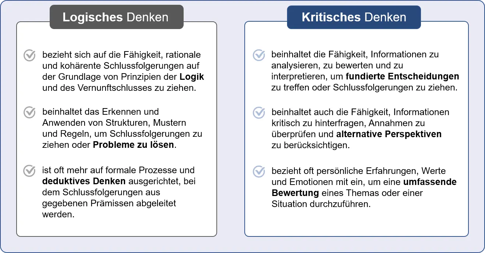<!-- style="width:60.35%" -->

Die individuelle Auseinandersetzung mit den von KI-Sprachmodellen wie ChatGPT generierten Antworten, also ihre Überprüfung durch deine

eigene Reflexion

ist selbstverständlich

förderlich für deine Akademisierung

. Ganz im Gegensatz dazu würde es deine Kompetenzentwicklung untergraben, wenn du alle KI-Antworten einfach für bare Münze nimmst, vorbehaltlos alles glaubst und ungeprüft übernehmen würdest, das wäre eher kontraproduktiv.

Im vorliegenden Fall können wir uns der von ChatGPT generierten Antwort anschließen: In gewisser Weise kann man sagen, dass kritisches Denken eine breitere Kategorie ist, die auch logisches Denken umfasst. Kritisches Denken umfasst nicht nur den reinen Prozess des logischen Schlussfolgerns, sondern bezieht auch andere Faktoren wie

Kontext, Perspektivenvielfalt und individuelle Erfahrungen

mit ein, um eine umfassendere Bewertung oder Entscheidung zu ermöglichen.

Es bleibt einordnend festzuhalten, dass diese Antwort natürlich leicht ist und ChatGPT vor keine Herausforderungen stellt, denn es handelt sich auch hierbei nicht um

Raketentechnik

. Der Unterschied zwischen logischem und kritischem Denken ist leicht nachzuschlagen und zum Beispiel in der Wikipedia gut erklärt, die auch Teil der Trainingsdaten von ChatGPT ist.

## Hybride Intelligenz\*

Der Schlüssel zum produktiven Verständnis von KI-Werkzeugen im Studium liegt in Form eines hybriden Konzepts von Intelligenz in deiner Hand: **Human-zentrierte hybride Intelligenz** wird charakterisiert durch eine Kombination von menschlicher und künstlicher Intelligenz, bei der Mensch und KI-System voneinander lernen, sodass Leistungen erbracht werden, die über das hinausgehen, was der Mensch oder die Maschine auf sich allein gestellt könnten (Rafner et al., 2021, S. 31). Um auf den Automobil-Vergleich zurückzukommen: Du willst selbstbestimmt gesteuert deine Studienziele erreichen? Dann mach dich am besten erstmal mit dem Cockpit vertraut und checke die "**akademischen Instrumente"**. Dieser Kurs hilft dir dabei, einige von ihnen werden auf der nächsten Seite exemplarisch vorgestellt. Mach dir auch ihre unterschiedlichen Einsatzgebiete klar, was gehört zum Beispiel eher zum **Entertainment-System** des Autos und wo schaltest du das **Navi** ein?

> [!NOTE]
> Studierende müssten im Laufe ihres Studiums einerseits eine generelle KI-Literacy ebenso wie fachspezifische Kompetenzen im Umgang mit KI aufbauen und sollten dazu (im Idealfall) mit KI-Systemen konfrontiert sein, die im Sinne der hybriden Intelligenz arbeiten (Reinmann, 2023). 

Dass KI dir auf Knopfdruck gut klingende Texte liefert, macht kritisches Denken, Reflexion und Recherche umso wichtiger. Es erscheint emfehlenswert, deine Informationskompetenz weiter auszubauen und die Antworten zu überprüfen, sind sie doch dafür bekannt, plausibel zu klingen, jedoch nicht unbedingt inhaltlich korrekt zu sein. KI-generierter Content ist bereits jetzt teilweise wirklich beeindruckend und die Technologie wird sich weiterentwickeln. Ebenso werden deine Ansprüche an eine KI steigen. **Du entscheidest**, an welcher Stelle du welche Werkzeuge einsetzt und auch, ob und bis zu welchem Grad du dich mit zusätzlich durch KI-generiertem Content und damit verbundenen Problemstellungen konfrontiert sehen willst. Abbildung 4 zeigt, was dir dabei hilft.

Das hilft dir dabei:
--------------------

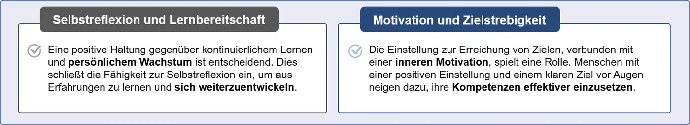

Zum Erwerb fachwissenschaftlich relevanter Kompetenz kommt zusammengefasst ab jetzt in gesteigertem Maße die Anforderung hinzu, als Partner\*in auf Augenhöhe mit KI im Sinn der o.g. human-zentrierten hybriden Intelligenz zusammenzuarbeiten. Neben dem nötigen Wissen und Können ist diesbezüglich nicht nur Motivation wichtig, sondern insbesondere Volition. Volition, auf Deutsch: Willenskraft, bezeichnet die **bewusste, willentliche Umsetzung von Zielen und Motiven in Resultate (Ergebnisse) durch zielgerichtete Steuerung von Gedanken, Emotionen, Motiven und Handlungen** (Baumeister & Tierny, 2012). Dieser Prozess der Selbststeuerung erfordert die aktive Überwindung von inneren und äußeren Widerständen wie zum Beispiel Unlustgefühlen oder Ablenkungen. Ebenso wesentlich hinzu kommt die praktische Erfahrung mit KI, die nur du selbst durch **Learning by Doing** zu gewinnen in der Lage bist.

*\*Die Informationen in diesem Tab sind wissenswert, wenn du die Quizfragen im letzten Tab auf dieser Seite lösen möchtest.*

## Chancen & Risiken\*

Chancen und Risiken im Studium\*
================================

Vielfach wird der Eindruck geäußert, dass es bei der zukünftigen Weiterentwicklung von Sprachmodellen zu qualitativen Sprüngen kommen könnte, was aber derzeit nicht sicher eingeschätzt werden kann. Reinmann et al. (2023) haben die aktuell diskutierten Chancen und Risiken übersichtlich erfasst. Wie sie zu berücksichtigen geben, sei relativ zu verstehen, was jeweils eine Chance und was eher ein Risiko ist – am Ende komme es auf die jeweils bestehende Wertebasis, Zielsetzung und den konkreten Kontext an, welche Bewertung sinnvoll und verantwortbar sei. Es folgt eine nochmals gekürzte Übersicht ihrer Ausführungen.

Chancen
============================================================

Entwicklung von Digital Literacy / Data Literacy / AI Literacy
------------------------------------------------------------

Über einen reflektierten Umgang mit ChatGPT kann man generell üben und erfahren, wie KI funktioniert, welche Folgen deren Einsatz hat und wie sie speziell die Arbeit mit und an Texten verändert. Konkret lässt sich erlernen, den Zweck der Erfassung und Verarbeitung von Daten sowie deren Herkunft, Zusammensetzung und Qualität kritisch zu hinterfragen.

Reflexion wissenschaftlicher Praktiken
--------------------------------------

Im Abgleich mit der KI kann man die eigene wissenschaftliche Praxis reflektieren (Ähnlichkeiten und Unterschiede).

Arbeitserleichterung bei standardisierten Schreibaufgaben
---------------------------------------------------------

ChatGPT zeigt sich in der Lage, brauchbare Vorschläge für Inhalte von Standard-Korrespondenz zu machen sowie erste Entwürfe im Rahmen standardisierter Textsorten zu generieren, mit denen man weiterarbeiten oder die man optimieren kann.

Überwindung von Anfangsbarrieren beim Schreiben
-----------------------------------------------

ChatGPT kann zum „Sparrings-Partner“ werden, indem er den Einstieg in ein Thema oder eine Aufgabe mit ersten Textvorschlägen erleichtert.

Förderung von Kreativität
-------------------------

ChatGPT kann die Funktion einer Kreativitätstechnik übernehmen, indem man auch unerwartete oder falsche Antworten konstruktiv nutzt, um z.B. ausgetretene Denkpfade zu verlassen oder eigene Denkprozesse anzuregen.

Generierung von Textbeispielen, -Zusammenfassungen und -Formaten
------------------------------------------------------------

ChatGPT kann Vorschläge für Textbeispiele erzeugen, längere Texte zusammenfassen (im Anschluss zu überprüfen) und von bestehenden Texten oder Vorgaben Vorschläge für spezielle Formate (z.B. Pressemitteilungen, Blogbeiträge) erstellen.

Texte optimieren und an verschiedene Bedarfe anpassen
-----------------------------------------------------

Bei bestehenden Texten kann Chat-GPT anhand von vorgegebenen Kriterien Vorschläge machen, wie der Text optimiert werden kann. Welche Qualität die Vorschläge haben, sollte allerdings vorab geprüft werden. Zudem können unterschiedliche Versionen eines Textes (z.B. für verschiedene Ziele oder Zielgruppen) generiert werden.

Risiken
============================================================

Sammlung von Nutzungsdaten
--------------------------

ChatGPT nutzt eingegebene Daten zur Formulierung von Antworten, allerdings ist unklar, wie genau die Rückmeldungen der User:innen in die Datengrundlage von ChatGPT einfließen.

Fehlerhafte und verzerrte Antworten
-----------------------------------

Antworten von ChatGPT können falsch oder fehlerhaft sein, je seltener das betreffende Wissen im Internet verteilt ist.

Bias-Gefahr und Training durch Eingaben
---------------------------------------

Sowohl die Auswahl der Daten als auch die dafür genutzte Sprache (Englisch) können zu einem Bias bei den Antworten führen.

Erschwerte Einschätzung der Ergebnisse
--------------------------------------

Die Quellen der Ergebnisse bleiben intransparent, das macht es schwierig, die Informationen zu bewerten. Da durch KI generierte Texte von Texten aus Menschenhand schwer zu unterscheiden sind, sind Fehlinformationen, ausgedachte Zitate etc. schwerer identifizierbar.

Unbezahlte Mitarbeit und künftiges Preismodell
----------------------------------------------

Eine Nutzung von ChatGPT ist ein unbezahlter Beitrag zur Weiterentwicklung eines Werkzeuges, für dessen kommerzielle Nutzung bereits Pläne durch Microsoft entwickelt wurden. Ob es parallel dazu weiter eine freie Nutzung geben wird, ist noch unklar.

Fehlende Berücksichtigung aktueller und wissenschaftlicher Quellen
------------------------------------------------------------

Zumindest derzeit ist die Datengrundlage von ChatGPT nicht aktuell, sodass wichtige Informationen fehlen können. Erkenntnisse aus wissenschaftlichen Studien, die nicht frei zugänglich sind, können ebenfalls nicht berücksichtigt werden.

Fehlinformationen
-----------------

ChatGPT generiert nicht nur Texte, sondern bietet auch Erklärungen für wissenschaftliche Zusammenhänge an. Neben falschen, zufällig generierten Zitaten oder Quellen sind dabei auch Fehlinformationen möglich, insbesondere wenn auf schnell auffindbare allgemeine Informationen gesetzt wird.

Ungeklärte Urheberschaft
------------------------

Es ist aktuell unklar, wie in Publikationen von ChatGPT erstellte Texte „zitiert“ werden und welche Kennzeichnungen erfolgen sollten. Dies gilt insbesondere, wenn ChatGPT z.B. „nur“ zum Finden einer besseren Formulierung eines vorher selbst geschriebenen Absatzes genutzt wird.

Unreflektierte und missbräuchliche Nutzung
------------------------------------------

Es besteht die Gefahr, dass Studierende ChatGPT & Co. unreflektiert nutzen, Aufgaben zur Texterstellung und -rezeption an die KI delegieren und damit wichtige akademische Kompetenzen nicht mehr selbst entwickeln.

*\*Die Informationen in diesem Tab sind wissenswert, wenn du die Quizfragen im letzten Tab auf dieser Seite lösen möchtest.*

## Lernziele für Studierende

Lernziele in Bezug auf KI
=========================

Wie lassen sich Sprachmodelle wie ChatGPT beim wissenschaftlichen Arbeiten einsetzen, ohne für dich als Student\*in kontraproduktiv wird, weil es den Aufbau deiner wissenschaftlichen Expertise substituiert und du somit ein potenzielles Deskilling riskieren würdest? In diesem Tab folgen Beispiele für Anwendungsszenarien, wie du KI zum Upskilling nutzen kannst. Salden & Leschke (2023) haben exemplarische, **auf KI bezogene Lernziele für Studierende** formuliert, die auch den Zielen dieses Kurses entsprechen:

* Studierende sollten die **Funktionsweise** von KI-basierten Schreibwerkzeugen sowie die **Möglichkeiten und Grenzen** der Unterstützung durch solche Werkzeuge erklären und beurteilen können.
* Die Studierenden sollten KI-basierte Schreibwerkzeuge im Sinne von Schreibassistenzsystemen für ihre akademische Textproduktion so einsetzen können, dass sie sie bei der Formulierung, Schärfung von Ideen und Argumentation sowie ggf. bei der stilistischen Überarbeitung **unterstützen**. Dazu gehört auch die Fähigkeit, den Textoutput von KI-Schreibwerkzeugen zu **reflektieren**, zu bearbeiten und in eigene Textstrukturen zu **integrieren**.
* Die Studierenden sollten in der Lage sein, die **rechtlichen Rahmenbedingungen** für den Einsatz von KI-basierten Schreibwerkzeugen (z.B. Kennzeichnungspflichten) zu erkennen und auf die eigene Textproduktion anzuwenden.

## Quiz

**Quiz: Kompetenzentwicklung: Deskilling vs. Upskilling**

**1. Was versteht man im Kontext von Kompetenzentwicklung unter Deskilling und Upskilling?**  
*Ordne die Begriffe Deskilling und Upskilling der jeweils richtigen Beschreibung zu.*

[(Deskilling) (Upskilling)]
[ (X) ( ) ] Bezeichnet den Prozess, bei dem durch technologische Veränderungen oder Automatisierung die Notwendigkeit für bestimmte Fähigkeiten im Arbeitsprozess reduziert oder eliminiert wird.
[ ( ) (X) ] Bezeichnet die individuelle Erweiterung und Vertiefung der bestehenden Fähigkeiten und Kenntnisse, um die Kompetenz zu steigern.

**2. Wie kann die Nutzung von KI im Studium dazu beitragen, die Qualität der akademischen Bildung zu ergänzen?**  
*Eine Antwort ist richtig.*

- [( )] KI kann alle notwendigen Aufgaben und Bewertungen generieren, was die Notwendigkeit von studentischem Engagement und kritischem Denken verringert.
- [( )] KI kann die Notwendigkeit des Lernens für die Studierenden völlig überflüssig machen und für eine sofortige Wissensaufnahme sorgen.
- [(X)] KI rationalisiert Routineaufgaben und verschafft den Studierenden Zeit, um komplexere Probleme anzugehen und ihre Fachkenntnisse zu verbessern.

**3. Warum ist es wichtig, die rechtlichen Rahmenbedingungen für den Einsatz von KI-basierten Schreibwerkzeugen zu beachten?**  
*Ergänze den Text mit den richtigen Wörtern.*

<!-- data-show-partial-solution data-randomize -->
Es ist wichtig, die rechtlichen [->[ Rahmenbedingungen ]] für den Einsatz von KI-basierten [->[ Schreibwerkzeugen ]] zu beachten, um sicherzustellen, dass die Nutzung dieser Werkzeuge im Einklang mit den geltenden [->[ Gesetzen ]] und Richtlinien steht. Dies umfasst beispielsweise Kennzeichnungspflichten für von KI generierte [->[ Inhalte ]] und die Einhaltung von Datenschutzbestimmungen.


## TOOLCHECK 2: Wissenschaftliche Recherche-Apps

TOOLCHECK 2: Wissenschaftliche Recherche-Apps
=============================================

Auf den letzten Seiten wurde bereits viel darüber berichtet, wie du einigen Limitierungen von Sprachmodellen entgegenwirken und sie individuell anpassen kannst (z.B.: Customize ChatGPT). Trotz der immensen und zu recht so populären Möglichkeiten von ChatGPT & Co. wurden währenddessen auch Gründe erläutert, die die **Eignung solcher "Standard"-Sprachmodelle im Studium** allerdings stark einschränken können. Hier geht es jetzt zunächst im Prinzip weiter um Strategien, wie du die dort bereits beschriebenen blinden Flecken kompensieren kannst, die ChatGPT & Co. ("solo" eingesetzt) eigentlich für den wissenschaftlichen Einsatz disqualifizieren würden, und zwar – Surprise! – durch Kombinieren mit KIs zur Recherche und Literaturverwaltung bzw. indem du ChatGPT am besten gleich komplett mit im akademischen Umfeld üblichen Tools ersetzt! Diese Tools, die Sprachmodelle wie ChatGPT bereits integrieren, basieren auf Datensätzen, die überwiegend aus akademischen Papern bestehen und liefern dir auch die korrekten Quellen sowie viele weitere Angaben mit, die für das wissenschaftliche Arbeiten sehr förderlich sein können.

Unsere besondere Empfehlung: Perplexity.ai
------------------------------------------

**i**")<!-- style="width:44.29%" -->

Am Beispiel [**Perplexity**](https://www.perplexity.ai/) erläutert, erstellt die KI erstellt Zusammenfassungen zu Fragestellungen und nennt entsprechende wissenschaftliche Quellen. In der Basisversion ist sie ohne Account nutzbar. Hier erkennt man sehr gut die **zielführende Kombination von akademischer Suchmaschine und Sprachmodell**, was absolut einleuchten sollte, wenn du die bisherigen Seiten aufmerksam gelesen hast. Das folgende Video zeigt, wie dank Perplexity mit ChatGPT als Copilot, also zuschaltbarem Plugin, "Halluzinationen" reduziert werden sowie Quellenangaben eingesehen und evaluiert werden können: "Suche nach weiteren Quellen" oder "Prüfe, ob xy richtig ist" wären mögliche Prompts.

**In diesem Tool Tip Tuesday-Video** bekommst du viele praktische Tipps und kannst sehr gut nachvollziehen, wie quellenbasierte Recherche mit KI funktioniert. Das spart viel Zeit, weil man schnell viel lernen kann. Die Highlights:

* [\[11:50\]](https://youtu.be/FaSDZnNoFwY?si=13SeWq85IKJEi7oK&t=710) Einstellmöglichkeiten: Ai-Profile/Custom Instructions
* [\[15:30\]](https://youtu.be/FaSDZnNoFwY?si=13SeWq85IKJEi7oK&t=930) Ergebnisvergleich mit und ohne ChatGPT als Copilot
* [\[16:10\]](https://youtu.be/FaSDZnNoFwY?si=cV4oF_5ZrMlHUE8D&t=970) Copilot = ChatGPT 4 umsonst (!) 5 Prompts alle 4 Stunden
* [\[17:16\]](https://youtu.be/FaSDZnNoFwY?si=Vic0WDmadfk6WKhB&t=1036) Bei Quellen trotzdem immer selber prüfen, ob man die wirklich nehmen will (Boulevard-Zeitung als Beispiel lässt sich löschen)
* [\[20:00\]](https://youtu.be/FaSDZnNoFwY?si=TFMoJlVr2HUXQbus&t=1200) **Nichts selber hochladen, was einem nicht selbst gehört!**
* [\[23:25\]](https://youtu.be/FaSDZnNoFwY?si=vp2FtdDSCHvj_3vS&t=1405) Perplexity als Chrome AI Companion, also Chrome-Plugin einrichten und Online-Artikel zusammenfassen und faktenchecken lassen

Im Video wird auf "relativ komische Terms of Service" hingewiesen: Du erteilst dem Unternehmen den **vollen Zugriff auf alle deine Inhalte, mit einer weltweiten Lizenz zur Vervielfältigung.** Also vergewissere dich immer, ob du die Rechte hast, geschützte Dokumente einzustellen!

!?[TOOL TIP TUESDAY mit Lasse Bremer und Max Behrens: Perplexity.AI](https://www.youtube.com/watch?v=FaSDZnNoFwY "TOOL TIP TUESDAY mit Lasse Bremer und Max Behrens: Perplexity.AI – KI-Campus")

> [!TIP]
> Die auf dieser Seite vorgestellten KIs erweitern Sprachmodelle wie ChatGPT um Optionen, mit denen deine Quellenrecherche sinnvoll ergänzt und beschleunigt wird. Die Qualität der Quellen ist allerdings auch hier nicht immer geprüft. Es kann sehr wohl weitere Quellen geben, die von dir selbst miteinzubeziehen wären. Deshalb eignen sie sich EINGESCHRÄNKT zur systematischen Literaturrecherche, sie geben einen guten ersten orientierenden Einblick in das wissenschaftliche Feld.

### Elicit

Elicit - Highlights
===================

")<!-- style="width:26.89%" -->

[**Elicit.com**](https://elicit.com/) ist eine App bzw. Seite so ähnlich wie Google Scolar, also eine Suchmaschine für Researchpaper, die jedoch zusätzlich KI nutzt und so die Suchergebnisse präziser und aussagekräftiger macht. Du brauchst also nicht mehr wie bei Google Scolar jedes einzelne Paper öffnen und selbst checken.

Nein, diese KI ist viel effektiver und nimmt dir bei der Literaturrecherche ganz viel Fleissarbeit ab. Du kannst nicht nur Schlagworte, sondern sogar ganze Fragestellungen eingeben und bekommst eine kurze Zusammenfassung der Paper geliefert, was super hilfreich und eine unglaubliche Erleichterung ist.

Funktionstest
-------------

Nach der Eingabe einer Suchanfrage präsentiert dir Elicit zunächst aus semantisch zu der Anfrage passenden Veröffentlichungen die 8 relevantesten Treffer, die thematisch sortiert dargestellt werden. Durch das Einbinden eines GPT-Sprachmodells kannst du sogar Fragen zu den Veröffentlichungen stellen. Darüber hinaus unterstützt dich Elicit dabei, Abschnitte aus den Veröffentlichungen zu zitieren und liefert Vorschläge, welche Zitate für deine Anfrage am relevantesten sein könnten. Du kannst Literatur zu einer Forschungsfrage suchen, Zusammenfassungen erstellen, Fragestellungen anpassen, Texte umschreiben und mehr. Also: Warum nicht mal für deine nächste Hausarbeit merken?

Video-Tutorial 1:

Dieses

**8-minütige Video**

, bereitgestellt von Elicit selbst, ermöglicht einen exzellenten Einstieg die Basisfunktionen und einige Einstellungen.

Video-Tutorial 2:

In 20 Minuten

wird

**hier**

gezeigt, wie Suchen in Form von Forschungsfragen gestartet werden können, wie zu möglichen Treffern auch eine Zusammenfassung der Publikationen generiert und wie relevante Details aus den gefundenen Texten für einen schnellen Überblick angefragt werden können.

### Connected Papers

")<!-- style="width:32.76%" -->

Connected Papers - Highlights
=============================

Mit [**Connectedpapers.com**](https://www.connectedpapers.com/) kannst du akademische Paper anhand visueller Graphen explorieren, d.h. thematisch ähnliche Artikel finden, wenn mensch ein Paper eingibt. Diese Visualisierung (die übrigens auch andere Apps anbieten – siehe Research Rabbit im nächsten Tab) ist ein deutlicher Mehrwert.

Connected Papers unterstützt als wissenschaftliche Literatur- und Netzwerkplattform dabei, relevante und verwandte wissenschaftliche Publikationen zu finden und zu vernetzen. Genutzt wird die Datenbank von Semantic Scholar mit Hunderten von Millionen Artikeln, die im übernächsten Tab vorgestellt wird.

Funktionstest
-------------

Der interaktive Graph zeigt anhand der Farbe der Treffer das Erscheinungsjahr, also die Aktualität und die Menge der Zitationen des jeweiligen Artikels, gibt also die Relevanz des Papers an. Du kannst sehen, wenn Paper auf diese Weise miteinander verbunden sind, wobei die räumliche Nähe anzeigt, wie eng diese Verbindung ist, d.h. heißt es bilden sich Cluster je nach Relevanz, was natürlich ein Mehrwert ist. Erhalte einen visuellen Überblick über das dich interessierende wissenschaftliche Feld und vergewissere dich, dass du kein wichtiges Paper übersehen hast – gemessen an den im Fundus vorhandenen. Exploriere die relevantesten vorhergehenden und davon abgeleiteten Artikel und nutze die KI als Unterstützung/Assistent, um das Literaturverzeichnis für deine Haus- oder Abschlussarbeit zu erstellen – vorzugsweise in einem human-zentrierten hybriden Intelligenz Setting.

Video-Tutorial:

Dieses

**9-minütige Video**

ist sehr informativ und klar erklärt und kann dir wirklich bei deinem akademischen Schreiben helfen.

### Research Rabbit

")<!-- style="width:29.79%" -->

Research Rabbit - Highlights
============================

Ähnlich wie connected papers gibt [**ResearchRabbit.ai**](https://www.researchrabbit.ai/) Zitationsnetzwerke aus. Anhand eines Ausgangstextes, einer Stichwortsuche oder einer Suche via Forschungsfrage stellt es die Beziehungen zu weiteren Texten und Autor\*innen graphisch dar.

Research Rabbit hat eine benutzerfreundliche und intuitive Benutzeroberfläche und wurde entwickelt, um das viele zeitaufwändige Hin und Her zwischen verschiedenen Suchmodi und Datenbanken "down the rabbithole" bei der Recherche zu automatisieren.

Funktionstest
-------------

Die verwendete Sprache ist, wie bei anderen Apps auch, idealerweise Englisch. Die Suche basiert auf Schlagwörtern und diversen Filtermöglichkeiten, mit denen Experten zu einem Thema bzw. häufig zitierte Autor\*innen eines Fachgebietes erkannt werden. Research Rabbit ermöglicht die Suche nach ähnlichen Texten zu einem Thema, ohne das weitere Suchbegriffe eingegeben werden müssen und verlinkt zu Originalquellen, teilweise hängen die PDFs auch an. Die Suchergebnisse können thematisch sortiert in Collections gespeichert werden, die auch öffentlich geschaltet werden können, sodass andere Nutzer die Quellensammlung einsehen können. Für den eigenen Gebrauch kannst du jedem Dokument Notizen und Annotationen hinzufügen, um es später leichter zu finden.

Video-Tutorial 1:

Dieser

**Appetitzer**

dauert nur 48 Sekunden, zeigt die attraktive Benutzeroberfläche und lässt ihre intuitive Bedienung erahnen.

Video-Tutorial 2:

Hier noch ein

**ausführlicheres, gut gemachtes Video**

. Es zeigt in 12 Minuten, wie viele repetetive, aber unbedingt notwendige Tätigkeiten an die App ausgelagert und dadurch das Ziel wesentlich früher erreicht werden kann, während man sich weniger aus dem Flow bringen lässt und viel produktiver ist. Auch der Unterschied zu Connected Papers (siehe vorheriger Tab) wird thematisiert.

### Semantic Scholar

Semantic Scolar - Highlights
============================

")<!-- style="width:28.62%" -->

[**Semantic Scolar.org**](https://www.semanticscholar.org/) ist eine sehr große und sehr bekannte wissenschaftliche Datenbank – also eine Datenbank, in der alle erforderlichen Angaben dezidiert eingepflegt sind, die bei Sprachmodellen wie ChatGPT fehlen. Anmeldung und Nutzung sind kostenlos. Das Ziel einer wissenschaftlichen Datenbank ist, zuverlässig wissenschaftliches Arbeiten zu unterstützen. Das Ziel eines Sprachmodells ist, Sprache zu (re)produzieren.

Diese KI-gestütze Suchmaschine geht über die Suche nach Stichwörtern hinaus und versucht den eigentlichen Inhalt zu verstehen, deshalb "semantic". Sie wird auch von anderen Apps/Seiten/KIs wie Connected Papers und Research Rabbit genutzt.

Funktionstest
-------------

Auch bei Semantic Scolar ist die Suchsprache idealerweise Englisch. Quellen können anhand von Stichwort- oder Personen-Suche exploriert werden. Den Suchergebnissen werden mit TLDRs (Too Long; Didn't Read) eine kurze Zusammenfassung des Textes von einem Satz vorangestellt werden, längere Abstracts können bei Bedarf ausgeklappt werden, außerdem gibt es Fenster mit Zitationen. Super ist, das Grafiken aus den Publikationen gezogen und angezeigt werden, damit du sie dir schon mal anschauen kannst, ohne den Link zu öffnen. Über das *Research Dashboard* werden ähnliche Quellen vorgeschlagen, im *Research Feed* werden die Ergebnisse der letzten Recherchen angezeigt.

Video:

In diesem knapp

**17-minütigen Video**

wird kurz und knapp, klipp und klar gezeigt, was Semantic Scolar kann und was nicht.

### SciSpace

")<!-- style="width:41.76%" -->

SciSpace - Highlights
=====================

[**SciSpace.com**](https://scispace.com/) bietet unter anderem Hilfe bei der Recherche, Textanalyse sowie beim Zitieren und Formulieren an. Du kannst dir hier mögliche Forschungsfragen zu einem Thema vorschlagen lassen, wenn du einzelne Begriffe eingibst.

Auch diese Plattform recherchiert anhand von Forschungsfragen nach möglichen Quellen und erstellt dir Zusammenfassungen, sogenannte Insights. Wer Google Chrome nutzt, kann den Copilot aktivieren, was (limitert) auch kostenfrei funktioniert.

Funktionstest
-------------

Auch hier ist die Suchsprache idealerweise Englisch, es gibt aber auch über 70 andere Sprachen, aus denen du auswählen kannst. Und auch hier können neben der Originalquelle und den im Artikel enthaltenen weitere, ähnliche Quellen exploriert werden, jedenfalls wenn sie im Volltext vorliegen. Im Bereich Analyse kannst du mittels Copilot Verständnisfragen zum Text stellen – die (Achtung!) ~~nicht~~ verifiziert werden können, falls der Volltext nicht vorliegt, hier dementsprechend auf jeden Fall aufpassen! Das ist natürlich eine super wertvolle Funktion, mit der du bei Quellen, die als PDF vorliegen, Passagen im Text markieren und sie dir erklären lassen kannst. Im unten verlinkten Video heißt es dazu, man könne PDFs nicht einfach nur lesen, sondern mit ihnen interagieren. Eine weitere interessante Funktion ist, dass du in den PDFs mit verschiedenen Farben annotieren und bearbeiten kannst.

Video:

Dieses knapp

**6-minütige Video**

zeigt vorweg kurz, was im Allgemeinen zu einem Literatur Review gehört und führt dann, orientiert an einem sich durchziehenden Beispiel, durch die Anwendung und Vorteile der Features/Funktionen.

### Quillbot

")<!-- style="width:22.06%" -->

Quillbot - Highlights
=====================

[**Quillbot.com**](https://quillbot.com/) ist ebenfalls super nützlich beim Schreiben von Texten. Die Bedienoberfläche mit den zwei großen Textfeldern erinnert zunächst an Übersetzer/Texteditoren wie DeepL oder Grammarly. Dieses Tool allerdings ist spezialisiert darauf, Texte zu paraphrasieren, also z.B. präziser oder einfacher zu formulieren.

Die Versprechung lautet: "Jetzt kannst du dich darauf konzentrieren, was du schreibst, nicht *wie* du es schreibst". Und obwohl Quillbot einiges mehr als nur paraphrasieren kann, bringt es diese Aussage ganz gut auf den Punkt: denn schreiben musst selbstverständlich immer noch du.

Funktionstest
-------------

Neben paraphrasieren kann Quillbot noch wesentlich mehr, wie du anhand der vielen Funktionen sehen kannst, die am linken Bildschirmrand aufgelistet sind. So manche davon eröffnen sich dir allerdings nur in der bezahlpflichtigen Premium-Version. Du kannst Text umschreiben, zusammenfassen, Literaturlisten für deine Bachelorarbeit generieren, übersetzen, die Rechtschreibung überprüfen ("Behebe alle Fehler") und außerdem gibt es eine Funktion zur Plagiatsprüfung. Du kannst also beispielsweise alternative Formulierungen und Synonyme für einzelne Wörter oder ganze Sätze generieren lassen oder die wichtigsten Aspekte eines Dokuments in einem kurzen Text extrahieren lassen. In der kostenlosen Version ist dies allerdings auf 125 Wörter begrenzt.

Der KI-Assistent heißt Quillbot Flow (Anmeldung erforderlich) assistiert dir beim Schreiben, übernimmt es aber nicht. Quillbot ist kompatibel mit anderen Plattformen wie Chrome, MS Word und MacOS sowie verfügbar in verschiedenen Sprachen, darunter Deutsch. Wie bei allen hier vorgestellten Tools ist grundlegend allerdins zu beachten, dass du dich immer selbst davon überzeugen solltest, dass die Programme deine Vorhaben zuverlässig umsetzen, was sie eindeutig nicht immer zu 100% tun! Die Qualität der Übersetzungen, Umschreibungen oder Zusammenfassungen kann je nach Sprache variieren, dadurch ist es gut möglich, dass sich der Sinn oder der Ton des Originaltextes verändert.

Video:

Dieses gut

**8-minütige Video**

gibt einen  sehr umfassenden Einblick in viele Quillbot-Funktionen/Features in kurzer Zeit.

### Vorsicht ist besser als Nachsicht\*

Die auf dieser Seite vorgestellten Tools machen Studieren wirklich einfacher, wenn du schriftliche Arbeiten erstellen willst, vor allem bei der Recherche. In den vorhergehenden Tabs wurde ihre Funktionsweise anhand einiger Highlights kurz vorgestellt, um beispielhaft mögliche Anwendungsszenarien zu skizzieren. Beachte, dass nicht alle Funktionen von jedem Tool aufgeführt sind, es kann also noch weitere Gemeinsamkeiten und Unterschiede geben, sowie natürlich weitere Tools, die hier gar nicht erwähnt wurden. Letztlich gilt es, auszuprobieren und diejenigen bzw. dasjenige zu finden, das am besten zum konkreten Einsatzzweck und deinem persönlichen Arbeitsstil inkl. der von dir bevorzugten Usability passt.

Komplett unabhängig von der jeweiligen KI oder dem akuten Einsatzzweck halte dir aber bitte **immer** eine Liste wie die folgende (vgl. Hattenhauer, 2023) vor Augen. Wenn du mit ruhigem Gewissen wissenschaftlich arbeiten und dich auf die Inhalte konzentrieren willst, solltest du dir im Vorfeld etwas Zeit dafür einplanen, damit du später mehr Ruhe hast. Deine Konzentration wird dann nicht von "Nebensächlichkeiten" bzw. Formalia absorbiert und du kannst dich voll und ganz auf die wirklich wichtigen, die inhaltlichen Fragen fokussieren.

In der Regel gelten Vorgaben der Hochschule, deiner Prüfenden und/oder es sind Fragen zu klären, wie du sie in der folgenden Liste findest.

Stimmen die Fakten?
-------------------

Sind die KI-generierten Aussagen korrekt oder hören sie sich nur gut an?

Existieren die Quellen wirklich?
--------------------------------

Woher stammen die Ergebnisse?

Urheberrecht
------------

Ist das Material evtl. geschützt?

KI-KENNZEICHNUNGSPFLICHT ⚠️
---------------------------

Was sagen die Prüfungsrichtlinien deiner Uni oder Hochschule?

Datenschutz
-----------

Keine personenbezogenen oder vertraulichen Daten (z.B. unveröffentlichte Forschungsergebnisse oder Geschäftsgeheimnisse) teilen!

Deepfakes
---------

Beachte stets die Gefahr von Fake Content **(**Fiktion vs. Fakten)!

Rechnungen
----------

Werden Kalkulationen sachgerecht durchgeführt? Nein, Sprachmodelle sind von Natur aus ~~keine~~ guten Taschenrechner! Der Vergleich von Sprachmodellen mit Taschenrechnern ist zwar sehr populär, übersieht aber eine wesentliche Tatsache: Taschenrechner liefern keine falschen Ergebnisse!

Wenn du auf den letzten Seiten gut aufgepasst hast, weißt du, dass einige dieser Fragen bei der Verwendung von Sprachmodellen wie ChatGPT bislang prinzipiell **nicht** zufriedenstellend beantwortet werden können. Dadurch ist hoffentlich deutlich geworden, warum ihre Verwendung im akademischen Kontext ernstzunehmende Probleme verursachen kann. Wenn du aktuelle Sprachmodelle wie ChatGPT (Stand: Juli 2024) wissenschaftlich anwenden willst, solltest du das wirklich nur sehr eingeschränkt tun … und dabei extrawachsam sein! **UNBEDINGT IMMER BEACHTEN**, dass sie dich bei der Generierung wissenschaftlicher Basiskompetenzen nicht wie akademische Datenbanken und Apps bzw. Webseiten unterstützen können. Und selbst die Tools auf dieser Seite – obwohl extra für diesen Zweck entwickelt – geben dir **~~keine~~ 100% Sicherheit** auf Knopfdruck. Die finale Verifikation liegt bei Dir!

*\*Die Informationen in diesem Tab sind wissenswert, wenn du die Quizfragen im letzten Tab auf dieser Seite lösen möchtest.*

### Quiz

**Quiz: TOOLCHECK II: Wissenschaftliche Recherche-Apps**

**1. Was sind einige wichtige Faktoren, die bei der Verwendung von KI-Tools für die akademische Recherche beachtet werden sollten?**  
*Entscheide bei jedem Faktor: Ja oder Nein?*

[(Ja) (Nein)]
[ (X) ( ) ] Validierung der Fakten
[ ( ) (X) ] Beliebtheit des KI-Tools unter den Peers
[ (X) ( ) ] Existenz und Zuverlässigkeit der Quellen
[ (X) ( ) ] Urheberrecht
[ (X) ( ) ] Einhaltung von Kennzeichnungspflichten gemäß den Prüfungsrichtlinien der Hochschule
[ ( ) (X) ] Markenname des Herstellers des KI-Tools
[ (X) ( ) ] Datenschutz
[ ( ) (X) ] Funktionen ohne Bezug zu akademischen Aufgaben
[ (X) ( ) ] Gefahr von Fake Content


## Einen eigenen "Study Buddy" konfigurieren

Einen eigenen "Study Buddy" konfigurieren
=========================================

<!-- style="width:46.07%" -->

Persönlich konfigurierbare KI-Assistent\*innen haben ein wirklich großes Potenzial, Studieren einfacher zu machen. Oder sagen wir lieber, du kannst sie punktuell einsetzen, um **individueller** zu lernen und dich **effektiver** – im Sinne von zielführender – beispielsweise auf Prüfungen vorbereiten. Und dabei eventuell sogar noch Zeit sparen.

Das gilt natürlich nur, wenn die Datenbasis des Sprachmodells deine Lerninhalte beinhaltet und nichts "hinzudichtet" oder verfremdet. In Abbildung 1 siehst du ein populäres Motiv für die Visualisierung dieser Art von Lernpartnerschaft – der Bot als Ping Pong Partner\*in. Schau mal genauer hin: Der Bot-Oberkörper wurde ~~auf~~ der Ping-Pong-Platte abgebildet, der Schläger ist eckig und die Tischbeine werden in Wirklichkeit eigentlich auch irgendwie anders platziert, oder? Diese sogenannten **Artefakte** sind bei KIs normal, und zwar nicht nur bei Bildgeneratoren – obwohl man sie dort schneller erkennt als bei Texten.

KI-Assistent\*innen erstellen ist viel leichter, als du vielleicht denkst
------------------------------------------------------------

Folge den super simplen Anleitungen in den Tabs unten auf dieser Seite: wobei konkret können sie dich unterstützen? Diese dynamischen, interaktiven Assistent\*innen können bei der Vermittlung von Inhalten helfen, sofortiges Feedback geben, 24/7 auf dich eingehen und **personalisierte Lernpfade** ermöglichen. Übrigens könnten KI-Chatbots schon bald in vielen Softwares das neue Normal sein, bei Microsoft beispielsweise bereits als "Copilot" bekannt. Aber von diesen Bots in spezifischen Softwares reden wir hier jetzt eigentlich gar nicht, es geht vielmehr um dich und wie leicht du einen eigenen Lernbot erstellst.

Mach mehr aus Standard-Sprachmodellen: persönliche Lerntutor\*innen, die sich dir anpassen, in dem sie dir erweiterte Erklärungen oder Beispiele liefern oder dich **nach deinen Vorgaben** gezielt testen. Auch könntest du problemlos Nachfragen stellen, die du in der Vorlesung vor Professor\*innen und Kommiliton\*innen vielleicht nicht so formulieren würdest.

Character.ai als Beispiel für das Funktionsprinzip "Coach/Lernbot"
------------------------------------------------------------

Auf [**Character.ai**](https://character.ai) kannst du mit Bots chatten, die beispielsweise Stars oder Filmfiguren imitieren. Die Nutzer\*innen können individuelle "Charaktere" kreieren und deren "Persönlichkeiten" formen, indem sie **spezifische Eigenschaften definieren**. Anschließend können sie diese in der Community veröffentlichen, um anderen die Interaktion mit ihnen zu ermöglichen. Viele dieser Charaktere sind von fiktiven Medien oder Prominenten inspiriert. Sie können beispielsweise als Unterstützung beim kreativen Schreiben dienen oder als Fitness-Assitent\*in dabei helfen, deine Workout-Ziele zu definieren und einzuhalten.

Voraussetzungen für Lernbots
----------------------------

Einem Bot erfolgreich zu integrieren erfordert also nicht viel, bei ChatGPT kannst du diese sogenannten Systemparameter – wie auf der Seite "Prompting Strategien" beschrieben – unter *Customize ChatGPT* einstellen. Mit dem in diesem Onlinekurs gewonnenen **Basiswissen über die Funktionsprinzipien und Limitationen** von Sprachmodellen hast du bereits die wesentlichen Voraussetzungen geschaffen, denn du kannst den allgemeinen Stellenwert der KI-generierten Aussagen wahrscheinlich angemessen einschätzen. Jetzt musst du deinen "Studdy Buddy" nur noch zielorientiert für die gelingende Kooperation fit machen.

> [!TIP]
> Per "Customize ChatGPT" oder "kiwi-Systemprompt" kannst du aus dem Bot deines Vertrauens superleicht einen Study Buddy machen. Definiere spezifische Eigenschaften und lass dich nach deinen Vorgaben coachen.

### Wobei können dir ChatGPT & Co. helfen?

Hier wird (das eingebettete Video startet bei [**Minute 7:52**](https://www.youtube.com/watch?v=gcLkMFfs2n8&t=472s)**)** kurz und knapp gezeigt, wie einfach und dazu kostenfrei es möglich ist, dich mit einem "KI Studdy Buddy" auf Prüfungen vorzubereiten. Im Prinzip musst du nur die **richtigen Fragen stellen bzw. präzise Anforderungen formulieren**, die sogenannten Prompts, wie auf der Seite "Prompting-Strategien: Wie sag ich's meinem Bot?" bereits behandelt wurde. Wenn du dich immer noch fragst, warum viele so fasziniert von den KI-Potenzialen sind, sollte es in Verbindung mit diesem Video hoffentlich noch einmal klar werden.

!?[7 Neue Apps, Die Studieren Viel Zu Einfach Machen (2025)](https://www.youtube.com/watch?v=gcLkMFfs2n8&start=472 "7 Neue Apps, Die Studieren Viel Zu Einfach Machen (2025) – Luis Newton")

### Sokratische KI-Tutoren konfigurieren

Bei einem sokratischen Dialog wird Wissen vermittelt, ohne zu belehren. Man lernt effektiver, weil man die Antwort nicht gesagt bekommt, sondern sich selbst (ein bisschen) anstrengen muss, um sie mit Hilfe des fachkundigen Tutors respektive der fachkundigen Tutorin herauszufinden. Es werden gezielte Fragen gestellt, um das vorhandene Wissen herauszufinden und mit dem zu verbinden, was gelernt werden soll. Die Tutor\*innen nehmen dabei die Position von Nichtwissenden ein.

Auch hier kannst du generative KI als Helfer nutzen, d.h. das Sprachmodell deiner Wahl zu deinem persönlichen sokratischen Tutor konfigurieren. **Den folgenden Prompt kannst du kopieren und einfügen.** Setze das **Thema, an dem du gerade arbeitest**, einfach für die grünen Teile ein:

```
Du bist eine erfahrene Professorin für Lehramt an Grundschulen

Ich möchte folgende Themen lernen
- Didiaktik der Grundschulmathematik
- Grundlagen der Grundschulpädagogik
- Grundschuldidaktik Deutsch

Stelle mir Fragen aus diesen drei Tehmenbereichen. Wenn du mir antwortest, dann teile mir nicht sofort die komplette Antwort mit, sondern nutze den sokratischen Frageansatz, um mir zu helfen, die Antwort selbst zu finden.
```

Der eigentliche Ursprung des sokratischen Dialogs
-------------------------------------------------

**Fun Fact:** Tatsächlich geht es beim sokratischen Dialog darum, sich über Scheinwissen klar zu werden und dieses gemeinsam aufzudecken, um eigenverantwortliches Denken herauszufordern. Sokratische Dialoge sind eine Methode, um durch gezielte Fragen sein Gegenüber selbst erkennen zu lassen, dass es entgegen der eigenen Annahme nur Scheinwissen besitzt oder Denkfehler begangen hat.

> [!NOTE]
> Wenn die KI mit dir spricht, notiere dir alles, was dich verwirrt oder von dem du glaubst, dass die KI es verwechselt. Gehe dem über vertrauenswürdige Quellen nach und sichere dich ab, okay?

### KI-Anwendungsbeispiele für Studierende\*

Auf [**dieser Webseite der Uni Frankfurt**](https://lehre-virtuell.uni-frankfurt.de/knowhow/einsatz-von-generativer-ki-im-studium-handlungsempfehlungen-fuer-studierende/) findest du bei Interesse detaillierte Tipps, wie KI dich beim Lernen und der Studienorganisation unterstützen kann. Auch hier wird vorangestellt, dass du den Einsatz unbedingt mit deinen Dozierenden besprechen musst, vor allem, wenn du ihn im Prüfungskontext wie z.B. beim Schreiben von Hausarbeiten verwenden willst. Gibt es bisher noch keine klaren Ansagen, dann musst du davon ausgehen, dass das Fehlen einer expliziten Erlaubnis faktisch einem Verbot gleichkommt! Sobald du das GO hast, könntest du dann auf Seiten wie dieser genauere Impulse sammeln, in welchen Phasen des Schreibprozesses du welche Art von Unterstützung durch Sprachmodelle erhalten kannst. Was jetzt folgt ist erst einmal nur eine der Übersichtlichkeit halber eingekürzte Liste mit exemplarischen Einsatzszenarien, wie du sie auf der Seite der Uni Frankfurt findest.

Semestervorbereitung
--------------------

Auf Grundlage von Literaturlisten oder Skripts kann eine KI mögliche Schwerpunkte in der Lehrveranstaltung identifizieren und kurze Zusammenfassungen generieren. So gewinnst du einen Überblick über das Semester und kannst die Inhalte einzelner Sitzungen bzw. die Abschnitte des Skripts in den Gesamtzusammenhang einordnen.

Studienorganisation/Semesterplanung
-----------------------------------

KI-Tools können Wochenpläne vorschlagen, um einen Überblick über verschiedene Kurskombinationen zu geben. Bei der Vorbereitung auf Klausuren kann ein tabellarischer Lernplan generiert werden, indem Sie Themen, verfügbare Zeit und ggf. Schwerpunkte angeben.

Seminarlektüre/Sitzungsvorbereitung
-----------------------------------

Mit KI-generierten Zusammenfassungen kannst du dir vor dem eigentlichen Lesen einen Eindruck vom Ziel und Aufbau eines Textes machen und sie beim Lesen ergänzen und verbessern. Setze dich kritisch mit dem höchstwahrscheinlich lückenhaften Text auseinander und erstelle ein für dich brauchbares Exzerpt.

Übersetzungshilfen
------------------

KI-Tools zur Übersetzung in oder aus Fremdsprachen sind bereits weit verbreitet. Auch hier solltest du vor allem auf wissenschaftliche Formulierungen achten, die in Übersetzungen oftmals verloren gehen können bzw. durch KI vereinfacht werden.

Mathematische Aufgaben lösen
----------------------------

Darauf spezialisierte KI-Tools wie [**Wolframalpha**](https://www.wolframalpha.com/) können helfen, mathematisches Grundverständnis zu entwickeln und beispielsweise Rechenwege nachzuvollziehen. Sprachmodelle wie ChatGPT sind hier jedoch besonders skeptisch zu betrachten, da ihre probabilistische Funktionsweise der notwendigen Exaktheit mathematischer Argumentation entgegensteht. Selbst bei richtigen Antworten können KIs kleine Fehler in Beweisführungen einbauen und so das Verständnis erschweren.

Prüfungsvorbereitung
--------------------

Eine inhaltliche Prüfungsvorbereitung sollte nur bei eng gefassten Textarbeiten oder naturwissenschaftlichen Grundlagenfächern verwendet werden. Das Einspeisen bereits behandelter Aufgaben und Generieren von ähnlichen Aufgabentypen kann beim Vorbereiten auf Klausuren eine nützliche Ergänzung sein. Sei dabei immer vorsichtig, da die Ergebnisse nicht auf inhaltliche Korrektheit geprüft werden und die Gefahr besteht, dass sie Fehlinformationen enthalten. Diese Gefahr wird größer, je stärker es sich bei den jeweiligen Themen um **Nischenthemen** handelt.

*\*Die Informationen in diesem Tab sind wissenswert, wenn du die Quizfragen im letzten Tab auf dieser Seite lösen möchtest.*

### Quiz

**Quiz: Study Buddy**

**1. Welche der folgenden Aussagen zum Einsatz von KI bei prüfungsrelevanten Tätigkeiten ist wahr?**  
*Eine Antwort ist richtig.*

- [( )] Die Studierenden sollten KI-Tools ohne Rücksprache mit ihren Dozenten einsetzen.
- [( )] Es ist nicht notwendig, den Einsatz von KI mit den Dozenten zu besprechen, solange die Erlaubnis nicht ausdrücklich verweigert wird.
- [(X)] Es ist wichtig, den Einsatz von KI mit den Dozenten zu besprechen, vor allem, wenn man sie im Rahmen einer Prüfung einsetzen möchte.

**2. Wie kann KI im Studium hilfreich sein?**  
*Ordne jedem Begriff die passende Beschreibung zu. Zwei Beschreibungen passen nicht und bleiben übrig.*

<!-- data-group data-show-partial-solution data-randomize -->
- Das Semester vorbereiten: [->[ (KI erstellt Zusammenfassungen für die Kursübersicht auf der Grundlage von Literaturlisten oder Skripten.) | KI plant automatisch soziale Ereignisse auf der Grundlage der Interessen des Nutzers. | KI analysiert die Handschrift nach Persönlichkeitsmerkmalen. ]]
- Organisieren des Semesters: [->[ (KI schlägt Wochenpläne und Prüfungspläne vor.) ]]
- Seminarlektüre vorbereiten: [->[ (KI liefert Zusammenfassungen von Texten für die Vorschau und die Erstellung von Exzerpten.) ]]
- Übersetzungshilfen: [->[ (KI kann dir bei der Übersetzung aus oder in viele Fremdsprachen helfen, aber wissenschaftliche Formulierungen können durch KI oft verloren gehen oder vereinfacht werden.) ]]
- Lösen von mathematischen Aufgaben: [->[ (KI kann dabei helfen, ein Grundverständnis für Mathematik zu entwickeln und Rechenwege zu verstehen, kann aber auch Fehler einbringen.) ]]
- Prüfungsvorbereitung: [->[ (KI erstellt prüfungsähnliche Aufgaben zum Üben, aber die Genauigkeit ist nicht garantiert.) ]]


# Geschafft! Zusammenfassung und Fazit


Zusammenfassung
===============

 auf Pixabay")<!-- style="width:43.32%" -->

Herzlichen Glückwunsch zum Abschluss dieses Mikromoduls, das wissenswerte Grundlagen zu künstlicher Intelligenz und ihrer Reichweite enthält. Wir hoffen, dass du erfolgreich mit deinem Upskilling hinsichtlich KI beginnen oder weiter auf deinem Wissen aufbauen konntest.

1. Im ersten Kapitel konntest du dir einen Überblick über den aktuellen KI-Entwicklungsstand im Sommer 2024 verschaffen, in dem es darum ging, was – vor dem Hintergrund, dass Stochastik an ihrer Entstehung eine ganz maßgebliche Rolle spielt – bei der Einordnung von KI-generierten "Aussagen" zu beachten ist. Du hast auch gelernt, dass ein Sprachmodell nicht allwissend sein kann. Es ist immer nur so gut, wie der Datensatz, mit dem es trainiert wurde.
2. Im zweiten Kapitel hast du verschiedene Kategorien von KI und einige mögliche Einsatzgebiete im Studium näher kennengelernt, außerdem wurden Strategien zum effektiven Prompten erläutert. Du weißt, wie du die "Customize ChatGPT"-Funktion nutzt. Und dann war da noch die Sache mit der Faktentreue: Bei GPT 3.5 lag sie gerade mal bei 60%. GPT 4 liefert immerhin 80%, der Rest können aber immer noch sogenannte *Halluzinationen* sein.
3. Das dritte Kapitel konntest du ebenfalls hoffentlich erfolgreich zum Upskilling nutzen, indem du dich mit den Möglichkeiten und Grenzen von KI-gestützten, wissenschaftlichen Recherche-Apps und "Study Buddies" vertraut machen konntest.

Fazit
=====

Herausfordernd ist auf persönlicher Ebene die ab jetzt dauerhafte Abwägung, wann und wofür man auf KI zurückgreift, welche Apps man auswählt und was man besser selbst ohne KI machen kann. Dies erfordert einen kontinuierlich hohen Grad an Metakognition (Vogelperspektive) und eine gute Einübung des Umgangs mit unterschiedlichen KIs, bis sich Routinen entwickeln und sie dir tatsächlich die Aufgaben erleichtern können. KI-Ergebnisse erforden immerhin einen nicht zu vernachlässigenden Kontrollaufwand (a.k.a. Maintanance).

Besonderes Augenmerk wurde in diesem Kurs darauf gelegt, sich abhängig vom gesetzten Ziel nicht sofort auf ein einziges Tool zu fokussieren. Stattdessen erscheint es ratsam, sich von dem Gedanken leiten zu lassen, dass gerade die angemessene Kombination verschiedener KIs (ggf. auch mit konventioneller Software) bedeutet, nicht nur effizient, sondern auch effektiv vorzugehen – was sich positiv unter anderem auf deine Produktivität und Kreativität auswirken kann.

Stets im Hinterkopf zu behalten ist die Frage "Lohnt es sich überhaupt für mich, diese KI einzusetzen?" Bei der Erstellung der Grafiken für diesen Kurs haben wir beispielsweise persönlich nochmal neu gelernt, dass es durchaus Fälle gibt, in denen man sogar schneller ans Ziel kommt und ein besseres Ergebnis erhält, wenn man Bilder mit einem konventionellen Grafikprogramm erstellt oder schlicht und einfach ein Foto macht, um einen Sachverhalt darzustellen.

Aktuell kann KI noch lange nicht alles, was dir möglicherweise so vorschwebt und man muss teilweise erst ein Gefühl dafür entwickeln, was mit den einzelnen Apps tatsächlich jenseits der Werbeversprechen möglich ist. Skills mit KI-Tools mit konventioneller Software zu kombinieren, um dein akademisches Profil zu schärfen ist in jedem Fall eine gute Idee! Vor allem, wenn man die allgegenwärtigen Begleiterscheinungen wie Stereotypisierungen und Vorurteile oder Umweltauswirkungen berücksichtigt.

> [!NOTE]
> Auf der nächsten Seite: Finales Quiz, Links zu weiteren Mikromodulen und ein ultrakurzes Feedback-Formular.


## Finales Quiz und Evaluation

**Quiz: Finales Quiz**

**1. Warum ist ein Verständnis der menschlichen Intelligenz wichtig für das Verständnis von KI?**  
*Mindestens zwei Antworten sind richtig.*

- [[X]] KI-Modelle basieren auf Informationen und Fehlern von Menschen und können Fakten nicht unabhängig überprüfen.
- [[ ]] Menschliche Intelligenz sollte als irrelevant betrachtet werden, da KI ausschließlich auf Algorithmen basiert.
- [[ ]] Die Ähnlichkeit zwischen menschlicher und künstlicher Intelligenz ist nur eine theoretische Überlegung, die keine praktischen Konsequenzen hat.
- [[X]] Ein besseres Verständnis von menschlicher Intelligenz ist notwendig, um die Grenzen von KI zu erkennen.

**2. KI-Trainingsprozess**  
*Ergänze den Text mit den richtigen Wörtern.*

<!-- data-show-partial-solution data-randomize -->
Der Zusammenhang zwischen der „Fütterung“ von [->[ Künstliche Intelligenz ]] und der [->[ Genauigkeit ]] der bereitgestellten Informationen ist von größter Bedeutung für die Leistung von KI-Systemen. Wenn KI mit [->[ Daten ]] trainiert werden, die von geringer Qualität oder sogar [->[ fehlerhaft ]] sind, ist es wahrscheinlich, dass die KI falsche oder irreführende Antworten liefert. Die Qualität der Informationen, die in den Trainingsprozess [->[ einfließt ]], hat direkte Auswirkungen darauf, wie gut eine KI [->[ lernt ]] und die relevanten Muster erkennt. Schlechte oder ungenaue Informationen können die [->[ Ergebnisse ]] erheblich beeinflussen und somit die Effizienz der KI-Systeme beeinträchtigen. Um akkurate Ergebnisse zu erzielen, müssen die genutzten Quellen [->[ sorgfältig ]] ausgewählt und auf ihre Verlässlichkeit überprüft werden.

**3. Richtig oder falsch?**  
*Ordne jeder Aussage die richtige Antwort zu.*

[(Richtig) (Falsch)]
[ (X) ( ) ] Sprachmodelle können die Wahrscheinlichkeit des nächsten Wortes in einer Sequenz bewerten.
[ ( ) (X) ] Der Output von Sprachmodellen ist immer verlässlich und kann ohne Zweifel wissenschaftlich genutzt werden.

**4. Wie können Übersetzungs-KIs wie Grammarly, LanguageTool und DeepL Write die Qualität von schriftlichen Arbeiten verbessern?**  
*Nur eine Antwort ist richtig.*

- [(X)] Indem sie Vorschläge für eine bessere Rechtschreibung, Grammatik, Stil und Klarheit machen.
- [( )] Indem sie basierend auf deinen Prompts Inhalte generieren, die kontextsensitiv und damit hochwertiger als bei Sprachmodellen sind.
- [( )] Sie geben dir Praxistipps zur Erstellung visueller Präsentationen zur Begleitung schriftlicher Arbeiten.

**5. Menschliche Kreativität und KI-Kreativität**  
*Antworte mit „Ja“, wenn du zustimmst, und mit „Nein“, wenn du nicht zustimmst.*

[(Ja) (Nein)]
[ (X) ( ) ] Die KI selbst ist nicht in der Lage, Emotionen in der gleichen Weise zu verstehen und zu empfinden wie der Mensch.
[ (X) ( ) ] Die KI könnte eine ironische Aussage oder einen satirischen Beitrag fälschlicherweise als wörtliche Wahrheit interpretieren, weil sie den Kontext nicht versteht.
[ ( ) (X) ] Eine KI kann in ihren kreativen Werken Bedeutungen und Botschaften vermitteln, die tiefergehende emotionale oder intellektuelle Einsichten bieten.

**6. Bestandteile einer Literaturangabe**  
*Ordne die Angaben den entsprechenden Kategorien zu.*

<!-- data-group data-show-partial-solution data-randomize -->
- Zielgerichteter Angriffsfußball: Mit dem Blick in die Tiefe angreifen und umschalten: [->[ (Titel: Untertitel) ]]
- Cyprian, M.: [->[ (Autor) ]]
- Fußballtraining: [->[ (Zeitschrift) ]]
- 39: [->[ (Jahrgang) ]]
- 11: [->[ (Heft) ]]
- 26–29: [->[ (Seiten) ]]

**7. Was versteht man im Kontext von Kompetenzentwicklung unter Deskilling und Upskilling?**  
*Ordne die Begriffe Deskilling und Upskilling der jeweils richtigen Beschreibung zu.*

[(Deskilling) (Upskilling)]
[ (X) ( ) ] Bezeichnet den Prozess, bei dem durch technologische Veränderungen oder Automatisierung die Notwendigkeit für bestimmte Fähigkeiten im Arbeitsprozess reduziert oder eliminiert wird.
[ ( ) (X) ] Bezeichnet die individuelle Erweiterung und Vertiefung der bestehenden Fähigkeiten und Kenntnisse, um die Kompetenz zu steigern.

**8. Warum ist es wichtig, die rechtlichen Rahmenbedingungen für den Einsatz von KI-basierten Schreibwerkzeugen zu beachten?**  
*Ergänze den Text mit den richtigen Wörtern.*

<!-- data-show-partial-solution data-randomize -->
Es ist wichtig, die rechtlichen [->[ Rahmenbedingungen ]] für den Einsatz von KI-basierten [->[ Schreibwerkzeugen ]] zu beachten, um sicherzustellen, dass die Nutzung dieser Werkzeuge im Einklang mit den geltenden [->[ Gesetzen ]] und Richtlinien steht. Dies umfasst beispielsweise Kennzeichnungspflichten für von KI generierte [->[ Inhalte ]] und die Einhaltung von Datenschutzbestimmungen.

**→ [Hier findest du eine Übersichtsseite mit weiteren Mikromodulen wie dem 3D-Druck Führerschein für das UOS-DigiLab.](https://digitale-lehre.virtuos.uni-osnabrueck.de/mikromodule-uebersicht/)**

> [!NOTE]
> Vielen Dank für dein Interesse an diesem Mikromodul. Wir hoffen, dass du hier Hilfreiches für dich finden konntest und wünschen dir viel Erfolg für dein weiteres Studium!

<!-- style="width:27.08%" -->

Feedback zum Mikromodul
=======================

Wie hat dir dieses Mikromodul gefallen? Wir sind auf Feedback angewiesen, um es **passgenau auf die Zielgruppe der Studierenden abzustimmen**. Fülle einfach die folgende ultra kurze Evaluation aus - es sind nur vier Ankreuz-Fragen und zwei offene Felder für deine Kommentare.

Hier geht es zur Umfrage: [**Kurzfragebogen zum MiMo "Willkommen im KI-Dschungel"**](https://survey.academiccloud.de/index.php/585294?lang=de-informal)  
  
**Danke!**


## Quellen und Ressourcen

Quellen und Ressourcen
======================

### Artikel

Baumeister, R. F., & Tierney, J. (2012). *Willpower: Rediscovering the greatest human strength*. Penguin.

Bender, E.M., Gebru, T., McMillan-Major, A., & Shmitchell, S. (2021). *On the Dangers of Stochastic Parrots: Can Language Models Be Too Big?*. In Proceedings of the 2021 ACM Conference on Fairness, Accountability, and Transparency (FAccT ’21). Association for Computing Machinery, New York, NY, USA, 610–623. Abgerufen am 13.12.23 unter [https://doi.org/10.1145/3442188.3445922](https://doi.org/10.1145/3442188.3445922)

Bongartz, P. & Merkert, P. (2022). *Skalierungshypothese vs. Neurosymbolik – Welche nächsten Schritte muss die KI-Forschung gehen?* c't 23/2022, S. 124 Abgerufen am 17.06.24 unter [https://www.heise.de/select/ct/2022/23/2222009572963243839](https://www.heise.de/select/ct/2022/23/2222009572963243839)

Bubeck, S., Chandrasekaran, V., Eldan, R., Gehrke, J., Horvitz, E., Kamar, E., ... & Zhang, Y. (2023). Sparks of artificial general intelligence: Early experiments with gpt-4. *arXiv preprint arXiv:2303.12712*. Abgerufen am 3.4.2024 unter [https://arxiv.org/pdf/2303.12712.pdf](https://arxiv.org/pdf/2303.12712.pdf)

Bsharat, S. M., Myrzakhan, A., & Shen, Z. (2023). *Principled Instructions Are All You Need for Questioning LLaMA-1/2, GPT-3.5/4.* arXiv preprint arXiv:2312.16171. Abgerufen am 28.2. unter [http://arxiv.org/pdf/2312.16171v1](http://arxiv.org/pdf/2312.16171v1)

Dauner, M., & Socher, G. (2025). Energy costs of communicating with AI. *Frontiers in Communication*, *10*, 1572947. Abgerufen am 21.7.2025 unter [https://www.frontiersin.org/journals/communication/articles/10.3389/fcomm.2025.1572947/full](https://www.frontiersin.org/journals/communication/articles/10.3389/fcomm.2025.1572947/full)

Hecker, D. & Paaß, G. (2022). *Sprachversteher: GPT-3 & Co. texten überzeugend, aber nicht faktentreu.* c't(9), S. 65 Abgerufen am 2.2.24 unter [https://www.heise.de/select/ct/2022/9/2204711320572887119](https://www.heise.de/select/ct/2022/9/2204711320572887119)

Jaźwińska, K., & Chandrasekar, A. (2025). AI search has a citation problem. *Columbia Journalism Review, www. cjr. org/tow\_center/we-compared-eight-ai-search-engines-theyreall-bad-at-citing-news. php*.

Marcus, G. (2018): [*The deepest problem with deep learning.*](https://medium.com/@GaryMarcus/the-deepest-problem-with-deep-learning-91c5991f5695) In: Medium. 1. Dezember 2018, abgerufen am 29. September 2020 unter [https://medium.com/\@GaryMarcus/the-deepest-problem-with-deep-learning-91c5991f5695](https://medium.com/@GaryMarcus/the-deepest-problem-with-deep-learning-91c5991f5695)

Metz, R. (2016). *Why Microsoft Accidentally Unleashed a Neo-Nazi Sexbot.* Abgerufen am 19.01.2023 unter [https://www.technologyreview.com/2016/03/24/161424/why-microsoft-accidentally-unleashed-a-neo-nazi-sexbot/](https://www.technologyreview.com/2016/03/24/161424/why-microsoft-accidentally-unleashed-a-neo-nazi-sexbot/)

Moore, J., Grabb, D., Agnew, W., Klyman, K., Chancellor, S., Ong, D. C., & Haber, N. (2025, June). Expressing stigma and inappropriate responses prevents LLMs from safely replacing mental health providers. In

Proceedings of the 2025 ACM Conference on Fairness, Accountability, and Transparency

(pp. 599-627).

OpenAI (2023). *GPT-4 System Card.* Abgerufen am 13.06.24 unter [https://cdn.openai.com/papers/gpt-4-system-card.pdf](https://cdn.openai.com/papers/gpt-4-system-card.pdf,)

Rafner, J.F., Dellermann, D., Hjorth, H.A., Verasztó, D., Kampf, C.E., Mackay, W.E., & Sherson, J. (2021). *Deskilling, up-*  
*skilling, and reskilling: a case for hybrid intelligence.* Morals + Machines, 2, 24-39.

Reinmann, G. (2023). *Deskilling durch Künstliche Intelligenz? Potenzielle Kompetenzverluste als Herausforderung für die Hochschuldidaktik.* Diskussionspapier Nr. 25. Berlin: Hochschulforum Digitalisierung. Abgerufen am 02.02.24 unter [https://hochschulforumdigitalisierung.de/sites/default/files/dateien/HFD\_DP\_25\_Deskilling.pdf](https://hochschulforumdigitalisierung.de/sites/default/files/dateien/HFD_DP_25_Deskilling.pdf),

Rouse, R. (2023) *“Large Language Model (LLM)”.* In: Technopedia. Abgerufen am 7.1. unter [https://www.techopedia.com/de/definition/large-language-model-llm](https://www.techopedia.com/de/definition/large-language-model-llm)

Salden, P., & Leschke, J. (2023). *Didaktische und rechtliche Perspektiven auf KI-gestütztes Schreiben in der Hochschulbildung.* Zentrum für Wissenschaftsdidaktik der Ruhr-Universität Bochum. Abgerufen am 9.9.23 unter [https://doi.org/10.13154/294-9734](https://doi.org/10.13154/294-9734)

Schönthaler, Philipp: *Schneller als gedacht - ChatGPT zwischen wirtschaftlicher Effizienz und menschlichem Wunschdenken.* c't Heft 9/2023 S. 126-131

Szymielewicz, K. (2019). *Your digital identity has three layers, and you can only protect one of them*. Abgerufen am 10.10.23 unter [https://qz.com/1525661/your-digital-identity-has-three-layers-and-you-can-only-protect-one-of-them](https://qz.com/1525661/your-digital-identity-has-three-layers-and-you-can-only-protect-one-of-them)KI-Tools

### Bücher & Buchbeiträge

Hattenhauer, R. (2023). *ChatGPT u. Co: Wie du KI richtig nutzt - schreiben, recherchieren, Bilder erstellen, programmieren*. Rheinwerk Verlag.

Heuveline, V. & Stiefel, V.: *Künstliche Intelligenz und Algorithmen - Wahrer Fortschritt oder doch nur digitale Alchemie?* In: *Rainer M. Holm-Hadulla, Joachim Funke, Michael Wink: Intelligenz: Theoretische Grundlagen und praktische Anwendungen.* Heidelberg University Press, 2021

Larson, E. J. (2021). *The myth of artificial intelligence: why computers can't think the way we do*. Harvard University Press.

### KI-Tools (im Kurs behandelt)

Connected Papers: [https://www.connectedpapers.com](https://www.connectedpapers.com/)

Elicit: [https://elicit.com](https://elicit.com/)

CatGPT: [https://www.cat-gpt.com](https://www.cat-gpt.com/)

ChatGPT: [https://chat.openai.com](https://chat.openai.com/)

DeepL: [https://www.deepl.com/translator](https://www.deepl.com/translator)

DeepL Write: [https://www.deepl.com/de/write](https://www.deepl.com/de/write)

HeyGen: [https://app.heygen.com](https://app.heygen.com/home)

Ideogram: [https://ideogram.ai](https://ideogram.ai)

Midjourney: [https://docs.midjourney.com/](https://docs.midjourney.com/)

Perplexity: [https://www.perplexity.ai](https://www.perplexity.ai/)

Quillbot: [https://quillbot.com](https://quillbot.com/)

Research Rabbit: [https://www.researchrabbit.ai](https://www.researchrabbit.ai)

SciSpace: [https://scispace.com](https://scispace.com)

Semantic Scolar: [https://www.semanticscholar.org](https://www.semanticscholar.org)

### Onlinekurse (extern)

KI-Campus: **Prompt Labor** [https://moodle.ki-campus.org/course/view.php?id=35](https://moodle.ki-campus.org/course/view.php?id=35)

KI-Konkret: **Starke und schwache KI** [https://www.ki-konkret.de/was-kann-ki.html](https://www.ki-konkret.de/was-kann-ki.html)

Open HPI: **Digitale Privatsphäre: Wie schütze ich meine persönlichen Daten im Netz?** [https://open.hpi.de/courses/privatsphaere2024](https://open.hpi.de/courses/privatsphaere2024)

### Vorträge

In Zusammenarbeit mit dem KI-Campus stellen das [VK:KIWA](https://www.vkkiwa.de/) und die FernUniversität in Hagen regelmäßig KI-Tools rund um das Thema akademisches Arbeiten und Schreiben vor und zeigen anhand von Use-Cases, wie diese in Lehre und Forschung praktisch eingesetzt werden können: [https://ki-campus.org/tool-tip-tuesday](https://ki-campus.org/tool-tip-tuesday)

Deutsche Gesellschaft für Hochschuldidaktik (dghd): Vortragsreihe zu KI in der Hochschullehre auf Youtube: [https://www.youtube.com/playlist?list=PLRxydb0PXCzUFLtOdsSC8pU6zY-AZsJuC](https://www.youtube.com/playlist?list=PLRxydb0PXCzUFLtOdsSC8pU6zY-AZsJuC)

Multimedia Kontor Hamburg - Veranstaltungsaufzeichnungen aus der Reihe 'Künstliche Intelligenz': [https://www.mmkh.de/schulungen/aufzeichnungen.html](https://www.mmkh.de/schulungen/aufzeichnungen.html)

Prof. Dr. Doris Wessels, FH Kiel (30.10.22) Generative KI trifft auf Hochschule: Eine Zeitreise vom "Urknall" bis heute, abgerufen am 25.09.23 unter [https://www.podcampus.de/nodes/Rbyod](https://www.podcampus.de/nodes/Rbyod)

### Videos (extern)

Arte Super Fails: **Wie Microsofts KI zum Nazi wurde** [https://youtu.be/c17mLFfAtbY?feature=shared](https://youtu.be/c17mLFfAtbY?feature=shared)

KI-Campus: **Generative KI in 2 Minuten erklärt** [https://www.youtube.com/watch?v=sDt5bTQBJis](https://www.youtube.com/watch?v=sDt5bTQBJis)

Prof. Mülhoff, Rainer: **Was darf KI? Eine Frage der Ethik?** [https://www.youtube.com/watch?v=7Q2BU2Htmqs](https://www.youtube.com/watch?v=7Q2BU2Htmqs)

Prof. Mülhoff, Rainer: **37C3 - KI – Macht – Ungleichheit** [https://youtu.be/iFV05xa7OCE?si=f66LnnwoUOzwqCa2](https://youtu.be/iFV05xa7OCE?si=f66LnnwoUOzwqCa2)

Schanze, Jens: **Plug & Pray - Von Computern und anderen Menschen** [https://de.wikipedia.org/wiki/Plug\_%26\_Pray](https://de.wikipedia.org/wiki/Plug_%26_Pray)

WDR: **Die Maus - Was ist Künstliche Intelligenz?** [https://youtu.be/\_80pKGuyKWc?feature=shared](https://youtu.be/_80pKGuyKWc?feature=shared)

youknow: **ChatGPT in 3 Minuten erklär**t [https://www.youtube.com/watch?v=\_fYUaTA9dTI](https://www.youtube.com/watch?v=_fYUaTA9dTI)

### Webseiten

Arbeitskreis Zukunft braucht Erinnerung: **Biografie Joseph Weizenbaum** [https://www.zukunft-braucht-erinnerung.de/joseph-weizenbaum/](https://www.zukunft-braucht-erinnerung.de/joseph-weizenbaum/)

BBC: **Representation of BBC News content in AI Assistants** [https://www.bbc.co.uk/mediacentre/2025/bbc-research-shows-issues-with-answers-from-artificial-intelligence-assistants](https://www.bbc.co.uk/mediacentre/2025/bbc-research-shows-issues-with-answers-from-artificial-intelligence-assistants)

Bayrisches Forschungsinstitut für Digitale Transformation: **Studie zur Verbreitung und Akzeptanz von KI an Schulen** [https://www.bidt.digital/generative-ki-verandert-schule-und-studium-zentrale-herausforderungen/](https://www.bidt.digital/generative-ki-verandert-schule-und-studium-zentrale-herausforderungen/)

Correctiv - Recherchen für die Gesellschaft: **Mode-Papst Franziskus? Nein, ein Bild mit weißem Daunenmantel ist nicht echt** [https://correctiv.org/faktencheck/2023/03/28/mode-papst-franziskus-nein-dieses-foto-mit-weissem-daunenmantel-ist-nicht-echt/](https://correctiv.org/faktencheck/2023/03/28/mode-papst-franziskus-nein-dieses-foto-mit-weissem-daunenmantel-ist-nicht-echt/)

Dr. Datenschutz: **Instagram und Datenschutz - Kannst du knicken** [https://www.dr-datenschutz.de/instagram-und-datenschutz-kannstduknicken/](https://www.dr-datenschutz.de/instagram-und-datenschutz-kannstduknicken/)

Europäische Union: **Vier Risikostufen des AI Act der EU** [https://digital-strategy.ec.europa.eu/de/node/9745](https://digital-strategy.ec.europa.eu/de/node/9745)

EY: **EY AI Sentiment Index 2025** [https://www.ey.com/de\_de/newsroom/2025/05/ey-ai-sentiment-index-2025](https://www.ey.com/de_de/newsroom/2025/05/ey-ai-sentiment-index-2025)

Goethe Universität Frankfurt am Main: **Einsatz von generativer KI im Studium – Handlungsempfehlungen für Studierende** [https://lehre-virtuell.uni-frankfurt.de/knowhow/einsatz-von-generativer-ki-im-studium-handlungsempfehlungen-fuer-studierende/](https://lehre-virtuell.uni-frankfurt.de/knowhow/einsatz-von-generativer-ki-im-studium-handlungsempfehlungen-fuer-studierende/)

Heise: **Einblick in die Firmengeschichte von OpenAI** [https://www.heise.de/hintergrund/KI-OpenAI-beendet-seine-Offenheit-4697816.html?seite=2](https://www.heise.de/hintergrund/KI-OpenAI-beendet-seine-Offenheit-4697816.html?seite=2)

Heise: **Studie: Therapie-Chatbots sind oft schlechte Berater bei psychischen Problemen** [https://www.heise.de/news/Studie-KI-Therapie-Bots-geben-moerderische-Tipps-und-verletzen-Leitlinien-10485464.html](https://www.heise.de/news/Studie-KI-Therapie-Bots-geben-moerderische-Tipps-und-verletzen-Leitlinien-10485464.html)

Heise: **Wie Sie Ihre Daten im Internet löschen (lassen)** [https://www.heise.de/hintergrund/Wie-Sie-Ihre-Daten-im-Internet-loeschen-lassen-7366143.html](https://www.heise.de/hintergrund/Wie-Sie-Ihre-Daten-im-Internet-loeschen-lassen-7366143.html)

Müller Martini: **Digital ist nicht nachhaltiger als Print - im Gegenteil!** [https://www.mullermartini.com/en/newsroom-en/mm-blog/market-trend/digital-is-no-more-sustainable-than-print-%E2%80%93-on-the-contrary!/](https://www.mullermartini.com/en/newsroom-en/mm-blog/market-trend/digital-is-no-more-sustainable-than-print-%E2%80%93-on-the-contrary!/)

HeyData: **Private Daten als Goldgrube - Soviel sind deine Daten wert** [https://heydata.eu/studien/wieviel-sind-meine-daten-wert-social-media](https://heydata.eu/studien/wieviel-sind-meine-daten-wert-social-media)

Österreichische Akademie der Wissenschaften: **Gefangen im Eliza-Effekt** [https://www.oeaw.ac.at/detail/news/gefangen-im-eliza-effekt](https://www.oeaw.ac.at/detail/news/gefangen-im-eliza-effekt)

Masswerk: **Mit ELIZA darüber sprechen, was dich belastet** [https://www.masswerk.at/elizabot/](https://www.masswerk.at/elizabot/)

Quarks (WDR): **Steigendem Energiebedarf mit Ökologisch erzegten Strom und bewusstem Konsum begegnen** [https://www.quarks.de/technik/energie/so-viel-energie-verbraucht-das-internet/](https://www.quarks.de/technik/energie/so-viel-energie-verbraucht-das-internet/)

Schulministerium NRW, 2023: **Umgang mit textgenerierenden KI-Systemen** [https://www.schulministerium.nrw/system/files/media/document/file/handlungsleitfaden\_ki\_msb\_nrw\_230223.pdf](https://www.schulministerium.nrw/system/files/media/document/file/handlungsleitfaden_ki_msb_nrw_230223.pdf)

t3n Magazin: **KI und Nischenwissen** [https://t3n.de/news/ki-prompt-engineering-nischenwissen-trainingsdaten-1601704/](https://t3n.de/news/ki-prompt-engineering-nischenwissen-trainingsdaten-1601704/)

TechCrunch: **Grok 4 scheint Elon Musk zu konsultieren, um kontroverse Fragen zu beantworten** [https://techcrunch.com/2025/07/10/grok-4-seems-to-consult-elon-musk-to-answer-controversial-questions/](https://techcrunch.com/2025/07/10/grok-4-seems-to-consult-elon-musk-to-answer-controversial-questions/)

Wikipedia: **Replika (Chatbot)** [https://de.wikipedia.org/wiki/Replika\_(Chatbot)](https://de.wikipedia.org/wiki/Replika_(Chatbot))

Zeit Online: **Firefox-Browser trackt, wenn man ihn lässt** [https://www.zeit.de/news/2021-11/09/firefox-browser-trackt-wenn-man-ihn-laesst](https://www.zeit.de/news/2021-11/09/firefox-browser-trackt-wenn-man-ihn-laesst)
